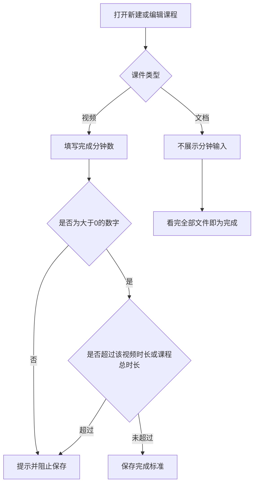
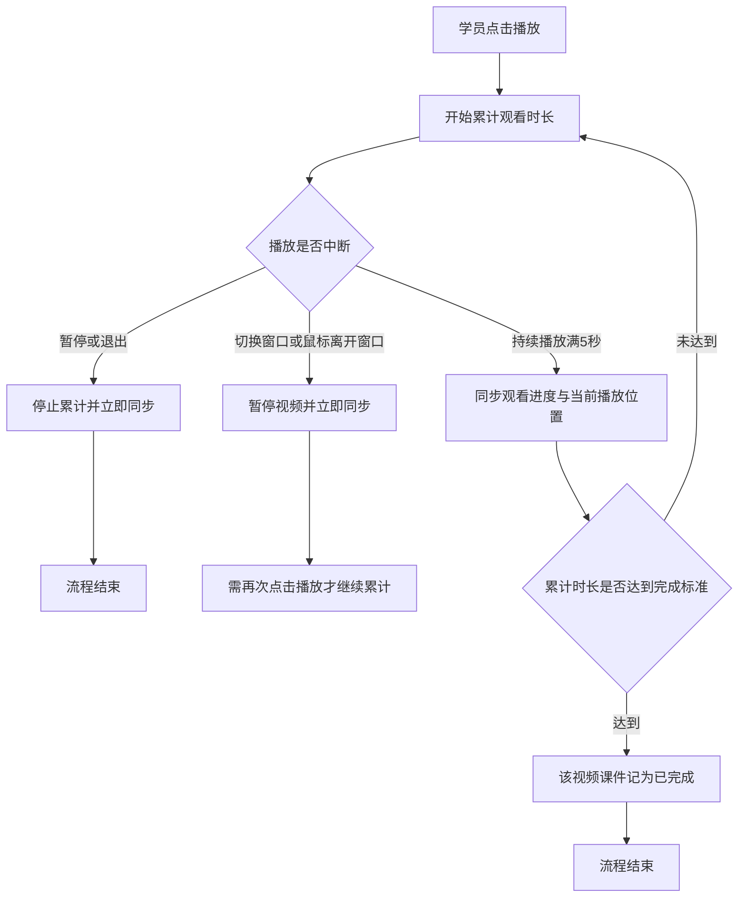
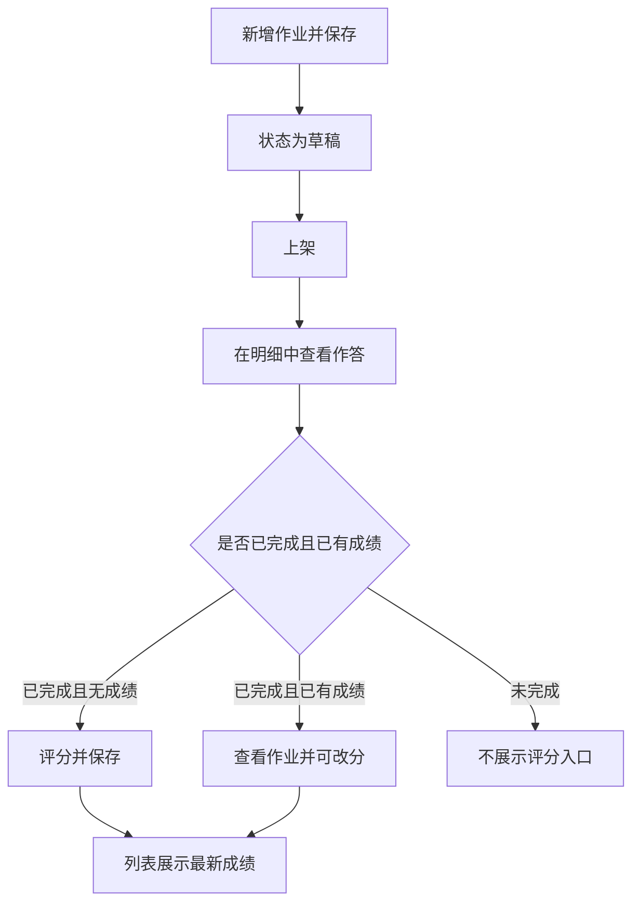
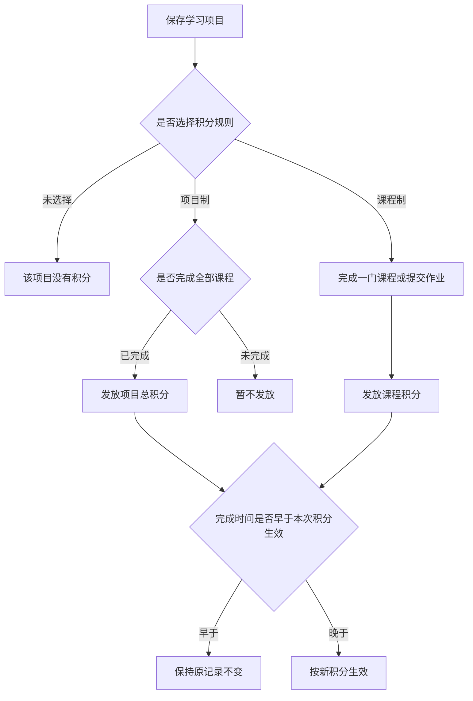
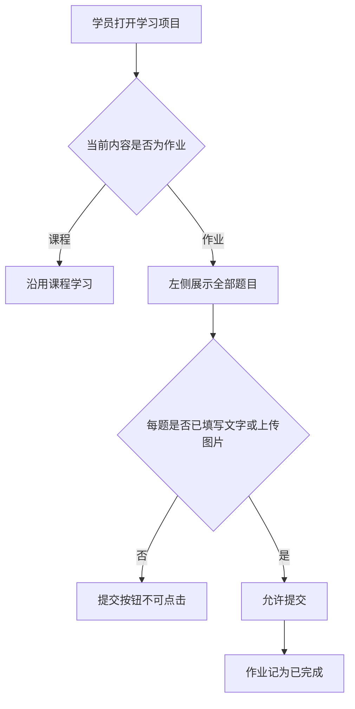
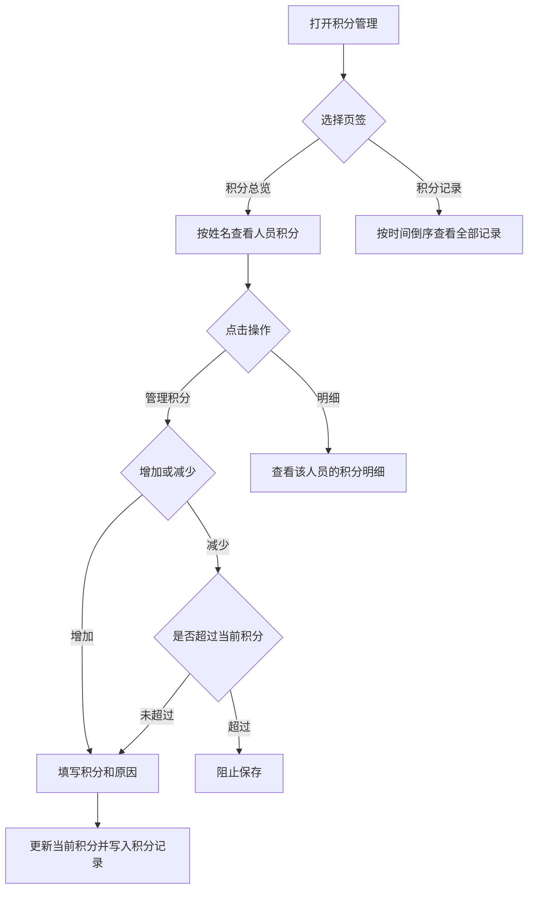

# PRD-AI质培中台课程完成标准与作业管理

## 一、修订记录

| 版本号 | 修改日期 | 修改原因 | 修订人 |
|--------|----------|----------|--------|
| v1.0 | 2026-10-15 | 初稿 | AI PRD Writer |
| v1.1 | 2026-10-15 | 补充学习项目积分与学习顺序、项目作业作答、考试积分 | AI PRD Writer |
| v1.2 | 2026-10-15 | 补充工作台积分管理 | AI PRD Writer |

## 二、需求概述

- **背景/现状**：视频按播完认定完成；项目和考试也不能配置积分、解锁顺序，项目课程里不能布置作业。
- **需求目标**：按实际观看认定视频完成，并支持作业管理、项目积分、学习顺序、考试积分和积分管理。
- **核心逻辑简述**：项目制在全部课程完成后发总积分，课程制每完成一门课程或提交一次作业都发课程积分；事后修改不影响已完成记录。未选积分规则则没有积分。

## 三、术语表

| 术语 | 定义 |
|------|------|
| 完成标准 | 视频课件判定完成所需的观看分钟数；文档课件不使用该分钟数 |
| 观看进度 | 学员处于播放状态的累计时长，从点击播放计到暂停或退出 |
| 当前播放位置 | 视频进度条当前所在的时间点，用于续播，不直接等于观看进度 |
| 课程总时长 | 同一课程下全部视频课件时长之和 |
| 作业成绩 | 管理员对整份作业给出的一档评价，取最近一次保存的结果 |
| 被项目引用 | 作业被学习项目选用；展示方式同课程管理中的被项目引用 |
| 项目制 | 积分规则的一种。完成项目中全部课程后，发放一次项目总积分 |
| 课程制 | 积分规则的一种。每完成一门课程或提交一次作业，发放基础信息中填写的课程积分 |
| 学习顺序 | 项目内课程和作业的解锁方式，分为按课程顺序、自由选择 |
| 当前积分 | 一名学员目前持有的积分合计 |
| 积分记录 | 积分增加或减少的一条明细 |

## 四、调整范围

| 序号 | 模块 | 调整类型 | 说明 |
|------|------|----------|------|
| 1 | 课程管理-新建/编辑 | 修改 | 课件列表新增「完成标准」。视频填写分钟数，文档不填写 |
| 2 | 课程学习-视频播放 | 修改 | 按实际播放时段累计观看时长，每 5 秒同步一次；离开窗口时暂停 |
| 3 | 课程学习-文档课件 | 沿用 | 不新增分钟输入，看完全部文件才算完成 |
| 4 | 在线学习-作业管理 | 新增 | 新增二级菜单，支持作业配置、上下架、引用查看、明细、评分与导出 |
| 5 | 学习项目-新建/编辑 | 修改 | 基础信息增加积分规则、学习顺序；项目课程可从作业库添加已上架作业 |
| 6 | 我的学习-学习项目 | 修改 | 学到作业时，左侧直接展示题目，支持文字和图片作答后提交 |
| 7 | 考试管理-新建/编辑 | 修改 | 增加可选积分，完成考试时按所填积分发放 |
| 8 | 工作台-积分管理 | 新增 | 新增二级菜单。积分总览可管理积分并查看个人明细；积分记录查看全部增减明细 |

页面布局、筛选区、右侧浮出、列表操作和确认提示均沿用 AI 质培中台现有样式。

## 五、业务流程图

**课件完成标准**

**视频观看累计**

**作业配置与评分**

**项目积分发放**

**项目作业作答**

**积分管理**

## 六、可交互原型

在线预览：[点击查看可交互原型](https://pages.yc345.tv/yping-c78bba/ai-training-completion-homework/)

> 原型为可交互页面，覆盖课程完成标准、作业管理、学习项目积分与顺序、项目作业作答、考试积分，以及积分管理。

## 七、功能需求详细描述

### 7.1 【新增】功能

**功能 / 按钮 / 弹窗类**

| 功能名称 | 功能类型 | 是否必填 | 交互说明 | 备注 |
|----------|----------|----------|----------|------|
| 完成标准 | 课件列表字段 | 视频必填，文档不适用 | 仅视频行展示数字输入框，单位分钟；文档行展示「看完全部文件」，无输入框 | 新建、编辑课程的课件列表均展示 |
| 作业管理 | 二级菜单 | 不适用 | 放在在线学习下、课程管理之后 | 列表按更新时间倒序 |
| 新增作业 / 编辑作业 | 右侧浮出 | 作业名称必填 | 点击「新增作业」或草稿、上架状态的「编辑」打开；题目只能是问答题 | 新保存的作业为草稿；编辑不改变当前状态 |
| 新增题目 | 按钮 | 上架前至少 1 题 | 在编辑浮层中追加题目，题目名称不超过 200 字 | 可删除题目 |
| 作业详情 | 右侧浮出 | 不适用 | 点击作业名称打开，只读展示名称、状态、题数和题目 | 不可在此修改 |
| 被项目引用 | 右侧浮出 | 不适用 | 引用数大于 0 时可点击，展示项目名称、项目时间、项目状态；点击「查看」打开只读项目详情 | 展示方式同课程管理；数量为 0 时不可点击 |
| 作业明细 | 详情页 | 不适用 | 点击「明细」进入人员作答列表；页头提供「返回」，回到作业管理 | 草稿、上架、下架均可进入 |
| 评分 | 右侧浮出 | 成绩必选 | 已完成且无成绩时展示；查看每题作答后单选成绩，保存后生效 | 取消不改变列表 |
| 查看作业 | 右侧浮出 | 成绩必选 | 已完成且已有成绩时展示；可改选成绩，保存后覆盖原成绩 | 列表展示最近一次保存结果 |
| 导出 | 按钮 | 不适用 | 按明细页当前筛选结果导出，不二次确认 | 无数据时提示且不导出 |
| 积分规则 | 单选 | 否 | 新建、编辑项目的基础信息中增加。可选项目制、课程制，也可不选 | 不选表示该项目没有积分 |
| 项目总积分 | 文本输入 | 选择项目制时必填 | 仅项目制时展示，只可输入大于 0 的数字 | 完成项目内全部课程后发放一次 |
| 课程积分 | 文本输入 | 选择课程制时必填 | 选择课程制后，在基础信息中展示一个输入框。只可输入大于 0 的数字。课程列表不单独填写 | 每完成一门课程或提交一次作业，都发放该积分 |
| 学习顺序 | 单选 | 是 | 基础信息中增加。按课程顺序，或自由选择 | 新建、编辑均需选择 |
| 从作业库中添加作业 | 按钮 | 否 | 位于项目课程区，与「从课程池添加课程」分开排列。打开后只列出已上架作业，可按作业名称筛选，确认后加入项目课程列表 | 同一作业不可重复添加；提交即算该作业完成 |
| 作业作答 | 学习页左侧内容 | 每题必答 | 学到作业时直接展示题目。每题可填文字，也可上传图片，图片最多 3 张 | 全部题目都作答后才可提交 |
| 考试积分 | 文本输入 | 否 | 新建、编辑考试时增加。只可输入大于 0 的数字 | 填写后，学员完成考试时发放；不填则不发放 |
| 积分管理 | 二级菜单 | 不适用 | 放在工作台下 | 含积分总览、积分记录两个页签 |
| 积分总览 | 列表 | 不适用 | 字段为姓名、部门、当前积分、操作。当前积分为该学员积分合计 | 可按姓名筛选。导出姓名、部门、当前积分；操作列是按钮，不导出 |
| 管理积分 | 右侧浮出 | 操作、积分必填 | 展示姓名、部门、当前积分。单选增加积分或减少积分后，再填写积分和原因 | 原因不超过 200 字。减少时积分不能超过当前积分 |
| 积分明细 | 右侧浮出 | 不适用 | 点击「明细」打开该学员记录。字段为类型、积分、原因、时间、操作人 | 类型为增加或减少。完成学习时原因为完成某课程、某项目或某考试；操作人是学员本人。管理员调整时操作人展示「管理员」 |
| 积分记录 | 列表 | 不适用 | 字段为姓名、部门、类型、积分、原因、时间、操作人。按时间倒序，带分页 | 可按姓名、类型、时间范围筛选。导出字段与列表一致 |

**作业列表字段**

| 字段名称 | 字段说明 | 字段来源 | 备注 |
|----------|----------|----------|------|
| 作业名称 | 创建时填写的名称，可点击查看详情 | 作业编辑内容 | 模糊搜索 |
| 作业题数 | 当前题目数量 | 作业编辑内容 | 随编辑结果变化 |
| 状态 | 草稿、上架、下架 | 上架、下架操作 | 单选筛选 |
| 被项目引用 | 引用该作业的学习项目数量 | 学习项目选用结果 | 大于 0 时可打开引用详情 |
| 更新人 | 最近一次编辑的操作人 | 保存、上架、下架 | 与更新时间成对展示 |
| 更新时间 | 最近一次编辑时间 | 保存、上架、下架 | 列表按该时间倒序 |
| 操作 | 明细，以及按状态出现的编辑、上架、下架、删除 | 当前状态 | 见 7.4 |

**作业编辑字段**

| 字段名称 | 字段说明 | 字段来源 | 备注 |
|----------|----------|----------|------|
| 作业名称 | 作业标题 | 管理员输入 | 必填；未约定字数上限 |
| 题目名称 | 问答题题干 | 管理员输入 | 必填，上限 200 字；不提供其他题型 |

**作业明细字段**

| 字段名称 | 字段说明 | 字段来源 | 备注 |
|----------|----------|----------|------|
| 姓名 | 作答学员姓名 | 学员作答记录 | 模糊搜索 |
| 部门 | 学员所属部门 | 学员资料 | — |
| 完成状态 | 未完成或已完成 | 学员是否提交完成 | 下拉单选 |
| 作业成绩 | 不合格、合格、良好、优秀、卓越 | 最近一次保存的评分 | 未评分时为空 |
| 完成时间 | 学员完成作业的时间 | 作答记录 | 未完成时为空 |
| 关联项目 | 该条记录对应的学习项目 | 项目与作业的关联 | 项目名称模糊搜索 |
| 操作 | 评分或查看作业 | 完成状态与是否已有成绩 | 未完成不展示操作按钮 |

导出列依次为：姓名、部门、完成状态、作业成绩、完成时间、关联项目，以及该作业的题目 1、题目 2、题目 3 等。每个题目列下方为该学员对应题目的回答；没有回答时留空。

### 7.2 【修改】功能

| 功能/字段名称 | 修改项 | 改前 | 改后 | 备注 |
|---------------|--------|------|------|------|
| 视频课件完成判定 | 完成条件 | 播放或拖动到视频结尾即算完成 | 累计观看时长达到该课件填写的分钟数即算完成，不要求播到结尾 | 分钟数在课件列表的完成标准中配置 |
| 视频观看时长 | 累计口径 | 按播放位置计算 | 只累计点击播放到暂停或退出的实际时间；拖动进度条不增加观看时长 | 暂停、退出、切换窗口、鼠标离开窗口时立即再同步一次 |
| 视频进度同步 | 同步频率与内容 | 按播放位置持续上报 | 播放过程中每 5 秒上传一次观看进度和当前播放位置 | 观看进度与当前播放位置分开记录 |
| 视频播放 | 离窗行为 | 切换窗口或鼠标离开窗口后仍可继续播放 | 切换窗口，或鼠标未停留在当前窗口时，立即暂停视频并停止累计 | 暂停后不自动续播，需再次点击播放 |
| 学习项目课程解锁 | 解锁条件 | 项目内课程没有顺序锁定 | 选择按课程顺序后，必须完成列表中的上一项，才可学习下一项；选择自由选择后，课程和作业都可直接学习 | 作业与课程按同一列表顺序排列 |
| 考试完成奖励 | 积分 | 完成考试不发放积分 | 填写考试积分后，完成考试时发放所填积分；不填写则不发放 | 只对填写后新完成的考试生效 |

### 7.4 状态与异常变更

**作业状态与操作**

| 状态 | 明细 | 编辑 | 上架 | 下架 | 删除 |
|------|------|------|------|------|------|
| 草稿 | 展示 | 展示 | 展示 | 不展示 | 展示 |
| 上架 | 展示 | 展示 | 不展示 | 展示 | 不展示 |
| 下架 | 展示 | 不展示 | 展示 | 不展示 | 不展示 |

上架、下架、删除前沿用现有确认提示。被项目引用只影响引用详情展示，不隐藏上架作业的下架按钮。

**按钮与校验**

| 涉及位置 | 变更动作 | 触发条件 | 系统行为 / 文案 |
|----------|----------|----------|------------------|
| 完成标准输入框 | 新增 | 输入非数字 | 不允许输入，只保留数字 |
| 完成标准输入框 | 新增 | 为空、为 0，或换算后超过该视频时长 | 不允许保存，并提示「请填写视频课件的完成标准」或「完成标准不能超过该视频时长」 |
| 完成标准输入框 | 新增 | 换算后超过课程总时长 | 不允许保存，并提示「完成标准不能超过课程总时长」 |
| 文档课件行 | 新增 | 课件类型为文档 | 不展示输入框，固定说明「看完全部文件」 |
| 视频播放 | 修改 | 累计观看时长达到完成标准 | 该课件记为已完成，并停止继续累计 |
| 视频播放 | 修改 | 该课件在新规则前已经完成 | 保持已完成，不重新计算 |
| 视频播放 | 修改 | 该课件尚未完成 | 按新的累计时长判断；不把此前的播放位置折算成观看时长 |
| 新增题目 | 新增 | 题目名称超过 200 字 | 不能继续输入 |
| 保存作业 | 新增 | 作业名称为空，或已添加的题目名称为空 | 不允许保存，并提示补全 |
| 上架 | 新增 | 题目数量为 0 | 不允许上架，并提示「请至少添加一道题目后再上架」 |
| 评分 / 查看作业 | 新增 | 未选择成绩 | 「保存」不可点击 |
| 评分 / 查看作业 | 新增 | 已选择成绩并点击保存 | 关闭浮层，明细列表立即展示该成绩 |
| 评分 / 查看作业 | 新增 | 点击取消或关闭 | 不改变已展示的成绩 |
| 明细操作列 | 新增 | 完成状态为未完成 | 不展示「评分」和「查看作业」 |
| 明细操作列 | 新增 | 已完成且成绩为空 | 展示「评分」 |
| 明细操作列 | 新增 | 已完成且已有成绩 | 展示「查看作业」；改分保存后按钮仍为「查看作业」 |
| 导出 | 新增 | 当前筛选结果为空 | 提示「当前没有可导出的数据」，不下载文件 |
| 作业明细为空 | 新增 | 该作业尚无作答 | 列表展示空状态「暂无作答记录」 |
| 积分规则 | 新增 | 不选择 | 不展示项目总积分和课程积分，项目不产生积分 |
| 项目总积分 / 课程积分 / 考试积分 | 新增 | 输入 0、负数或非数字 | 不允许输入非法字符；保存时若不是大于 0 的数字，提示「请输入大于 0 的数字」 |
| 学习顺序 | 新增 | 未选择就保存 | 不允许保存，提示「请选择学习顺序」 |
| 项目制 | 新增 | 学员完成项目内全部课程，且完成发生在积分规则保存之后 | 发放当前项目总积分 |
| 课程制 | 新增 | 学员完成某一门课程或提交一次作业，且完成发生在课程积分保存之后 | 发放基础信息中填写的课程积分 |
| 积分规则或积分数值 | 新增 | 学员在本次修改前已经完成项目或对应课程 | 不补发、不改写已获得的积分；没有获得过的也不补发 |
| 积分规则或积分数值 | 新增 | 学员尚未完成 | 按保存后的规则，在其之后完成时发放 |
| 从作业库中添加作业 | 新增 | 作业不是上架状态 | 选择列表中不出现 |
| 从作业库中添加作业 | 新增 | 该作业已在当前项目中 | 不可再次添加，并提示「该作业已添加」 |
| 学习项目播放列表 | 新增 | 学习顺序为按课程顺序，且上一项未完成 | 下一项不可进入，提示「请先完成前面的内容」 |
| 作业提交 | 新增 | 仍有题目未填写文字且未上传图片 | 「提交」不可点击 |
| 作业上传图片 | 新增 | 同一题已有 3 张图片再上传 | 不允许继续添加，提示「最多上传 3 张图片」 |
| 作业提交 | 新增 | 每题都已填写文字或已上传图片，并点击提交 | 该作业记为已完成。课程制下同时发放课程积分 |
| 考试积分 | 新增 | 未填写 | 完成考试不发放积分 |
| 考试积分 | 新增 | 已填写，且学员在保存后完成考试 | 发放所填积分 |
| 考试积分 | 新增 | 学员在修改前已完成考试 | 不补发，也不改写已经发放的积分 |
| 管理积分 | 新增 | 未选择增加或减少 | 不展示积分和原因，「保存」不可点击 |
| 管理积分 | 新增 | 积分不是大于 0 的数字 | 不允许保存，提示「请输入大于 0 的数字」 |
| 管理积分 | 新增 | 减少积分大于当前积分 | 输入时不能超过当前积分；保存时提示「减少积分不能超过当前积分」 |
| 管理积分 | 新增 | 原因超过 200 字 | 不能继续输入 |
| 积分导出 | 新增 | 当前筛选结果为空 | 提示「当前没有可导出的数据」，不下载文件 |
| 积分总览为空 | 新增 | 没有符合姓名的学员 | 列表展示空状态「暂无数据」 |
| 积分记录为空 | 新增 | 没有符合筛选的记录 | 列表展示空状态「暂无数据」 |

## 八、埋点与数据需求

## 九、权限说明

作业管理、学习项目、考试管理和积分管理沿用各自现有的管理端权限。学员在我的学习中作答项目作业；评分、上下架、积分配置、积分调整和导出仅管理员可操作。
