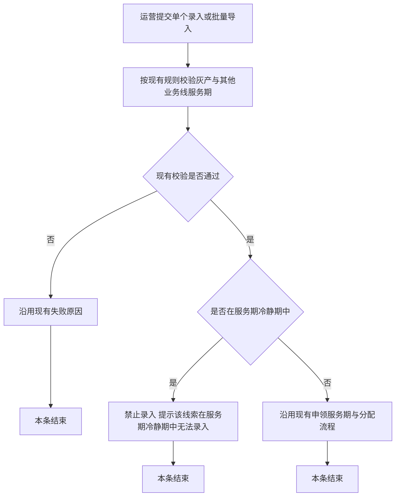
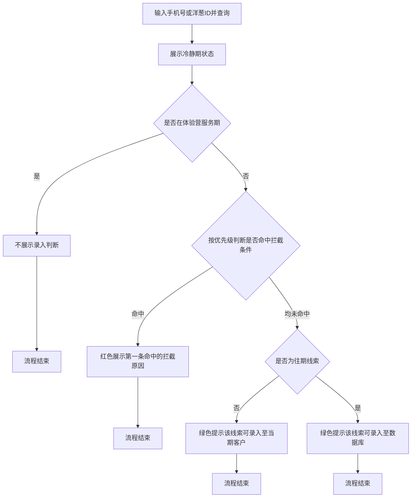

# PRD-体验营服务期冷静期录入拦截

## 一、修订记录

| 版本号 | 修改日期 | 修改原因 | 修订人 |
|--------|----------|----------|--------|
| v1.0 | 2026-11-26 | 初稿 | AI PRD Writer |

## 二、需求概述

- **背景/现状**：当线索处于服务期冷静期时，客户管理的单个录入和批量导入不拦截，录入后申领不到体验营服务期；线索查询也看不到冷静期和能否录入。
- **需求目标**：当线索处于服务期冷静期时，系统应禁止录入并提示原因；线索查询应展示冷静期状态和录入判断。
- **核心逻辑简述**：录入前校验服务期冷静期，命中即拦截；线索不在体验营服务期时，线索查询按优先级展示拦截原因或可录入去向。

## 三、术语表

| 术语 | 定义 |
|------|------|
| 服务期冷静期 | 体验营服务期结束后，禁止再次申领体验营服务期的时段，时长沿用现有家庭服务期规则（现为 90 天） |
| 跟进冷静期 | 通过数据库「添加冷静期客户」为线索设置的冷静期，期内不可录入 |
| 往期线索 | 曾进入过体验营客户管理、当前不在体验营服务期的线索 |
| 当期客户 / 数据库 | 体验营-客户管理下的两个客户列表，各自都有「单个录入客户」和「批量导入」入口 |

## 四、调整范围

1. 体验营-线索查询-撞单查询：新增「冷静期状态」「录入判断」两个字段。
2. 体验营-客户管理-当期客户、数据库：单个录入客户新增服务期冷静期拦截。
3. 体验营-客户管理-当期客户：批量导入新增服务期冷静期拦截，导入说明同步补充。
4. 体验营-客户管理-数据库：批量导入中服务期冷静期的失败原因改为统一文案。

不调整：服务期冷静期时长、跟进冷静期的设置方式和现有拦截文案、其余录入校验规则。

## 五、业务流程图

**流程一：录入时服务期冷静期拦截**

**流程二：线索查询录入判断**

## 六、可交互原型

在线预览：[点击查看可交互原型](https://pages.yc345.tv/yping-c78bba/camp-calm-period-entry-check/)

> 原型为带变更批注的可交互 HTML 页面。打开即可看到本次变更编号；收起右侧批注栏后连线隐藏，点击编号会重新打开批注。

## 七、功能需求详细描述

### 7.1 冷静期状态

【新增】撞单查询新增「冷静期状态」字段，位于「当前服务期」下方。线索在不在体验营服务期都展示。

| 字段名称 | 字段说明 | 字段来源 | 备注 |
|----------|----------|----------|------|
| 冷静期状态 | 展示该线索当前所处的服务期冷静期、跟进冷静期及截止时间 | 服务期冷静期取家庭服务期冷静期判定；跟进冷静期取线索的冷静期时间 | 截止时间格式：年-月-日 时:分:秒 |

| 情况 | 展示内容 |
|------|----------|
| 仅在服务期冷静期 | 服务期冷静期 至 截止时间（红色） |
| 仅在跟进冷静期 | 跟进冷静期 至 截止时间（红色） |
| 两种都在 | 分两行展示，服务期冷静期在上 |
| 都不在，或截止时间已过 | 无冷静期 |

### 7.2 录入判断

【新增】撞单查询新增「录入判断」字段，位于「冷静期状态」下方。仅当线索不在体验营服务期（无服务期，或在其他业务线服务期）时展示；在体验营服务期时不展示。

按以下优先级判断，只展示第一条命中的结果：

| 优先级 | 判断条件 | 展示文案 | 颜色 |
|--------|----------|----------|------|
| 1 | 灰产账号 | 该手机号是灰产账号，无法录入 | 红色 |
| 2 | 在其他业务线服务期 | 该客户在其他业务线服务期，无法录入 | 红色 |
| 3 | 在服务期冷静期中 | 该线索在服务期冷静期中，无法录入。 | 红色 |
| 4 | 在跟进冷静期中 | 该线索在跟进冷静期中，无法录入 | 红色 |
| 5 | 未进入过体验营客户管理 | 该线索可录入至当期客户 | 绿色 |
| 6 | 往期线索，不满足数据库录入条件（有销售跟进、锁定中、已转化等） | 沿用数据库录入的现有失败原因，如「该线索锁定时间未过期」 | 红色 |
| 7 | 往期线索，满足数据库录入条件 | 该线索可录入至数据库 | 绿色 |

录入判断只做提示，不改变录入结果；实际能否录入以提交时的校验为准。

### 7.3 单个录入客户

| 功能/字段名称 | 修改项 | 改前 | 改后 | 备注 |
|---------------|--------|------|------|------|
| 单个录入客户（当期客户、数据库） | 服务期冷静期校验 | 不校验服务期冷静期，录入后申领不到体验营服务期，或提示的原因不明确 | 线索在服务期冷静期中时禁止录入，提示「该线索在服务期冷静期中，无法录入。」 | 弹窗不关闭，可修改后重新提交 |

- 校验时机：在现有灰产、其他业务线服务期校验之后，申领体验营服务期之前。
- 同时命中服务期冷静期和跟进冷静期时，优先提示服务期冷静期。
- 只命中跟进冷静期时，沿用现有拦截和文案。

### 7.4 批量导入

| 功能/字段名称 | 修改项 | 改前 | 改后 | 备注 |
|---------------|--------|------|------|------|
| 当期客户-批量导入 | 服务期冷静期手机号的处理 | 导入成功，但没有体验营服务期 | 该行导入失败，不入库、不分配销售、不申请手机号，失败原因「该线索在服务期冷静期中，无法录入。」 | 其余行继续导入，计入失败条数 |
| 当期客户-批量导入 | 导入说明 | 未提及服务期冷静期 | 无法导入的情况中补充「该线索在服务期冷静期中」 | 位置不变 |
| 数据库-批量导入 | 结果明细的导入结果文案 | 无服务期，申领体验营服务期失败 | 该线索在服务期冷静期中，无法录入。 | 仍计入失败 |

未注册手机号在当期客户批量导入中注册成功后，没有历史服务期，不会命中服务期冷静期。

### 7.5 状态与异常变更

| 涉及位置 | 变更动作 | 触发条件 | 系统行为 / 文案 |
|----------|----------|----------|------------------|
| 线索查询-冷静期状态 | 新增 | 冷静期信息查询失败 | 红色展示「冷静期查询失败，请稍后重试」 |
| 线索查询-录入判断 | 新增 | 判断所需信息查询失败 | 红色展示「暂无法判断是否可录入，请稍后重试」 |
| 单个录入、批量导入 | 新增 | 服务期冷静期查询失败 | 不放行；单个录入提示「查询用户服务期失败，请稍后重试」，批量导入该行失败，原因相同 |
| 录入、导入与线索查询 | 沿用 | 系统临时取消服务期冷静期校验期间（如大促窗口） | 不拦截服务期冷静期，冷静期状态和录入判断均不计入服务期冷静期 |

## 八、埋点与数据需求

本次无。

## 九、权限说明

本次无。「线索查询」「单个录入客户」「批量导入」沿用现有权限。
