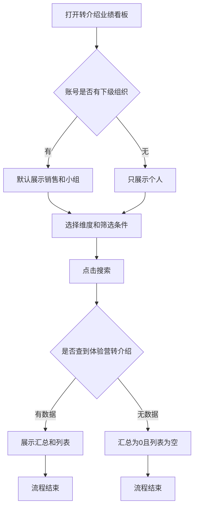
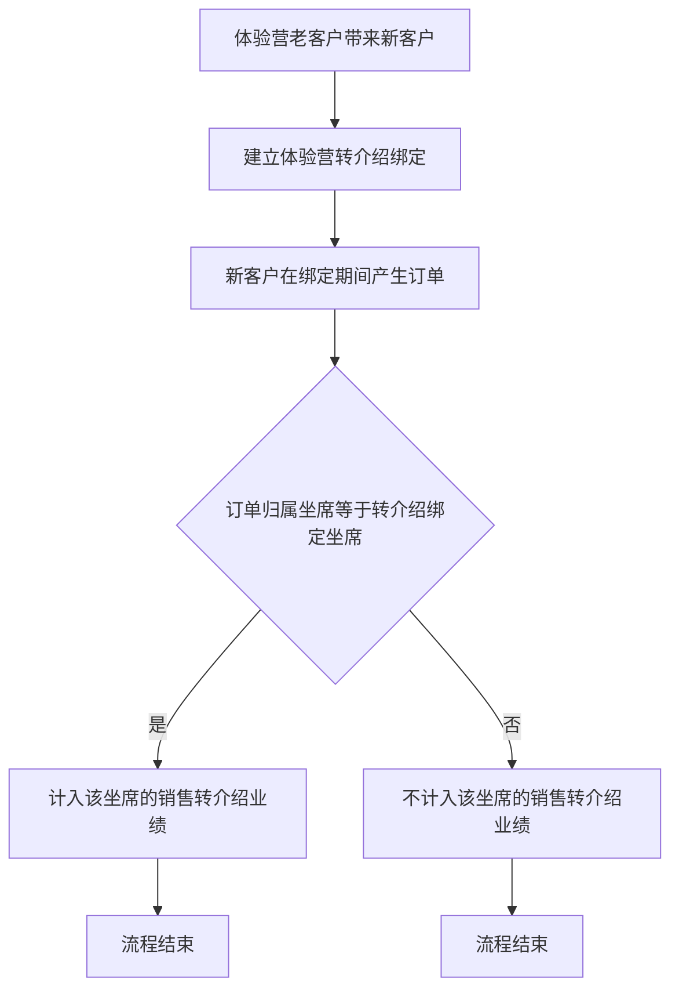
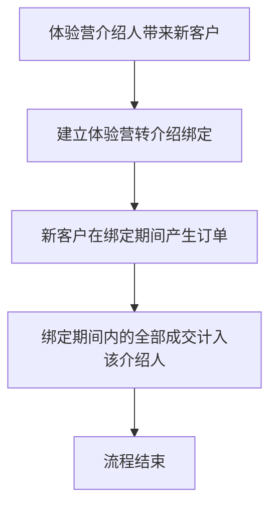

# PRD - 体验营转介绍业绩看板

## 一、修订记录

| 版本号 | 修改日期 | 修改原因 | 修订人 |
|--------|----------|----------|--------|
| v1.0 | 2026-10-30 | 初稿 | AI PRD Writer |

## 二、需求概述

- **背景/现状**：体验营能查看转介绍线索转化，但没有与电销转介绍业绩统计相同的坐席业绩看板。
- **需求目标**：当用户进入体验营数据统计时，系统应提供字段一致的转介绍业绩看板，且只统计体验营转介绍。
- **核心逻辑简述**：用户按销售或伴学、小组或个人查看海报、裂变和成交。计入规则与电销页相同，数据只取体验营转介绍。

## 三、术语表

| 术语 | 定义 |
|------|------|
| 体验营转介绍 | 老客户通过体验营坐席分享的海报或链接带来新客户，并在体验营侧留下的绑定关系 |
| 转介绍绑定期间 | 体验营转介绍关系生效的期间 |
| 下载海报客户量 | 所选时间内，已下载体验营转介绍海报的老客户数 |
| 裂变老客户 | 所选时间内，成功带来新客户的老客户数 |
| 裂变新客户 | 所选时间内，由老客户带来的新客户数 |
| 转化新客户 | 所选时间内，完成购课且符合当前维度计入规则的裂变新客户数 |
| 订单归属坐席 | 订单最终归属的体验营坐席 |
| 转介绍绑定坐席 | 转介绍关系里，老客户所绑定的体验营坐席 |
| 客单价 | 订单金额除以转化新客户数 |
| 转化率 | 转化新客户数除以裂变新客户数 |

## 四、调整范围

| 序号 | 模块 | 页面 | 调整内容 |
|------|------|------|----------|
| 1 | 体验营后台 - 数据统计 | 转介绍业绩看板 | 新增看板。筛选、汇总、列表、详情与电销「转介绍业绩统计」一致，统计范围改为体验营转介绍 |

电销「转介绍业绩统计」和体验营已有「转介绍线索转化」本次不改。

## 五、业务流程图

**打开看板并查询**

**销售维度如何计入**

**伴学维度如何计入**

## 六、可交互原型

在线预览：[点击查看可交互原型](https://pages.yc345.tv/yping-c78bba/camp-referral-performance/)

> 原型为带变更批注的可交互 HTML 页面。打开即可看到本次变更编号；收起右侧批注栏后连线隐藏，点击编号会重新打开批注。

## 七、功能需求详细描述

### 7.1 【新增】看板入口

体验营「数据统计」新增「转介绍业绩看板」，打开后默认销售、小组。

| 功能名称 | 功能类型 | 是否必填 | 交互说明 | 备注 |
|----------|----------|----------|----------|------|
| 转介绍业绩看板 | 菜单 | 不适用 | 放在「转介绍线索转化」下方。有下级时默认销售和小组；无下级只看个人 | 改前：无此功能。改后：数据统计下可进入该看板 |

### 7.2 【新增】维度与视图

增加销售、伴学两个维度，其下再切换小组和个人，字段与电销转介绍业绩统计一致。

| 功能名称 | 功能类型 | 是否必填 | 交互说明 | 备注 |
|----------|----------|----------|----------|------|
| 销售 | 维度切换 | 不适用 | 默认选中。展示销售口径的字段和计入规则 | 改前：无此功能 |
| 伴学 | 维度切换 | 不适用 | 展示伴学口径的字段和计入规则 | 销售、伴学均可切换小组和个人 |
| 小组 | 视图切换 | 不适用 | 有下级组织时出现，默认选中 | 无下级组织时不出现小组 |
| 个人 | 视图切换 | 不适用 | 展示老客户明细 | 无下级时只保留个人 |

切换维度或视图后，按当前筛选条件重新查询。

### 7.3 【新增】筛选与汇总

按小组、坐席和日期筛选，个人还可按手机号、洋葱ID筛选；搜索后刷新汇总和列表。

| 功能名称 | 功能类型 | 是否必填 | 交互说明 | 备注 |
|----------|----------|----------|----------|------|
| 小组 | 下拉多选 | 否 | 小组视图提示「请选择归属坐席小组」，个人视图提示「请选择小组」 | 默认不限 |
| 坐席 | 下拉多选 | 否 | 小组视图提示「请选择归属坐席」，个人视图提示「请选择坐席」。选项随所选小组变化 | 默认不限 |
| 客户手机号 | 输入框 | 否 | 仅个人视图。支持回车搜索 | 匹配老客户手机号 |
| 客户洋葱ID | 输入框 | 否 | 仅个人视图。支持回车搜索 | 匹配老客户洋葱ID |
| 日期 | 日期范围 | 否 | 默认本月1日 0点至今天当前时间，页面展示到日 | 可改范围后再搜索 |
| 搜索 | 按钮 | 不适用 | 始终可点。按当前条件刷新汇总和列表，回到第1页 | 改前：无此功能。改后：搜索刷新汇总和列表 |
| 重置 | 按钮 | 不适用 | 清空小组、坐席、手机号、洋葱ID，日期恢复默认，回到第1页并刷新 | 重置恢复默认条件 |

汇总条两个维度都展示，口径为当前筛选结果合计：

| 字段名称 | 字段说明 | 字段来源 | 备注 |
|----------|----------|----------|------|
| 下载海报客户量 | 已下载体验营转介绍海报的老客户数 | 体验营海报下载记录 | 伴学列表不展示该列，汇总仍展示 |
| 裂变老客户 | 成功带来新客户的老客户数 | 体验营转介绍绑定 | 所选时间范围内 |
| 裂变新客户 | 带来的新客户数 | 体验营转介绍绑定 | 所选时间范围内 |
| 转化新客户 | 完成购课且符合当前维度计入规则的新客户数 | 体验营订单和转介绍绑定 | 销售、伴学计入规则见 7.6 |
| 订单金额/元 | 计入业绩的订单金额合计 | 体验营订单 | 不含未计入的订单 |
| 客单价/元 | 订单金额除以转化新客户数 | 计算 | 转化新客户为 0 时显示 0 |
| 转化率 | 转化新客户数除以裂变新客户数 | 计算 | 裂变新客户为 0 时显示 0%，否则保留两位小数 |

无符合条件的数据时，汇总各项为 0，转化率为 0%，列表为空，分页共 0 条。查询失败时同样把汇总置为 0、列表清空。

### 7.4 【新增】小组列表

小组视图按坐席汇总，销售含下载海报客户量，伴学以介绍人起列且不含该列。列与电销对应维度一致，支持排序和分页。

**销售**

| 字段名称 | 字段说明 | 字段来源 | 备注 |
|----------|----------|----------|------|
| 线索归属坐席 | 体验营坐席姓名 | 体验营组织 | 固定在左侧 |
| 所属小组 | 坐席所在小组 | 体验营组织 | 固定在左侧 |
| 下载海报客户量 | 该坐席名下已下载海报的老客户数 | 体验营海报下载记录 | 可排序 |
| 裂变老客户 | 该坐席名下带来新客户的老客户数 | 体验营转介绍绑定 | 可排序 |
| 裂变新客户 | 带来的新客户数 | 体验营转介绍绑定 | 可排序 |
| 转化新客户 | 符合销售计入规则的购课新客户数 | 体验营订单和转介绍绑定 | 可排序 |
| 订单量 | 计入业绩的订单数 | 体验营订单 | 可排序 |
| 订单金额/元 | 计入业绩的订单金额 | 体验营订单 | 可排序 |
| 客单价/元 | 订单金额除以转化新客户数 | 计算 | 可排序。转化新客户为 0 时显示 0 |
| 转化率 | 转化新客户数除以裂变新客户数 | 计算 | 可排序。分母为 0 时显示 0% |

**伴学**

| 字段名称 | 字段说明 | 字段来源 | 备注 |
|----------|----------|----------|------|
| 介绍人 | 体验营内发起转介绍的人员 | 体验营转介绍绑定 | 固定在左侧 |
| 所属小组 | 介绍人所在小组 | 体验营组织 | 固定在左侧 |
| 裂变老客户 | 该介绍人名下带来新客户的老客户数 | 体验营转介绍绑定 | 可排序 |
| 裂变新客户 | 带来的新客户数 | 体验营转介绍绑定 | 可排序 |
| 转化新客户 | 绑定期间内完成购课的新客户数 | 体验营订单和转介绍绑定 | 可排序 |
| 订单量 | 计入业绩的订单数 | 体验营订单 | 可排序 |
| 订单金额/元 | 计入业绩的订单金额 | 体验营订单 | 可排序 |
| 客单价/元 | 订单金额除以转化新客户数 | 计算 | 可排序。转化新客户为 0 时显示 0 |
| 转化率 | 转化新客户数除以裂变新客户数 | 计算 | 可排序。分母为 0 时显示 0% |

点击可排序列的表头，按升序、降序、取消排序切换，并刷新当前页。默认每页 20 条。

### 7.5 【新增】个人明细

个人视图展示老客户手机号和洋葱ID，可查看裂变明细，订单量可打开成交明细。手机号明文。

| 字段名称 | 字段说明 | 字段来源 | 备注 |
|----------|----------|----------|------|
| 线索归属坐席或介绍人 | 销售显示线索归属坐席，伴学显示介绍人 | 体验营组织 | 与电销对应维度一致 |
| 所属小组 | 人员所在小组 | 体验营组织 | — |
| 老客户手机号 | 发起转介绍的老客户手机号 | 客户信息 | 明文，不打码 |
| 老客户洋葱ID | 老客户的洋葱ID | 客户信息 | — |
| 裂变新客户 | 该老客户带来的新客户数 | 体验营转介绍绑定 | 可排序 |
| 转化新客户 | 符合当前维度计入规则的购课新客户数 | 体验营订单和转介绍绑定 | 可排序 |
| 订单量 | 计入业绩的订单数 | 体验营订单 | 可点击，打开订单明细 |
| 订单金额/元 | 计入业绩的订单金额 | 体验营订单 | 可排序 |
| 客单价/元 | 订单金额除以转化新客户数 | 计算 | 转化新客户为 0 时显示 0 |
| 转化率 | 转化新客户数除以裂变新客户数 | 计算 | 可排序。分母为 0 时显示 0% |
| 查看详情 | 打开该老客户的裂变新客户明细 | — | 每行都有 |

**查看详情**

| 字段名称 | 字段说明 | 字段来源 | 备注 |
|----------|----------|----------|------|
| 新客户手机号 | 裂变新客户手机号 | 客户信息 | 明文 |
| 裂变时间 | 新客户通过转介绍完成注册的时间 | 体验营转介绍绑定 | 精确到秒 |
| 成交时间 | 完成购课的时间 | 体验营订单 | 未成交为空。精确到秒 |
| 订单金额/元 | 计入业绩的订单金额 | 体验营订单 | 未成交为空 |

标题为「查看详情 - 老客户手机号」。无明细时列表为空，分页共 0 条。支持分页，默认每页 20 条。

销售维度下，订单归属坐席不等于转介绍绑定坐席的成交，不出现在详情里。伴学维度下，绑定期间内的成交都出现。

**订单明细**

点击订单量打开，标题为「订单详情 - 老客户手机号」。

| 字段名称 | 字段说明 | 字段来源 | 备注 |
|----------|----------|----------|------|
| 购课用户手机号 | 购课用户手机号 | 客户信息 | 明文 |
| 购课用户洋葱ID | 购课用户洋葱ID | 客户信息 | — |
| 订单金额 | 该笔计入业绩的订单金额 | 体验营订单 | — |
| 订单成交时间 | 成交时间 | 体验营订单 | 精确到秒 |

订单量为 0 时仍可打开，列表为空。关闭弹窗后回到当前列表，筛选条件不变。

### 7.6 【新增】取值范围

汇总和列表只取体验营转介绍的海报、裂变和订单，不取电销转介绍。

| 功能/字段名称 | 修改项 | 改前 | 改后 | 备注 |
|---------------|--------|------|------|------|
| 统计人群 | 取值范围 | 无此功能 | 只统计体验营组织内的坐席、介绍人，以及他们名下的体验营转介绍 | 电销组织、伴学项目组的转介绍不进入本看板 |
| 海报、裂变、订单 | 取值范围 | 无此功能 | 海报下载、裂变绑定、转化订单都取体验营侧记录 | 不把电销转介绍业绩统计的结果直接搬过来 |
| 销售计入 | 计入规则 | 无此功能 | 绑定期间内，仅订单归属坐席等于转介绍绑定坐席时，计入该坐席 | 规则与电销销售维度相同，对象换成体验营 |
| 伴学计入 | 计入规则 | 无此功能 | 绑定期间内的全部成交计入该介绍人 | 规则与电销伴学维度相同，对象换成体验营 |
| 客单价 | 零值 | 无此功能 | 转化新客户为 0 时显示 0 | 汇总和列表相同 |
| 转化率 | 零值 | 无此功能 | 裂变新客户为 0 时显示 0%，否则保留两位小数 | 汇总和列表相同 |

人员可见范围跟随体验营组织权限：只能看到自己有权查看的小组和坐席。

## 八、埋点与数据需求

无。

## 九、权限说明

| 权限 | 说明 |
|------|------|
| 看板查看 | 需单独授权。未授权时，「数据统计」不显示「转介绍业绩看板」 |
| 数据范围 | 沿用体验营组织权限，只能查看权限范围内的小组和坐席 |
| 小组视图 | 没有下级组织的账号不显示小组，只显示个人 |
