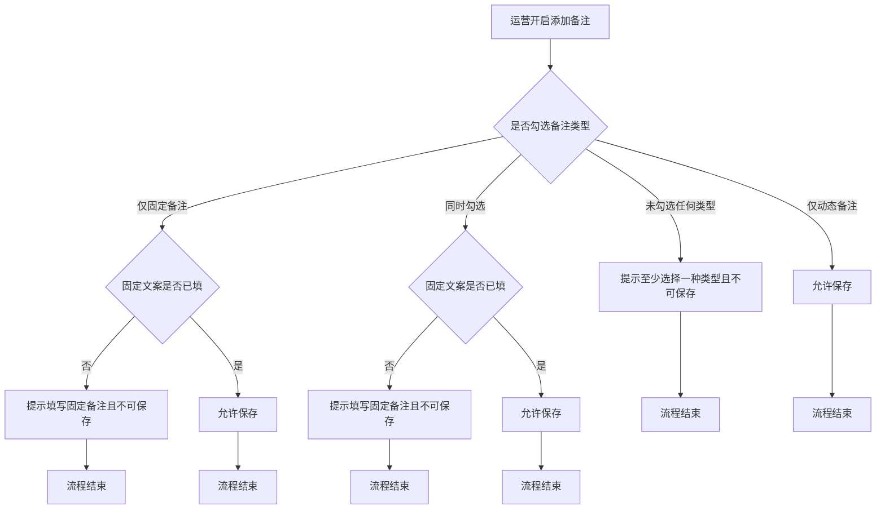
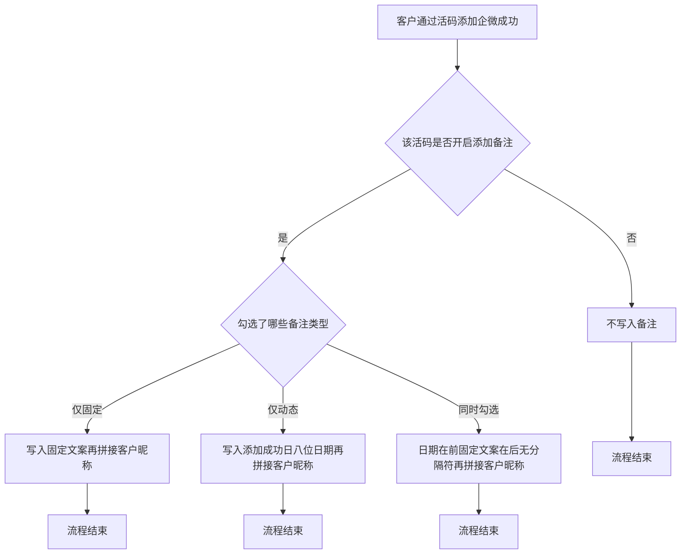

# PRD-渠道活码备注固定与动态

## 一、修订记录

| 版本号 | 修改日期 | 修改原因 | 修订人 |
|--------|----------|----------|--------|
| v1.0   | 2026-11-26 | 初稿 | AI PRD Writer |

## 二、需求概述

- **背景/现状**：WHEN 运营在渠道活码配置「添加备注」，THEN 仅支持填写一段固定文案，无法按添加成功日区分批次。
- **需求目标**：WHEN 配置添加备注，THEN 可自主选择固定备注、动态备注或同时使用。
- **核心逻辑简述**：动态备注取客户添加成功当天，按年月日八位数字写入；同时使用时日期在前、固定文案在后且无分隔符；末尾仍拼接客户昵称。

## 三、术语表

| 术语 | 定义 |
|------|------|
| 渠道活码 | 电销 CRM 中用于承接不同渠道客户添加企微的活码场景 |
| 固定备注 | 运营预先填写的不变文案，客户添加成功时原样写入备注 |
| 动态备注 | 按客户通过该活码添加企微成功当天自动生成的日期备注，格式为年月日八位数字，例如 20260606 |
| 客户昵称后缀 | 现网写入备注时自动拼接在末尾的客户昵称，形如「-客户昵称」 |

## 四、调整范围

1. 电销 CRM 后台 → 活动管理 → 渠道活码 → 新增/编辑活码场景：改造「添加备注」配置区。
2. 客户通过活码添加企微成功时的备注写入规则：支持固定、动态及组合拼接。
3. 已有活码历史配置兼容：原有备注文案迁移为固定备注；未填写备注的保持关闭。
4. 添加标签、欢迎语、使用成员等其他配置：不在本次范围。

## 五、业务流程图

**备注配置与保存校验**

**添加成功时备注写入**

## 六、可交互原型

在线预览：部署完成后回填

> 原型为带变更批注的可交互 HTML 页面。打开即可看到本次变更编号；收起右侧批注栏后连线隐藏，点击编号会重新打开批注。

## 七、功能需求详细描述

#### 7.1 【新增】功能

**7.1 【新增】备注类型选择**

| 功能名称 | 功能类型 | 是否必填 | 交互说明 | 备注 |
|----------|----------|----------|----------|------|
| 备注类型勾选 | 多选勾选 | 开启添加备注后必选至少一类 | 提供「固定备注」「动态备注」，可单选或同时勾选 | 未勾选任一类时不可保存 |

**7.1 【新增】动态备注**

| 功能名称 | 功能类型 | 是否必填 | 交互说明 | 备注 |
|----------|----------|----------|----------|------|
| 动态备注 | 勾选项 + 规则说明 | 否 | 勾选后展示规则说明，无需手工填日期 | 日期取添加成功当天，格式如 20260606 |

**7.1 【新增】备注拼接预览**

| 功能名称 | 功能类型 | 是否必填 | 交互说明 | 备注 |
|----------|----------|----------|----------|------|
| 备注拼接预览 | 预览区 | 否 | 按当前勾选与固定文案实时展示最终备注形态 | 示例日期与示例昵称仅用于预览 |

#### 7.2 【修改】功能

**7.2 【修改】固定备注填写时机**

| 功能/字段名称 | 修改项 | 改前 | 改后 | 备注 |
|---------------|--------|------|------|------|
| 固定备注输入框 | 展示与必填条件 | 开启添加备注后始终展示并可填写 | 仅勾选固定备注时展示；勾选后文案必填 | 未勾选固定备注时不写入固定文案 |
| 添加备注写入内容 | 拼接规则 | 仅固定文案 + 客户昵称后缀 | 按勾选组合写入：仅固定 / 仅动态 / 动态在前固定在后且无分隔符，再拼客户昵称 | 客户昵称后缀沿用现网规则 |

**组合结果示例（客户昵称=张三，添加成功日=2026-06-06）：**

| 勾选情况 | 固定文案 | 最终备注 |
|----------|----------|----------|
| 仅固定 | 春季投放 | 春季投放-张三 |
| 仅动态 | （无） | 20260606-张三 |
| 同时使用 | 春季投放 | 20260606春季投放-张三 |
| 关闭添加备注 | — | 不写入备注 |

#### 7.3 状态与异常变更

| 涉及位置 | 变更动作 | 触发条件 | 系统行为 / 文案 |
|----------|----------|----------|------------------|
| 保存 | 新增 | 开启添加备注但未勾选任何类型 | 提示「请至少选择一种备注类型」，不可保存 |
| 保存 | 新增 | 勾选固定备注但固定文案为空 | 提示「请填写固定备注」，不可保存 |
| 动态备注写入 | 新增 | 勾选动态备注且客户添加成功 | 按添加成功当天写入年月日八位数字 |
| 历史配置兼容 | 新增 | 已有活码存在原备注文案 | 迁移为：开启添加备注 + 勾选固定备注 + 回填原文案；动态备注默认不勾选 |
| 历史配置兼容 | 新增 | 已有活码原备注为空 | 保持添加备注关闭 |

## 八、埋点与数据需求

无。

## 九、权限说明

无新增权限点；沿用渠道活码新增/编辑现有权限。
