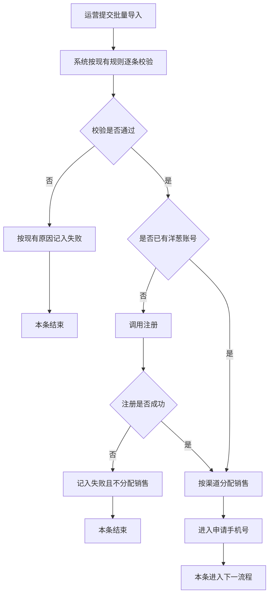
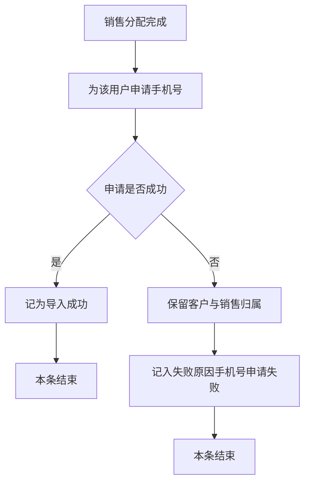

# PRD-当期客户批量导入

## 一、修订记录

| 版本号 | 修改日期 | 修改原因 | 修订人 |
|--------|----------|----------|--------|
| v1.0 | 2026-10-16 | 初稿 | AI PRD Writer |

## 二、需求概述

- **背景/现状**：当期客户导入后会按渠道分配销售，但未注册手机号不会补注册洋葱账号，分配后也不会为该用户申请手机号。
- **需求目标**：当运营批量导入当期客户时，系统应补齐洋葱账号、按渠道分配销售，并为该用户申请手机号。
- **核心逻辑简述**：未注册先注册，失败则不入库；成功后按渠道分配销售并申请手机号，申请失败保留归属并记入失败。

## 三、术语表

| 术语 | 定义 |
|------|------|
| 当期客户 | 体验营当前投放期次中、已归属销售跟进的客户 |
| 洋葱账号 | 用户在洋葱完成注册后获得的账号，列表中以洋葱ID展示 |
| 申请手机号 | 销售分配完成后，系统为该客户申请其导入手机号，供归属销售联系 |

## 四、调整范围

1. 体验营-客户管理-当期客户-批量导入：手机号没有洋葱账号时，先完成注册再继续后续处理。
2. 体验营-客户管理-当期客户-批量导入：按渠道完成销售分配后，为该用户申请手机号。
3. 导入说明、导入结果与失败下载：补充注册失败、手机号申请失败两类结果。

销售分配规则、导入模板字段、客户列表字段本次不调整。

## 五、业务流程图

**流程一：注册并分配销售**

**流程二：申请手机号**

## 六、可交互原型

在线预览：[点击查看可交互原型](https://pages.yc345.tv/yping-c78bba/current-period-batch-import/)

> 原型为可交互 HTML 页面，点击链接即可在浏览器中体验完整交互流程。

## 七、功能需求详细描述

处理对象为体验营-客户管理-当期客户的批量导入。导入模板、校验项和按渠道分配销售的规则沿用现有配置。洋葱账号就绪后的体验营服务期处理沿用现有规则，本次不单独调整。

### 7.1 【新增】导入结果明细

| 功能名称 | 功能类型 | 是否必填 | 交互说明 | 备注 |
|----------|----------|----------|----------|------|
| 导入结果明细 | 结果弹窗内表格 | 不适用 | 提交完成后展示每条手机号的洋葱账号、分配销售、申请手机号和结果 | 关闭弹窗后停留在当期客户列表 |

| 字段名称 | 字段说明 | 字段来源 | 备注 |
|----------|----------|----------|------|
| 洋葱账号 | 已有账号展示原洋葱ID；本次新注册展示新洋葱ID；注册失败展示为空 | 注册结果 | 已有账号不重复注册 |
| 分配销售 | 按渠道分配到的销售 | 现有渠道分配结果 | 注册失败时为空 |
| 申请手机号 | 已申请、未申请或申请失败 | 手机号申请结果 | 注册失败为未申请 |
| 结果 | 导入成功、洋葱账号注册失败，或已入库且手机号申请失败 | 本条处理结果 | 与成功条数、失败条数一致 |

### 7.2 【修改】批量导入处理与说明

| 功能/字段名称 | 修改项 | 改前 | 改后 | 备注 |
|---------------|--------|------|------|------|
| 未注册手机号 | 洋葱账号处理 | 不注册，仍写入客户，洋葱账号为空 | 先注册；成功后继续分配销售并申请手机号；失败则不入库、不分配、不申请手机号 | 失败原因：洋葱账号注册失败 |
| 销售分配完成后 | 手机号申请 | 不申请 | 为该用户申请导入文件中的手机号 | 仅分配成功的客户申请 |
| 成功条数 | 计入条件 | 写入客户并完成销售分配即成功 | 洋葱账号就绪、销售分配完成、手机号申请成功，三者同时满足才成功 | 申请失败计入失败条数 |
| 导入说明 | 无法导入的说明 | 仅包含手机号已在客户管理中，以及渠道或订单不在洋葱系统 | 保留原有两条，并补充注册失败、手机号申请失败 | 位置仍在导入弹窗 |

处理判断：

- 手机号未通过现有校验：沿用现有失败原因，不注册、不分配销售、不申请手机号。
- 手机号已有洋葱账号：跳过注册，使用已有账号。
- 手机号没有洋葱账号：调用注册。
- 注册失败：该条失败，原因「洋葱账号注册失败」，客户不进入当期客户。
- 注册成功或已有账号：按渠道分配销售，分配规则沿用现有配置。
- 现有规则判定该条无法入库：不申请手机号，失败原因沿用现有。
- 销售分配成功：为该用户申请手机号。
- 申请成功：记为导入成功，客户进入当期客户，并展示洋葱ID与分配销售。
- 申请失败：客户与销售归属保留，记入失败，原因「已入库，手机号申请失败」。

关闭结果弹窗后，导入成功和「已入库，手机号申请失败」的客户出现在当期客户列表；注册失败的客户不出现。

### 7.3 状态与异常变更

| 涉及位置 | 变更动作 | 触发条件 | 系统行为 / 文案 |
|----------|----------|----------|------------------|
| 提交按钮 | 新增禁用 | 导入进行中 | 按钮禁用并展示加载，不可重复提交；结束后恢复 |
| 失败下载文件 | 新增原因 | 注册失败或手机号申请失败 | 分别写入「洋葱账号注册失败」「已入库，手机号申请失败」 |
| 当期客户列表 | 新增结果 | 申请手机号失败 | 客户仍在列表中，销售归属保留 |

## 八、埋点与数据需求

（无）

## 九、权限说明

（无）
