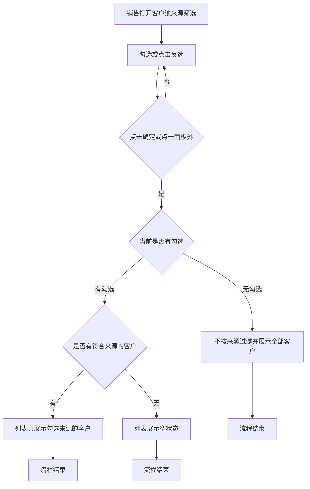
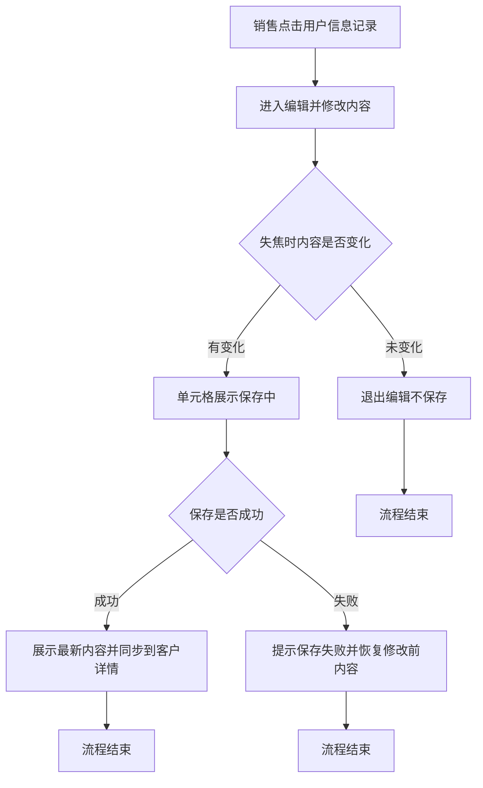
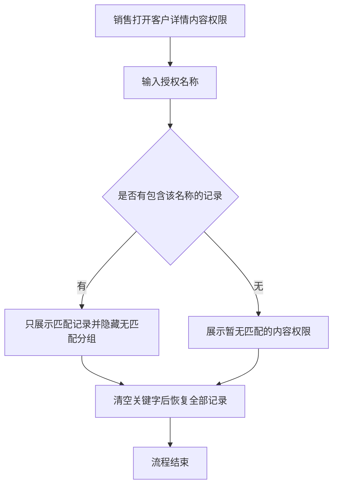

# PRD-客户池列表与详情优化

## 一、修订记录

| 版本号 | 修改日期 | 修改原因 | 修订人 |
|--------|----------|----------|--------|
| v1.0 | 2026-10-19 | 初稿 | AI PRD Writer |

## 二、需求概述

- **背景/现状**：客户池来源只能正向勾选，用户信息记录不能在列表修改；客户详情不能按授权名称筛内容权限，且线索触发场景、来源、最近一次看课时间位置分散。
- **需求目标**：来源可反选，列表可直接改用户信息记录，内容权限可按授权名称筛选，并调整这三个字段的位置。
- **核心逻辑简述**：反选后点确定或关闭面板才筛选；列表失焦保存，与详情同一条记录；授权名称按包含过滤；字段只换位、取值不变。

## 三、术语表

| 术语 | 定义 |
|------|------|
| 反选 | 在来源筛选中，把已勾选的来源取消，把未勾选的来源勾上 |
| 用户信息记录 | 一个客户只保留一条，展示在客户池列表中，跟进时可随时补充 |
| 授权名称 | 内容权限列表里标识具体授权内容的名称，例如初中英语 |
| 内容权限 | 客户详情中的页签，按同步课、培优课等分组展示客户已获得的内容授权 |

## 四、调整范围

1. 客户池列表：来源筛选增加反选；用户信息记录改为可直接编辑。
2. 客户详情：内容权限列表增加按授权名称筛选；基础信息中线索触发场景、来源、最近一次看课时间调整先后顺序。
3. 客户详情从其他入口打开时，字段顺序与授权名称筛选一并生效。已成交、付费线索池等其他列表本次不改。

## 五、业务流程图

**来源反选筛选**

**列表编辑用户信息记录**

**按授权名称筛选内容权限**

## 六、可交互原型

在线预览：[点击查看可交互原型](https://pages.yc345.tv/yping-c78bba/customer-pool-list-detail/)

> 原型为可交互 HTML 页面，点击链接即可在浏览器中体验完整交互流程。

## 七、功能需求详细描述

### 7.1 客户池列表

#### 来源反选

| 功能/字段名称 | 修改项 | 改前 | 改后 | 备注 |
|---------------|--------|------|------|------|
| 来源筛选 | 交互逻辑 | 只能逐项勾选，面板内只有清空、确定 | 在清空左侧增加反选。点击后已勾选的来源取消，未勾选的来源勾上 | 只作用于客户池列表的来源筛选 |
| 来源筛选 | 生效时机 | 点击确定，或点击面板外关闭面板后，按勾选结果筛选 | 不变。反选和清空只改勾选，不立即刷新列表 | 沿用现有关闭面板即筛选的规则 |

- 一项都未勾选时点击反选，结果为全部勾选。
- 已全部勾选时点击反选，结果为全部取消。
- 来源存在上下级时，反选作用于全部可勾选来源；父级是否勾选随子级联动，沿用现有规则。
- 确定或关闭面板时，若没有任何勾选，则不按来源过滤，展示全部客户。
- 筛选后没有客户时，沿用现有空列表展示。
- 点击页面上的清空筛选条件时，来源勾选一并清除，沿用现有清空范围。
- 反选按钮在面板打开时可点击，无禁用状态。确定、清空保持可点击。

#### 用户信息记录直接编辑

| 功能/字段名称 | 修改项 | 改前 | 改后 | 备注 |
|---------------|--------|------|------|------|
| 用户信息记录 | 交互逻辑 | 列表只展示文字，修改需进入客户详情的跟单记录 | 点击单元格即可编辑，失焦后保存 | 仍是一个客户一条记录 |

- 编辑框为多行输入，最多 500 字，并展示已输入字数；达到 500 字后不能继续输入。
- 失焦时内容与进入编辑前一致，则退出编辑且不保存。
- 内容有变化时进入保存中，此期间该单元格不可再次编辑。
- 保存成功后退出编辑，单元格展示最新内容，不弹出成功提示。客户详情跟单记录中的用户信息记录同步为同一内容。
- 保存失败时提示「保存失败，请重试」，单元格恢复为修改前内容，并可再次编辑。
- 原本没有内容时，单元格仍可点击，编辑框为空。
- 未处于编辑时，超长内容最多展示三行，悬停查看全文，沿用现有展示。
- 点击编辑不打开客户详情。从洋葱ID进入详情后返回，列表保留当前来源筛选和已保存的用户信息记录。
- 不新增权限。能查看客户池的销售即可在列表编辑。

### 7.2 客户详情

#### 内容权限按授权名称筛选

| 功能名称 | 功能类型 | 是否必填 | 交互说明 | 备注 |
|----------|----------|----------|----------|------|
| 授权名称筛选 | 输入框 | 否 | 在内容权限列表上方输入授权名称，按包含关系即时筛选 | 清空后恢复全部记录 |

- 匹配规则：去掉首尾空格后，授权名称包含所输入文字即保留；不区分英文大小写。
- 输入过程中即时筛选，无需再点确定。
- 某个分组下没有匹配记录时，不展示该分组。
- 所有分组都没有匹配记录时，展示「暂无匹配的内容权限」。
- 关键字为空时，恢复全部分组和记录。
- 筛选只影响当前客户的内容权限列表，不改变授权数据本身。

#### 基础信息字段换位

| 功能/字段名称 | 修改项 | 改前 | 改后 | 备注 |
|---------------|--------|------|------|------|
| 线索触发场景、来源、最近一次看课时间 | 展示顺序 | 来源，然后是最近一次看课时间，然后是线索触发场景 | 线索触发场景，然后是来源，然后是最近一次看课时间 | 只换顺序，取值和可点击查看详情的规则不变 |

- 线索触发场景、最近一次看课时间继续占用较宽的一格，避免长文本被截断。
- 因顺序变化，这三个字段所在的行和列会随之变化。其余基础信息字段的顺序、取值和编辑方式不变。
- 从客户池以外的入口打开同一客户详情时，同样使用调整后的顺序。

## 八、埋点与数据需求

无

## 九、权限说明

无
