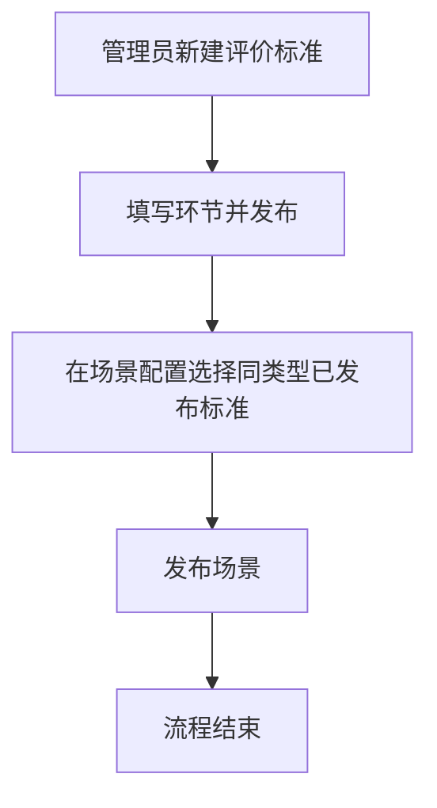
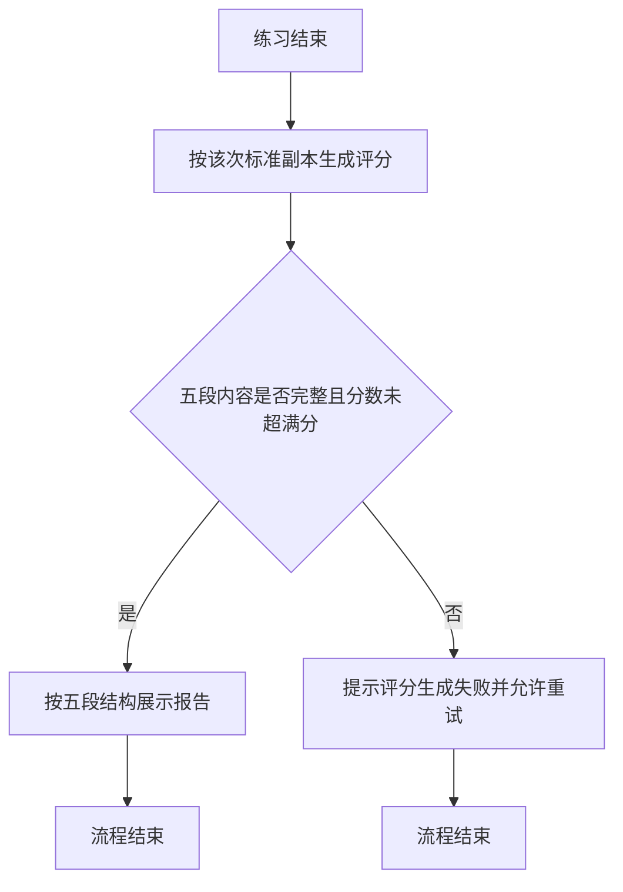
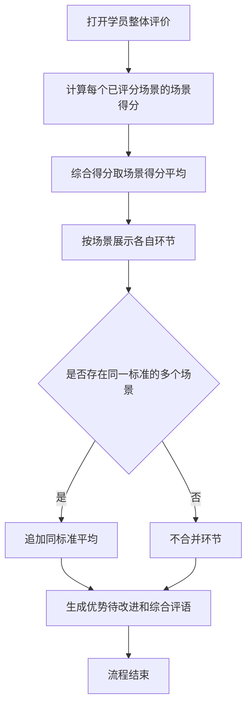

# PRD-AI质培中台评价标准管理

## 一、修订记录

| 版本号 | 修改日期 | 修改原因 | 修订人 |
|--------|----------|----------|--------|
| v1.0 | 2026-10-16 | 初稿 | AI PRD Writer |
| v1.1 | 2026-10-16 | 问答对练开启按题评分时增加逐题结果；单次评分提示词拆成 AI客户与问答对练两套 | AI PRD Writer |
| v1.2 | 2026-10-16 | 任务没有是否通过的配置，考试只展示得分 | AI PRD Writer |
| v1.3 | 2026-10-16 | 明确标准副本不一致时的人员汇总、环节平均，以及上线前旧评分的展示 | AI PRD Writer |
| v1.4 | 2026-10-19 | 补充客户池客户详情中订单、观看记录和学情报告的生成规则 | AI PRD Writer |
| v1.5 | 2026-10-19 | 任务管理学员明细和我的任务展示通话录音与转写；仅评价标准管理的结果示例不展示 | AI PRD Writer |

## 二、需求概述

- **背景/现状**：当不同场景需要不同评价口径时，系统仍用两段全局模板打分，单次结果和人员评价都无法按同一结构展示。
- **需求目标**：当管理员为每个场景选择不同评价标准时，系统仍按固定五段结构展示单次评分，并按场景得分汇总人员评价。
- **核心逻辑简述**：评价标准按量表维护，并在场景发布时绑定。单次评分固定输出五段内容。人员综合得分取各场景得分的平均，环节只在同一标准内比较。

## 三、术语表

| 术语 | 定义 |
|------|------|
| 评价标准 | 一条可复用的评分量表，包含适用场景类型和若干评分环节 |
| 环节 | 评价标准中的一个评分项，含名称、满分和评分说明 |
| 得分点 | 针对单个环节、依据逐字稿写出的具体判断说明 |
| 场景得分 | 一次练习在某个场景上的得分，等于该次各环节得分之和 |
| 综合得分 | 一名学员在一个任务下的人员得分，等于已评分场景的场景得分平均 |
| 标准副本 | 练习开始时保存的评价标准内容，之后修改标准不影响已产生的评分 |
| 同标准平均 | 同一任务里、使用同一条评价标准的多个场景，按环节对齐后的平均表现 |

## 四、调整范围

| 页面 | 变更 |
|------|------|
| 评价标准管理 | 新增页面，维护量表、发布状态，并提供结果示例 |
| 场景配置 | 评价标准由只读文本改为必选已发布标准 |
| 对练台配置管理 | 去掉两段全局评价模板的编辑，只保留模型选择 |
| 评分结果 | 单次报告改为固定五段；结果示例不展示通话录音 |
| 任务管理 | 学员整体评价改为按场景汇总，不再使用固定五环节 |

## 五、业务流程图

**维护标准并绑定场景**

**单次评分**

**人员评价**

## 六、可交互原型

在线预览：[点击查看可交互原型](https://pages.yc345.tv/yping-c78bba/evaluation-criteria-management/)

> 原型为可交互页面。评价标准管理可筛选、新建、发布和查看结果示例；场景配置可选择评价标准；任务管理可查看两名学员的整体评价。

## 七、功能需求详细描述

本章按页面列出本次新增和修改。弹窗均从右侧浮出。

### 7.1 页面：评价标准管理

【新增】二级菜单，放在场景配置和对练台配置管理之间。

#### 功能：标准列表

| 功能名称 | 功能类型 | 是否必填 | 交互说明 | 备注 |
|----------|----------|----------|----------|------|
| 标准名称搜索 | 输入框 | 否 | 按名称筛选 | — |
| 适用类型 | 下拉 | 否 | 全部、AI客户、问答对练 | — |
| 状态 | 下拉 | 否 | 全部、草稿、已发布、已停用 | — |
| 重置 | 按钮 | 不适用 | 清空筛选 | — |
| 新建标准 | 按钮 | 不适用 | 进入新建页 | — |
| 标准名称 | 列表字段 | 不适用 | 点击打开只读详情，右侧浮出 | — |
| 适用类型 | 列表字段 | 不适用 | AI客户或问答对练 | — |
| 环节数 | 列表字段 | 不适用 | 展示环节个数 | — |
| 引用场景数 | 列表字段 | 不适用 | 大于 0 时可点击，右侧浮出引用场景 | 展示场景名称、状态、是否被进行中任务引用 |
| 状态 | 列表字段 | 不适用 | 草稿、已发布、已停用 | — |
| 更新人、更新时间 | 列表字段 | 不适用 | 最后一次保存或状态变更 | — |

操作随状态变化：

| 状态 | 操作 | 规则 |
|------|------|------|
| 已发布 | 编辑、停用、结果示例 | 被进行中任务引用时不允许停用，提示「该标准正在被进行中的任务引用，不允许停用」 |
| 草稿 | 编辑、删除 | 删除需二次确认，确认框从右侧浮出；删除后不可恢复 |
| 已停用 | 启用、结果示例 | 启用后变为已发布，可被场景选择 |

已被已发布场景引用、但没有进行中任务时，仍可停用。确认文案说明停用后这些场景保持原绑定，新场景不能再选择。确认框从右侧浮出。

#### 功能：新建与编辑

独立页面。右上角为返回、保存草稿、发布。

| 功能名称 | 功能类型 | 是否必填 | 交互说明 | 备注 |
|----------|----------|----------|----------|------|
| 标准名称 | 输入框 | 是 | 不超过 20 字 | 同类型下不可重名 |
| 适用类型 | 下拉 | 是 | AI客户或问答对练 | 创建后不可改 |
| 按题评分 | 开关 | 否 | 仅问答对练展示，新建时默认开启 | 开启后，在各环节得分概览下方增加按题评分。每题展示题目、学员回答、判定和说明。判定为命中、部分命中或未命中。逐题结果不另计总分 |
| 说明 | 输入框 | 否 | 只给管理员看，不进入评分 | 不超过 50 字 |
| 环节名称 | 输入框 | 发布时必填 | 不超过 10 字，同一标准内不重复 | 至少 1 个，最多 8 个 |
| 满分 | 数字 | 发布时必填 | 正整数 | 全部环节满分合计必须等于 100 |
| 评分说明 | 多行文本 | 发布时必填 | 写清什么表现得高分、什么表现扣分 | 不超过 500 字，进入提示词 |
| 分数档 | 选填文本 | 否 | 可写分数区间和判定句 | 只供模型判断，报告不展示等级字母 |
| 上移、下移、删除 | 按钮 | 不适用 | 调整环节顺序；只剩 1 个时删除不可用 | — |
| 添加环节 | 按钮 | 不适用 | 已有 8 个时不可再加 | 默认满分填入距 100 的剩余分 |
| 结果预览 | 展示区 | 不适用 | 随环节名称、满分和按题评分开关实时变化 | 问答对练且开启按题评分时，预览在各环节得分概览下方展示逐题结果 |
| 保存草稿 | 按钮 | 不适用 | 至少填写标准名称 | 满分合计可以不等于 100 |
| 发布 | 按钮 | 不适用 | 校验通过后状态变为已发布 | 校验失败时提示具体原因，停留在当前页 |

满分合计实时展示。不等于 100 时标红，发布不可用。编辑已发布标准并再次发布时，提示「修改后仅对新发起的练习生效」。

#### 功能：结果示例

【新增】已发布和已停用标准可打开。从右侧浮出，只展示评分报告，不展示通话录音和转写。

报告结构见 7.4。示例按各环节满分的八成生成示意分数，得分点按示例逐字稿撰写，用于核对结构。

#### 功能：单次评分提示词模板

【新增】系统固定使用，页面不可编辑。AI客户和问答对练各用一套。方括号内为每次评分时填入的内容。两套模板都要求：不要输出等级，不要输出标准里没有的环节。无法判断的环节得分记 0，并说明缺少依据。输出不完整、环节与标准副本不一致、或任一得分超出满分时，页面展示「评分生成失败」，提供重试，不展示模型原文。

**AI客户提示词模板**

你是电销培训评估专家。请只根据本次通话逐字稿，按下面的评价标准打分。

评价标准名称：【标准名称】
环节：
1. 【环节名称】，满分【满分】。评分说明：【评分说明】。分数档：【有则逐条列出，没有则写无】

逐字稿：
【本次通话逐字稿】

请按顺序输出五段，缺一不可：

1. 各环节得分。每个环节给出得分和满分，得分不得高于满分，不得为负数。总分为各环节得分之和。
2. 得分点详细说明。每个环节单独一段，以「逐字稿中」开头，写明销售做了什么、没做什么，并引用逐字稿原话，说明是否满足该环节核心要求。不要只复述评分说明。
3. 优势表现。列出已经做到的动作，每条一句话。
4. 待改进项。列出未完成的动作，每条一句话。
5. 综合评语。一段话，给出下一步练习建议。

**问答对练提示词模板**

你是电销培训评估专家。请对照每道题的标准答案，按下面的评价标准为学员作答打分。

评价标准名称：【标准名称】
按题评分：【开启或关闭】
环节：
1. 【环节名称】，满分【满分】。评分说明：【评分说明】。分数档：【有则逐条列出，没有则写无】

题目材料，按题号逐题给出：
题号：【题号】
题目：【题目】
标准答案：【标准答案】
学员回答：【学员回答】

请按顺序输出。各环节得分、得分点详细说明、优势表现、待改进项、综合评语五段缺一不可。按题评分开启时，在各环节得分之后、得分点详细说明之前，增加按题评分一段。

1. 各环节得分。每个环节给出得分和满分，得分不得高于满分，不得为负数。总分为各环节得分之和。总分只来自环节得分，不要把题目再加一次分。
2. 按题评分。仅当本标准开启按题评分时输出，每题一段。写明题号、题目、判定和说明。判定只能是命中、部分命中、未命中。说明要引用学员原话，并对照标准答案写明命中了哪一点、缺了哪一点。关闭按题评分时不要输出这一段。
3. 得分点详细说明。每个环节单独一段，写明学员整体作答是否满足该环节核心要求，并引用学员原话。不要只复述评分说明。
4. 优势表现。列出已经做到的动作，每条一句话。
5. 待改进项。列出未完成的动作，每条一句话。
6. 综合评语。一段话，给出下一步练习建议。

### 7.2 页面：场景配置

【修改】评价标准。

| 功能/字段名称 | 修改项 | 改前 | 改后 | 备注 |
|---------------|--------|------|------|------|
| 评价标准 | 录入方式 | 只读长文本，内容来自对练台配置管理的全局模板 | 必选下拉，只列出与场景类型一致且已发布的标准 | 未选择不能发布场景 |
| 评价标准 | 生效范围 | 全局模板变更影响后续练习 | 更换标准后，只影响新发起的练习 | 已产生的评分仍用当时的标准副本 |
| 预览评分结果 | 新增按钮 | 无 | 按当前所选标准打开评分结果，右侧浮出，展示通话录音和转写 | 未选择标准时提示先选择 |

场景列表、类型选择、标签、提示词、选题和效果测试沿用现有配置。类型选择、标签管理和停用确认改为从右侧浮出。

### 7.3 页面：对练台配置管理

【删除】评价模板的可编辑入口。

| 功能/字段名称 | 删除范围 | 影响说明 |
|---------------|----------|----------|
| 对练评价默认模板 | 整段可编辑文本 | 原内容迁移为已发布标准「外呼综合五维」，供 AI客户场景默认选中 |
| 问答对练评价模板 | 整段可编辑文本 | 原内容迁移为已发布标准「问答三段论」，并默认开启按题评分 |

对练模型和评价模型的选择保留，沿用现有配置。

### 7.4 页面：评分结果

【修改】任务明细、我的任务、客户池中查看单次评分时，右侧报告改为下列五段。任务管理的学员明细、我的任务查看评分报告时，展示通话录音和转写。只有评价标准管理的结果示例不展示通话录音和转写。

| 功能/字段名称 | 修改项 | 改前 | 改后 | 备注 |
|---------------|--------|------|------|------|
| 单次报告结构 | 展示板块 | 得分、判断依据写在每个环节下方，另有优势、待改进、评语 | 固定为：各环节得分概览、得分点详细说明、优势表现、待改进项、综合评语 | 不展示等级。问答对练且标准开启按题评分时，在各环节得分概览下方增加按题评分 |
| 按题评分 | 新增板块 | 无逐题结果 | 每题展示题目、学员回答、判定和说明。判定为命中、部分命中或未命中 | 只在该标准开启按题评分时展示。不另计总分，任务得分仍是各环节得分之和 |
| 各环节得分概览 | 展示内容 | 环节下直接附判断依据 | 只展示环节名称、得分进度和「得分/满分」 | 总分等于各环节得分之和，并展示加总公式 |
| 得分点详细说明 | 新增板块 | 无独立板块 | 每个环节一段，格式为「环节名称：逐字稿中……」 | 必须引用原话，说明做了什么、没做什么 |
| 结果示例 | 左侧内容 | 展示通话录音和转写 | 不展示 | 只保留评分报告。仅评价标准管理的结果示例不展示；任务管理学员明细和我的任务仍展示通话录音和转写 |
| 考试通过标识 | 展示位置 | 结果示例可切换考试模式 | 结果示例不提供该切换 | 任务没有是否通过的配置。单次评分和人员评价都只展示得分，不展示通过或未通过 |

练习开始时保存标准副本。之后修改标准，不影响这条结果。报告底部说明本次使用的标准名称。

上线前已经生成、没有标准副本的旧评分，查看时保持原来的展示，不改写成五段报告。上线后新产生的评分，按练习开始时的标准副本生成五段报告。

### 7.5 页面：任务管理

【修改】学员明细中的「查看报告」，即人员维度的整体评价。从右侧浮出，并展示通话录音和转写。

#### 功能：汇总规则

| 功能名称 | 规则 |
|----------|------|
| 场景得分 | 场景练习取该场景最高分。考试模式每个场景只考一次，场景得分就是这一次的得分。自由练习取该场景下已评分通话总分的平均分；每通先按自己的标准副本算总分，副本不同也可以对总分取平均 |
| 未评分 | 未完成、未开考，以及自由练习中未达 5 分钟评分门槛的通话，不进入平均 |
| 综合得分 | 已评分场景的场景得分做算术平均，每个场景权重相同。同一场景练习多次，不提高该场景权重 |
| 计入说明 | 分数下方写明计算公式，并说明未评分场景不计入。一个场景都没有分时，列表和报告展示「—」 |
| 考试得分 | 任务没有是否通过的配置。列表和报告只展示综合得分、各场景得分，不展示通过或未通过 |
| 环节得分 | 自由练习在同一份标准副本内，对纳入场景得分平均的那些通话，按环节取平均。不另挑一通代表。场景练习展示最高分那一次的环节得分。考试展示这一次考试的环节得分 |
| 分场景表现 | 每个场景一块：场景名称、类型、所用标准、场景得分，以及对应标准副本的环节得分。同一场景出现多份副本时，按副本分块展示环节，不合成一张图 |
| 同标准平均 | 至少两个已评分场景的标准副本，环节名称、顺序和满分完全一致时，才按环节对齐取平均。只是标准名称相同、副本内容已经不同，不合并 |
| 文字评价 | 优势、待改进、综合评语由模型生成，每条优势和待改进标明场景名称。综合得分和同标准平均由系统计算，不交给模型重算 |

列表中的综合得分与报告顶部的综合得分使用同一套算法。

#### 功能：人员维度提示词模板

【新增】系统固定使用，页面不可编辑。模型只写文字，不重算分数。

你是电销培训评估专家。下面是一名学员在同一任务中各场景已经生成的评分。请只根据这些材料写整体评价。不要重新打分，不要计算综合得分，不要发明一套跨场景的统一环节。

学员：【姓名】
任务：【任务名称】
任务模式：【自由练习、场景练习或考试】

各场景材料如下。未评分场景不要写入评价：
场景名称：【名称】
场景类型：【AI客户或问答对练】
评价标准：【标准名称】
场景得分：【分数】
各环节得分：【环节名称、得分、满分】
得分点：【该场景已生成的得分点原文】
优势：【该场景已生成的优势原文】
待改进：【该场景已生成的待改进原文】
场景评语：【该场景已生成的综合评语原文】

请按顺序输出三段：

1. 优势表现。每条以「【场景名称】」开头，只归纳该场景已经做到的动作。
2. 待改进项。每条以「【场景名称】」开头，只归纳该场景未完成的动作。
3. 综合评语。一段话。标准副本不同的场景，不要把环节横向比较。多个场景使用同一份标准副本时，可以指出这些场景里共同偏弱的环节。给出下一步练习建议。不要输出综合得分，不要输出环节平均分，不要判断通过或未通过。

### 7.6 页面：客户池-客户详情

【修改】客户详情中订单记录、观看记录和学情报告的模拟数据生成规则。

| 功能名称 | 改前 | 改后 |
|----------|------|------|
| 订单记录 | 随机生成，可为空态，未限制条数 | 随机生成，最多 3 条；没有付费记录时展示空态 |
| 观看记录 | 按客户年级对应学段跨科目随机抽取，可为空态，未明确条数和排序 | 最多生成 5 条；按观看时间从新到旧排列；没有看课记录时展示空态 |
| 学情报告 | 按学段随机生成科目，无年级时为空态，未明确数量和学习时长上限 | 最多生成 5 个；每条学习时长不超过 1 小时；无年级时展示空态 |

## 八、埋点与数据需求

无

## 九、权限说明

沿用质培中台现有菜单权限。管理员和培训师可维护评价标准、在场景中选择标准。学员只能查看自己的单次评分和人员评价。
