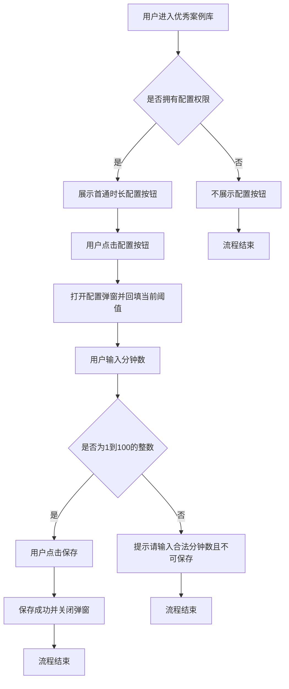
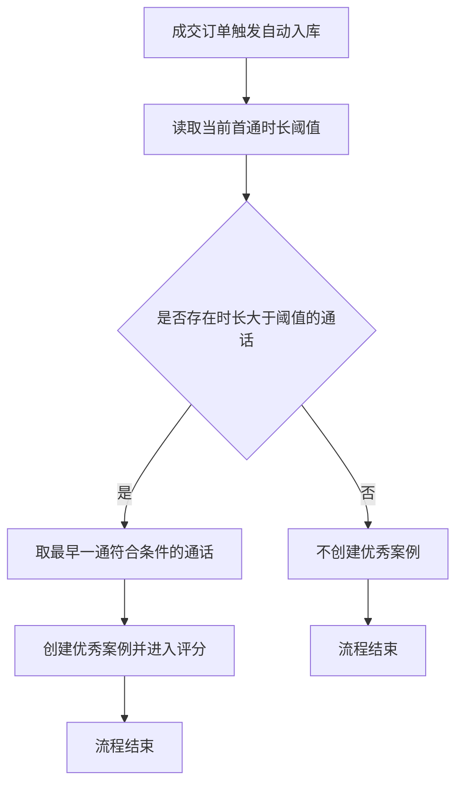

# PRD-优秀案例库首通时长配置

## 一、修订记录

| 版本号 | 修改日期 | 修改原因 | 修订人 |
|--------|----------|----------|--------|
| v1.0 | 2026-11-11 | 初稿 | AI PRD Writer |

## 系统现状与可复用能力

| 项 | 说明 |
|----|------|
| 现有相关功能 | 「AI陪练台 → 优秀案例库」已支持筛选、列表、人工审核、查看通话、加入案例；成交订单满足业务条件后，系统会取该坐席对该线索「通话时长大于固定阈值」的最早一通，自动创建优秀案例并进入评分。 |
| 现有阈值 | 首通时长阈值当前写死为大于 5 分钟，页面无配置入口。 |
| 可参考能力 | 优秀案例库筛选区已有搜索/重置按钮布局；电销后台其它模块已有「按钮权限控制」与「弹窗数值配置」交互可对齐。 |
| 本次复用 | 复用优秀案例库页面与筛选区布局；复用现有自动入库与评分链路，仅把固定 5 分钟改为可配置阈值。 |
| 与现状差异 | 新增带权限的「首通时长配置」按钮与配置弹窗；入库判定改为读取已保存阈值。 |
| 重复性结论 | 非重复需求。现有无配置入口，阈值不可调。 |

> 待确认：①配置是否全局生效（本文默认：全局一份配置，对全部坐席统一生效）；②保存后是否回溯历史未入库通话（本文默认：不回溯，仅影响配置生效后的新入库判定）。

## 二、需求概述

- **背景/现状**：当运营需要调整进入优秀案例库评分的首通通话时长门槛时，系统固定大于 5 分钟，无法按业务节奏灵活调整。
- **需求目标**：当用户拥有配置权限时，系统应支持在优秀案例库页面配置「首通通话时长大于 X 分钟」自动入库评分，X 为 1～100 的整数分钟。
- **核心逻辑简述**：有权限用户打开配置弹窗修改并保存阈值；后续自动入库按最新阈值判定；无权限用户不展示配置入口。

## 三、术语表

| 术语 | 定义 |
|------|------|
| 优秀案例库 | AI陪练台下用于查看、审核、管理待评优通话案例的列表页 |
| 首通通话时长阈值 | 自动进入优秀案例库评分时，要求该通话时长必须大于的分钟数 |
| 自动入库评分 | 成交订单满足条件后，系统按阈值找到对应首通通话，创建优秀案例并触发评分 |

## 四、调整范围

本次仅调整优秀案例库的首通自动入库时长门槛配置：

1. **新增**：筛选区「首通时长配置」按钮；配置弹窗；独立按钮权限。
2. **修改**：自动入库判定由固定大于 5 分钟改为读取已保存阈值；未配置过时默认仍为 5。
3. **保留**：优秀案例库筛选、列表、审核、查看通话、加入案例及现有其它自动入库条件。
4. **后端能力（概括）**：提供阈值查询与保存能力，并在自动入库流程读取该阈值。
5. **不在范围**：人工加入案例规则、评分模型/维度、优秀录音库展示规则、历史案例回溯补录。

## 五、业务流程图

**业务流程：配置首通时长阈值**

**业务流程：按阈值自动入库评分**

## 六、可交互原型

在线预览：[点击查看可交互原型](https://pages.yc345.tv/yping-c78bba/excellent-case-first-call-duration/)

> 原型为带变更批注的可交互 HTML 页面。打开即可看到本次变更编号；收起右侧批注栏后连线隐藏，点击编号会重新打开批注。

## 七、功能需求详细描述

### 7.1 【新增】功能

#### 7.1 【新增】首通时长配置按钮

| 功能名称 | 功能类型 | 是否必填 | 交互说明 | 备注 |
|----------|----------|----------|----------|------|
| 首通时长配置 | 按钮 | 不适用 | 位于搜索、重置旁；点击打开配置弹窗 | 仅有按钮权限时展示 |

#### 7.1 【新增】首通时长配置弹窗

| 功能名称 | 功能类型 | 是否必填 | 交互说明 | 备注 |
|----------|----------|----------|----------|------|
| 首通时长配置弹窗 | 弹窗 | 不适用 | 展示说明文案与分钟输入框，支持取消/保存 | 打开时回填当前已保存值 |
| 首通通话时长阈值 | 数字输入 | 是 | 单位分钟；仅允许 1～100 的整数 | 未配置过默认 5；非法值提示「请输入 1～100 的整数分钟」且不可保存 |

### 7.2 【修改】功能

| 功能/字段名称 | 修改项 | 改前 | 改后 | 备注 |
|---------------|--------|------|------|------|
| 自动入库时长判定 | 判定阈值 | 固定大于 5 分钟 | 读取已保存阈值；未配置过按 5 分钟 | 仅影响保存后的新入库，不回溯历史 |

### 7.4 状态与异常变更

| 涉及位置 | 变更动作 | 触发条件 | 系统行为 / 文案 |
|----------|----------|----------|------------------|
| 首通时长配置按钮 | 新增 | 无配置权限 | 不展示按钮 |
| 首通时长配置弹窗 | 新增 | 输入非 1～100 整数或为空 | 提示「请输入 1～100 的整数分钟」，不保存 |
| 首通时长配置弹窗 | 新增 | 保存成功 | 提示「保存成功」，关闭弹窗，后续入库按新阈值 |

## 八、埋点与数据需求

无。

## 九、权限说明

| 权限名称 | 控制对象 | 说明 |
|----------|----------|------|
| 优秀案例库页面权限 | 页面进入 | 沿用现有；仅有页面权限不能配置阈值 |
| 首通时长配置权限 | 配置按钮与弹窗保存 | 新增独立按钮权限；有权限才展示按钮并可保存 |
