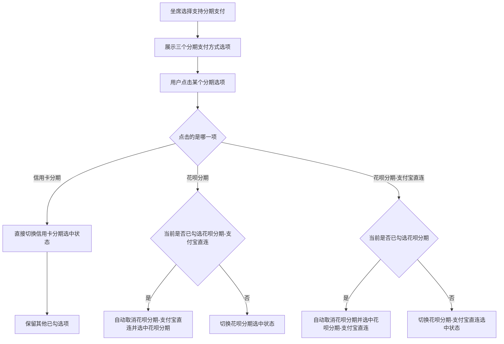
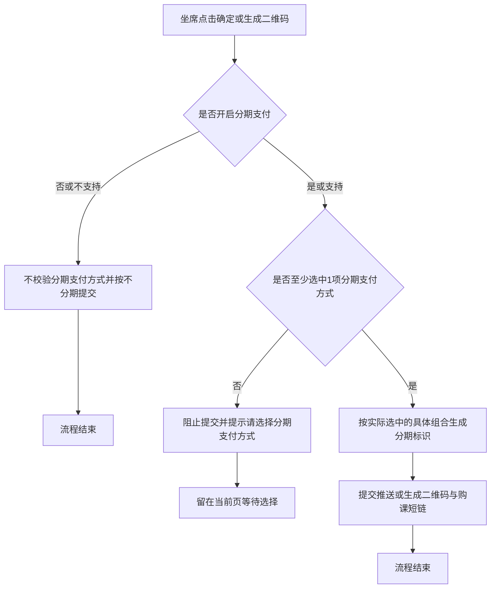

# PRD-分期支付方式新增花呗直连

## 一、修订记录

| 版本号 | 修改日期 | 修改原因 | 修订人 |
|--------|----------|----------|--------|
| v1.0 | 2026-11-26 | 初稿 | AI PRD Writer |

## 二、需求概述

- **背景/现状**：电销CRM与体验营CRM的分期支付方式当前仅提供「花呗分期」和「信用卡分期」两个选项，无法选择支付宝直连的花呗分期渠道。
- **需求目标**：当坐席选择支持分期支付时，系统应在所有分期支付方式展示位置新增「花呗分期（支付宝直连）」选项，并限制其与「花呗分期」不能同时选中。
- **核心逻辑简述**：在电销CRM及体验营CRM全量分期支付入口追加该枚举值；用户勾选「花呗分期」与「花呗分期（支付宝直连）」中任一项时自动取消另一项，两者均可与「信用卡分期」组合选择。

## 三、术语表

| 术语 | 定义 |
|------|------|
| 花呗分期 | 现有渠道的分期支付枚举，与「花呗分期（支付宝直连）」互斥 |
| 花呗分期（支付宝直连） | 本次新增的分期支付枚举，走支付宝直连花呗分期通道，与原「花呗分期」不可同时选择 |
| 信用卡分期 | 现有分期支付枚举，可分别与上述两种花呗分期同时选择 |

## 四、调整范围

本次共涉及 **电销CRM（PC端 8 处、移动端 4 处）** 与 **体验营CRM（PC端 5 处）** 所有在用展示分期支付方式的位置，完整清单如下：

### 4.1 电销CRM需更改页面位置（共 12 处）

| 序号 | 所属端 | 页面 / 模块路径 | 交互载体 | 字段标签与当前选项 |
|------|--------|-----------------|----------|------------------|
| 1 | PC端 | 客户池 / 已成交 / 线索查询 / 客户详情 → 支付推送 | 支付推送弹窗（「支付推送」页签） | 分期支付方式：花呗分期、信用卡分期（默认选中花呗分期） |
| 2 | PC端 | 客户详情 / 线索查询 → 补差续购查询页签（补差 / 会场行） | 生成动态二维码弹窗 | 分期支付方式：花呗分期、信用卡分期（默认选中花呗分期） |
| 3 | PC端 | 客户详情 / 线索查询 → 补差续购查询页签（续购行） | 生成动态二维码弹窗 | 分期支付方式：花呗分期、信用卡分期（默认选中花呗分期） |
| 4 | PC端 | 客户详情（含AI外呼客户详情）→ 加购学习机页签 | 表单页签 | 分期支付方式：花呗分期、信用卡分期（默认选中花呗分期） |
| 5 | PC端 | AI外呼客户详情 → 续购页签 | 生成动态二维码弹窗 | 分期支付方式：花呗分期、信用卡分期（默认选中花呗分期） |
| 6 | PC端 | 客户管理 → 差价查询（新） | 生成动态二维码弹窗 | 分期支付方式：花呗分期、信用卡分期（默认选中花呗分期） |
| 7 | PC端 | 客户管理 → 专属链接（新）→ 列表操作列「二维码」 | 生成动态二维码弹窗 | 分期支付方式：花呗分期、信用卡分期（默认选中花呗分期） |
| 8 | PC端 | 客户管理 → 专属链接（新）→ 顶部「创建动态会场链接（新）」 | 创建会场链接（新）弹窗 | 分期支付方式：花呗分期、信用卡分期（默认选中花呗分期） |
| 9 | 移动端 | 客户详情底部操作栏 → 支付推送 | 支付推送页 | 分期支付方式：花呗分期、信用卡分期（默认选中花呗分期） |
| 10 | 移动端 | 客户详情 → 补差价查询（新）/ 续购页签 → 动态二维码 | 动态二维码页 | 分期支付方式：花呗分期、信用卡分期（默认选中花呗分期） |
| 11 | 移动端 | 客户管理 → 专属链接（新）→ 列表点击课程 | 生成动态二维码页 | 分期支付方式：花呗分期、信用卡分期（默认选中花呗分期） |
| 12 | 移动端 | 客户管理 → 专属链接（新）→ 创建动态会场链接（新） | 创建会场链接（新）页 | 分期支付方式：花呗分期、信用卡分期（默认选中花呗分期） |

> 注：电销CRM中已隐藏或停用入口的旧版创建动态会场链接弹窗、旧版专属链接相关页面及移动端加购学习机组件共用同一分期选项配置，将随本次一并更新生效。

### 4.2 体验营CRM需更改页面位置（共 5 处）

| 序号 | 所属端 | 页面 / 模块路径 | 交互载体 | 字段标签与当前选项 |
|------|--------|-----------------|----------|------------------|
| 1 | PC端 | 客户管理（客户详情）/ 线索查询（撞单查询）→ 支付推送 | 支付推送弹窗（「支付推送」页签） | 支付方式：花呗分期、信用卡分期（默认不勾选） |
| 2 | PC端 | 客户管理（客户详情）/ 线索查询 → 补差续购查询页签（补差 / 会场行） | 动态二维码分期配置弹窗 | 支付方式：花呗分期、信用卡分期（默认不勾选） |
| 3 | PC端 | 客户管理（客户详情）/ 线索查询 → 补差续购查询页签（续购行） | 生成动态二维码弹窗 | 分期支付方式：花呗分期、信用卡分期（默认选中花呗分期） |
| 4 | PC端 | 专属售卖链接 → 列表操作列「动态二维码」 | 动态二维码分期配置弹窗 | 支付方式：花呗分期、信用卡分期（默认不勾选） |
| 5 | PC端 | 专属售卖链接 → 右上角「创建动态会场二维码」 | 创建动态会场二维码弹窗 | 支付方式：花呗分期、信用卡分期（默认不勾选） |

> 注：体验营CRM代码中已下线隐藏的历史「加购学习机」页签及相关旧版独立组件，如保留代码则同步替换分期选项与互斥逻辑。

### 4.3 不调整范围

1. 不调整各页面展示分期支付的前置资格条件（如坐席分期实验组资格、体验营订单实付金额需大于 100 元、推送类型过滤等）。
2. 不调整「分期支付」单选默认状态及各页面原有的未勾选/默认勾选策略。
3. 不新增或调整菜单权限。

## 五、业务流程图

**流程一：分期支付方式勾选与互斥交互流程**

**流程二：提交校验与分期参数传递流程**

## 六、可交互原型

在线预览：[点击查看可交互原型](https://pages.yc345.tv/yping-c78bba/installment-alipay-direct/)

> 原型为带变更批注的可交互 HTML 页面。打开即可看到本次变更编号；收起右侧批注栏后连线隐藏，点击编号会重新打开批注。

## 七、功能需求详细描述

### 7.1 电销CRM分期支付方式变更

#### 7.1.1 电销CRM支付推送弹窗

【修改】「支付推送」弹窗中的「分期支付方式」多选框新增「花呗分期（支付宝直连）」选项，并与「花呗分期」建立互斥关系。

| 功能/字段名称 | 修改项 | 改前 | 改后 | 备注 |
|---------------|--------|------|------|------|
| 分期支付方式 | 选项枚举与顺序 | 展示「花呗分期」「信用卡分期」共 2 项 | 展示「花呗分期」「花呗分期（支付宝直连）」「信用卡分期」共 3 项 | 沿用坐席分期支付实验组资格控制及分期支付为「是」时展示的条件 |
| 分期支付方式 | 默认选中值 | 默认选中「花呗分期」 | 保持默认选中「花呗分期」，切回分期支付为「是」时仍重置为「花呗分期」 | 不默认选中「花呗分期（支付宝直连）」 |
| 分期支付方式 | 互斥交互规则 | 2 项可任意多选或全选 | 「花呗分期」与「花呗分期（支付宝直连）」互斥：已选其一时勾选另一项，系统自动取消前者仅保留新勾选项；「信用卡分期」可与上述任一项同时选中 | 允许取消勾选单个选项，但提交时仍校验至少选 1 项 |

#### 7.1.2 电销CRM PC端其余页面位置

【修改】电销CRM PC端其余 7 处展示分期支付方式的弹窗与页签（补差续购查询-补差/会场动态二维码弹窗、补差续购查询-续购动态二维码弹窗、客户详情-加购学习机页签、AI外呼详情-续购动态二维码弹窗、差价查询（新）-动态二维码弹窗、专属链接（新）-列表动态二维码弹窗、专属链接（新）-创建会场链接（新）弹窗）同步更新。

| 功能/字段名称 | 修改项 | 改前 | 改后 | 备注 |
|---------------|--------|------|------|------|
| 上述 7 处位置-分期支付方式 | 选项枚举及互斥交互 | 展示「花呗分期」「信用卡分期」2 项，无互斥限制 | 统一展示「花呗分期」「花呗分期（支付宝直连）」「信用卡分期」3 项，默认选中「花呗分期」，执行与 7.1.1 相同的两项花呗互斥规则 | 已隐藏入口的旧版会场链接弹窗同步更新，避免历史引用口径不一致 |

#### 7.1.3 电销CRM移动端页面位置

【修改】电销CRM移动端 4 处展示分期支付方式的 H5 页面（客户详情-支付推送页、客户详情-补差/续购动态二维码页、专属链接（新）-生成动态二维码页、专属链接（新）-创建会场链接（新）页）同步更新。

| 功能/字段名称 | 修改项 | 改前 | 改后 | 备注 |
|---------------|--------|------|------|------|
| 移动端 4 处页面-分期支付方式 | 选项枚举及互斥交互 | 展示「花呗分期」「信用卡分期」2 项，无互斥限制 | 统一展示「花呗分期」「花呗分期（支付宝直连）」「信用卡分期」3 项，默认选中「花呗分期」，执行与 7.1.1 相同的两项花呗互斥规则 | 移动端布局自动换行适配 3 个选项显示；历史停用入口的旧版页面同步更新 |

### 7.2 体验营CRM分期支付方式变更

#### 7.2.1 体验营CRM支付推送弹窗

【修改】体验营CRM客户管理（客户详情）与线索查询（撞单查询）共用的「支付推送」弹窗中，「支付方式」多选框新增「花呗分期（支付宝直连）」选项，并与「花呗分期」互斥。

| 功能/字段名称 | 修改项 | 改前 | 改后 | 备注 |
|---------------|--------|------|------|------|
| 支付方式 | 选项枚举与互斥交互 | 展示「花呗分期」「信用卡分期」2 项，默认不勾选 | 展示「花呗分期」「花呗分期（支付宝直连）」「信用卡分期」3 项，保持默认不勾选，执行两项花呗互斥、均兼容「信用卡分期」规则 | 沿用非预热推送且商品价格大于 100 元、分期支付选「支持」时的展示与重置条件 |

#### 7.2.2 体验营CRM补差续购与专属售卖链接

【修改】体验营CRM「补差续购查询」与「专属售卖链接」共 4 处弹窗同步新增「花呗分期（支付宝直连）」并执行互斥交互。

| 页面位置 | 修改项 | 改前 | 改后 | 备注 |
|----------|--------|------|------|------|
| 补差续购查询-补差/会场动态二维码弹窗 | 支付方式选项与互斥 | 展示「花呗分期」「信用卡分期」2 项，默认不勾选 | 新增「花呗分期（支付宝直连）」，保持默认不勾选，执行两项花呗互斥规则 | 实付大于 100 元且选「支持」时展示 |
| 补差续购查询-续购动态二维码弹窗 | 分期支付方式选项与互斥 | 展示「花呗分期」「信用卡分期」2 项，默认选中「花呗分期」 | 新增「花呗分期（支付宝直连）」，保持默认选中「花呗分期」，执行两项花呗互斥规则 | 切回「是」时重置为「花呗分期」 |
| 专属售卖链接-动态二维码分期配置弹窗 | 支付方式选项与互斥 | 展示「花呗分期」「信用卡分期」2 项，默认不勾选 | 新增「花呗分期（支付宝直连）」，保持默认不勾选，执行两项花呗互斥规则 | 每次打开弹窗重置为默认状态 |
| 专属售卖链接-创建动态会场二维码弹窗 | 支付方式选项与互斥 | 展示「花呗分期」「信用卡分期」2 项，默认不勾选 | 新增「花呗分期（支付宝直连）」，保持默认不勾选，执行两项花呗互斥规则 | 用户实付大于 100 元且选「支持」时展示 |

### 7.3 提交校验与组合传递规则

【修改】全量改造位置在提交推送、生成二维码或生成购课短链时，校验逻辑与组合传递口径同步调整如下：

| 涉及位置 | 变更动作 | 触发条件 | 系统行为 / 传递口径 |
|----------|----------|----------|---------------------|
| 确定 / 生成二维码 / 提交按钮 | 必填校验（沿用并兜底） | 分期支付选「是/支持」且分期支付方式未勾选任何选项时点击提交 | 阻止提交并提示「请选择分期支付方式」（体验营标注为「支付方式」的弹窗沿用「请选择支付方式」），当前弹窗或页面保持不关闭 |
| 分期参数生成（改前） | 数量判定 | 原逻辑按勾选数量等于 2 即传递全部标识 | 废除仅按勾选数量等于 2 判定全选的旧逻辑 |
| 分期参数生成（改后） | 仅选「花呗分期」 | 勾选「花呗分期」且点击提交 | 传递花呗分期单一标识 |
| 分期参数生成（改后） | 仅选「花呗分期（支付宝直连）」 | 勾选「花呗分期（支付宝直连）」且点击提交 | 传递花呗分期（支付宝直连）单一标识 |
| 分期参数生成（改后） | 仅选「信用卡分期」 | 勾选「信用卡分期」且点击提交 | 传递信用卡分期单一标识 |
| 分期参数生成（改后） | 选「花呗分期」+「信用卡分期」 | 同时勾选上述 2 项且点击提交 | 传递花呗分期与信用卡分期组合标识（沿用原双选口径） |
| 分期参数生成（改后） | 选「花呗分期（支付宝直连）」+「信用卡分期」 | 同时勾选上述 2 项且点击提交 | 传递花呗分期（支付宝直连）与信用卡分期组合标识 |
| 分期参数生成（兜底） | 分期支付选「否/不支持」 | 未开启分期支付时点击提交 | 清空或忽略分期支付方式选项，不传递分期标识 |

> 说明：需同步确保后端接收分期参数、购课短链生成、二维码链接拼接及下游支付落地页均支持识别「花呗分期（支付宝直连）」单一标识及其与「信用卡分期」的组合标识。

## 八、埋点与数据需求

无。

## 九、权限说明

沿用电销CRM与体验营CRM现有各页面访问权限及坐席分期支付实验组资格判定规则，本次不新增权限项。
