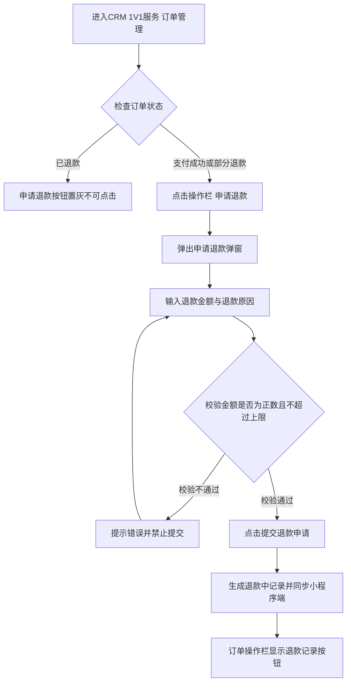
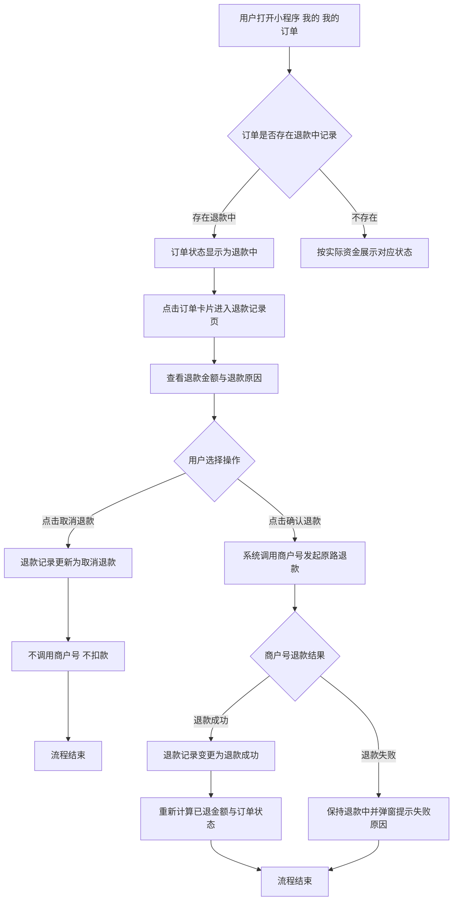

# PRD-1V1服务订单退款

## 一、修订记录

| 版本号 | 修改日期 | 修改原因 | 修订人 |
|--------|----------|----------|--------|
| v1.0 | 2026-10-15 | 初稿 | AI PRD Writer |

## 二、需求概述

- **背景/现状**：当前电销CRM「1V1服务-订单管理」列表缺少退款流程管控能力，无法在线发起退款并与小程序端用户确认联动。
- **需求目标**：在电销CRM支持针对支付成功与部分退款订单发起退款及记录管理，并在启思宇宙小程序端由用户确认后触发商户号原路退款。
- **核心逻辑简述**：CRM端支持按未退金额上限发起退款并允许退款中撤销或编辑；小程序端实时联动展示退款中状态，并提供确认退款（调用商户号退款）与取消退款能力。

## 三、术语表

| 术语 | 定义 |
|------|------|
| 订单状态 | 订单的资金履约状态，包含「支付成功」、「部分退款」、「已退款」三种状态 |
| 退款状态 | 单笔退款申请记录的流转状态，包含「退款中」、「退款成功」、「取消退款」三种状态 |
| 退款上限 | 单笔申请可退金额的最大值，计算公式为：已支付金额 - 累计已退款金额 |
| 商户号退款 | 启思宇宙小程序调用支付商户号退款能力，将款项原路返还至用户原支付渠道的操作 |

## 四、调整范围

1. 电销CRM「1V1服务-订单管理」列表：列表表格新增「订单状态」列与「操作」列（包含【申请退款】、【退款记录】按钮）。
2. 电销CRM「申请退款」弹窗：提供退款金额输入（正数校验、未退金额上限校验）、退款原因输入（200字符限制）及提交能力。
3. 电销CRM「退款记录」弹窗：展示历史及当前退款记录明细；针对状态为「退款中」的记录提供【取消退款】与【编辑】操作。
4. 启思宇宙小程序「我的-我的订单」：订单存在退款中记录时状态展示为「退款中」；点击卡片进入退款记录页。
5. 启思宇宙小程序「退款记录」页：展示订单号、支付金额、退款金额、退款原因，并针对退款中记录提供【确认退款】（调用商户号）与【取消退款】操作。

## 五、业务流程图

**CRM端发起退款申请与维护流程**

**小程序端用户确认与商户号退款流转**

## 六、可交互原型

在线预览：[点击查看可交互原型](https://pages.yc345.tv/yping-c78bba/order-refund-management/)

> 原型为可交互 HTML 页面，点击链接即可在浏览器中体验完整交互流程。

## 七、功能需求详细描述

### 7.1 【新增】功能

#### 1. CRM 订单列表新增字段与操作

| 功能名称 | 功能类型 | 是否必填 | 交互说明 | 备注 |
|----------|----------|----------|----------|------|
| 订单状态列 | 列表字段 | 不适用 | 展示订单资金履约状态，取值包含：支付成功、部分退款、已退款 | 位于支付手机号右侧 |
| 操作列 | 列表字段 | 不适用 | 固定展示在表格最右侧，放置当前行可用业务操作按钮 | 宽度自适应 |
| 申请退款按钮 | 操作按钮 | 不适用 | 当订单状态为「支付成功」或「部分退款」时允许点击，点击后弹出「申请退款」弹窗；当订单状态为「已退款」时置灰且不可点击 | 若当前订单存在未处理完毕的「退款中」记录，该按钮同样置灰并提示存在退款审核 |
| 退款记录按钮 | 操作按钮 | 不适用 | 当订单发生过退款（存在退款记录，包括退款中、退款成功、取消退款）时展示；未发生过退款时不展示 | 点击后弹出「退款记录」弹窗 |

#### 2. CRM 申请退款弹窗

| 功能名称 | 功能类型 | 是否必填 | 交互说明 | 备注 |
|----------|----------|----------|----------|------|
| 申请退款弹窗 | 交互弹窗 | 不适用 | 点击操作栏【申请退款】后弹出，居中展示 | 点击右上角关闭或取消按钮可关闭 |
| 退款金额 | 文本输入框 | 是 | 仅可输入正数（支持到两位小数），输入上限 = 已支付金额 - 已退款金额。超出上限或输入非正数时即时红色报错提示并拦截提交 | 默认聚焦，输入框下方动态展示当前最大可退额度 |
| 退款原因 | 多行文本域 | 否 | 支持输入申请退款的业务背景与理由，字符上限200字符，输入框右下方实时显示字符计数器（如 0/200），超出不可继续输入 | 换行与标点均计入字数 |
| 提交申请按钮 | 操作按钮 | 不适用 | 点击后对金额格式及上限进行强校验，通过后生成一条状态为「退款中」的退款记录，更新本地操作栏展示，并联动小程序端订单状态变更为「退款中」 | 成功后轻提示"退款申请已发起" |

#### 3. CRM 退款记录弹窗

| 功能名称 | 功能类型 | 是否必填 | 交互说明 | 备注 |
|----------|----------|----------|----------|------|
| 退款记录弹窗 | 交互弹窗 | 不适用 | 点击操作栏【退款记录】后弹出，以列表表格形式展示该订单下全部退款流转记录 | 支持按发起时间倒序排列 |
| 发起人 | 列表字段 | 不适用 | 展示在CRM系统点击提交申请退款的操作人姓名或员工账号 | 自动取自当前登录人信息 |
| 退款金额 | 列表字段 | 不适用 | 展示该笔申请填写的退款金额，格式如：¥xx.xx | 红色加粗显示 |
| 退款原因 | 列表字段 | 不适用 | 展示发起时所填写的退款原因文本，内容过长时支持换行或浮层完整查看 | - |
| 退款状态 | 列表字段 | 不适用 | 展示单笔退款记录状态，取值包含：「退款中」（橙色）、「退款成功」（绿色）、「取消退款」（灰色） | 状态随小程序端与CRM端操作实时联动 |
| 退款时间 | 列表字段 | 不适用 | 展示发起该笔退款申请的时间，精确至秒（YYYY-MM-DD HH:mm:ss） | - |
| 取消退款操作 | 行操作按钮 | 不适用 | 仅当该条记录退款状态为「退款中」时展示。点击后弹出二次确认提示，确认后该笔记录状态直接变更为「取消退款」，不发起扣款操作 | 若订单无其他退款中记录，小程序端恢复原状态 |
| 编辑操作 | 行操作按钮 | 不适用 | 仅当该条记录退款状态为「退款中」时展示。点击后弹出编辑退款信息弹窗，允许修改退款金额与退款原因 | 保存后实时同步至记录明细及小程序端 |

#### 4. 小程序端退款记录与确认处理页

| 功能名称 | 功能类型 | 是否必填 | 交互说明 | 备注 |
|----------|----------|----------|----------|------|
| 退款记录页面 | 小程序二级页 | 不适用 | 在「我的-我的订单」列表点击订单卡片进入，顶部导航栏展示标题「退款记录」与返回按钮 | 单页面滑动浏览 |
| 订单基础信息区 | 内容区块 | 不适用 | 卡片顶部展示当前订单的基础信息，包含：商品名称、订单号、实付金额、已退金额 | 金额按真实发生数据汇总 |
| 退款明细卡片 | 列表项区块 | 不适用 | 逐条展示该订单的退款记录，卡片内包含：订单号、支付金额、退款金额、退款原因、发起时间及当前退款状态 | 状态标签清晰区分 |
| 确认退款按钮 | 操作按钮 | 不适用 | 仅在退款状态为「退款中」的明细卡片上展示。用户点击后弹出二次确认提示，确认后系统调用微信支付商户号发起原路退款操作；退款成功后状态变更为「退款成功」，款项按原支付路径返还用户账户 | 调用商户号期间展示加载状态 |
| 取消退款按钮 | 操作按钮 | 不适用 | 仅在退款状态为「退款中」的明细卡片上展示。用户点击后二次确认，确认后该条退款记录状态更改为「取消退款」，不触发商户号退款操作 | 取消后卡片显示已取消提示文案 |

### 7.2 【修改】功能

| 功能/字段名称 | 修改项 | 改前 | 改后 | 备注 |
|---------------|--------|------|------|------|
| 小程序「我的订单」卡片状态 | 状态判定与展示 | 订单固定展示「已支付」绿色状态 | 当该订单存在退款状态为「退款中」的记录时，状态优先变更为橙色「退款中」；无退款中记录时按实际资金退款进度展示「已支付 / 部分退款 / 已退款」 | 提醒用户存在待确认的退款处理 |
| 小程序「我的订单」卡片交互 | 点击链路与终点 | 点击订单卡片无响应或仅查看通用订单详情 | 点击订单卡片直接跳转进入该订单的「退款记录」页，支持查看退款原因并执行确认退款或取消退款 | 形成闭环交互链路 |

### 7.3 【删除】功能

无

### 7.4 状态与异常变更

| 涉及位置 | 变更动作 | 触发条件 | 系统行为 / 文案 |
|----------|----------|----------|------------------|
| CRM列表【申请退款】按钮 | 禁用判断 | 订单状态为「已退款」 | 按钮置灰不可点击，鼠标悬停无手型指针 |
| CRM列表【申请退款】按钮 | 禁用判断 | 该订单已存在处理中的「退款中」记录 | 按钮置灰不可点击，点击提示"当前订单有正在处理中的退款申请，请处理完成后再发起" |
| CRM【退款金额】输入框 | 输入校验 | 输入非数字、负数、0 或包含特殊符号 | 红色高亮并提示"仅可输入大于0的正数" |
| CRM【退款金额】输入框 | 输入校验 | 输入金额 > (已支付金额 - 已退款金额) | 红色高亮并提示"退款金额不可超过当前最大可退上限" |
| CRM【退款原因】输入框 | 长度限制 | 字符数达到200字符上限 | 无法继续输入文字，计数器高亮显示"200/200" |
| 小程序【确认退款】操作 | 异常捕获 | 商户号账户余额不足或退款接口调用异常 | 弹出提示"退款发起失败，请联系专属客服处理"，退款记录保持「退款中」状态，不中断订单 |

## 八、埋点与数据需求

默认为空

## 九、权限说明

默认为空
