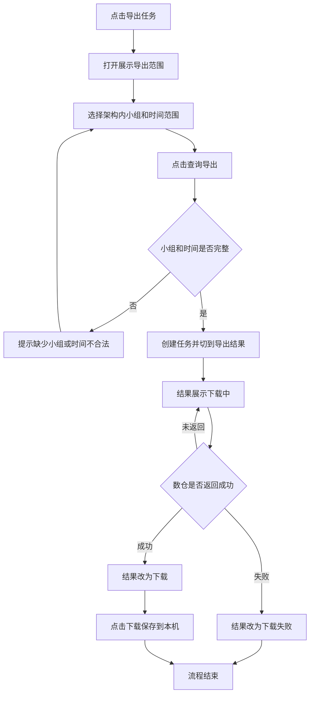

# PRD-绩效导出任务

## 一、修订记录

| 版本号 | 修改日期 | 修改原因 | 修订人 |
|--------|----------|----------|--------|
| v1.0 | 2026-10-14 | 初稿 | AI PRD Writer |

## 二、需求概述

- **背景/现状**：绩效页现有导出只能按当前列表直接下载，不能按指定小组和时间交给数仓计算，也不能回看历史结果。
- **需求目标**：用户发起导出任务后，系统按所选小组和时间提交数仓计算，并提供结果下载。
- **核心逻辑简述**：选择架构内小组和时间后点击查询导出；未返回为下载中，失败为下载失败，成功后可下载到本机。

## 三、术语表

| 术语 | 定义 |
|------|------|
| 数仓 | 按查询条件计算并生成导出文件的数据仓库 |
| 架构范围 | 当前登录账号所属组织内可查看的小组范围 |
| 导出任务 | 一次按小组和时间范围发起、由数仓计算的导出 |

## 四、调整范围

- 绩效页筛选区新增「导出任务」按钮，位于现有「导出」左侧。线索维度、家庭维度均展示。
- 新增「导出任务」弹窗，包含「导出范围」「导出结果」两个标签。
- 导出任务提交数仓，由数仓按小组和时间范围计算并回传结果。现有「导出」保持不变。

## 五、业务流程图

**导出任务**

## 六、可交互原型

在线预览：[点击查看可交互原型](https://pages.yc345.tv/yping-c78bba/performance-export-task/)

> 原型为可交互页面，点击链接即可体验选择小组、提交导出、查看下载中、下载失败和下载文件。

## 七、功能需求详细描述

#### 7.1 【新增】功能

**功能 / 按钮 / 弹窗类**

| 功能名称 | 功能类型 | 是否必填 | 交互说明 | 备注 |
|----------|----------|----------|----------|------|
| 导出任务 | 按钮 | 不适用 | 位于绩效页筛选区现有「导出」左侧，点击打开弹窗，默认停在「导出范围」 | 线索维度、家庭维度均展示 |
| 导出范围 | 标签 | 不适用 | 用于填写本次导出的小组和时间范围 | 与「导出结果」可来回切换 |
| 选择小组 | 选择器 | 是 | 可多选；仅展示当前账号架构范围内的小组，范围外小组不展示、不可选；勾选团队即选中其下全部小组 | 未选择时点击「查询导出」提示「请选择小组」 |
| 选择时间范围 | 时间选择器 | 是 | 选择开始时间和结束时间 | 未选择提示「请选择时间范围」；开始晚于结束时提示「开始时间不能晚于结束时间」 |
| 查询导出 | 按钮 | 不适用 | 校验通过后创建任务，自动切到「导出结果」，新记录置顶 | 校验不通过时留在「导出范围」，不创建任务 |
| 导出结果 | 标签 | 不适用 | 展示当前登录人发起的导出任务，按导出时间从新到旧排列 | 无记录时展示「暂无导出任务」 |
| 下载 | 按钮 | 不适用 | 仅在数仓返回成功后出现，点击将本次导出文件保存到本机 | 下载中、下载失败时不出现该按钮 |

**列表字段类**

| 字段名称 | 字段说明 | 字段来源 | 备注 |
|----------|----------|----------|------|
| 导出时间 | 点击「查询导出」的时间 | 任务创建时间 | 精确到秒 |
| 小组 | 本次选择的小组 | 导出范围中的选择 | 多个小组一并展示 |
| 查询时间 | 本次选择的开始时间至结束时间 | 导出范围中的时间范围 | 与导出时间不是同一字段 |
| 导出人 | 发起本次任务的登录人 | 当前登录账号 | |
| 导出结果 | 数仓返回状态 | 数仓回传 | 未返回为「下载中」，失败为「下载失败」，成功为「下载」 |

#### 7.4 状态与异常变更

| 涉及位置 | 变更动作 | 触发条件 | 系统行为 / 文案 |
|----------|----------|----------|------------------|
| 查询导出 | 新增 | 未选择小组 | 提示「请选择小组」，不创建任务 |
| 查询导出 | 新增 | 未选择开始或结束时间 | 提示「请选择时间范围」，不创建任务 |
| 查询导出 | 新增 | 开始时间晚于结束时间 | 提示「开始时间不能晚于结束时间」，不创建任务 |
| 查询导出 | 新增 | 小组和时间均合法 | 创建任务，切到「导出结果」，新记录置顶，导出结果为「下载中」 |
| 导出结果 | 新增 | 数仓尚未返回 | 显示「下载中」，不可下载 |
| 导出结果 | 新增 | 数仓返回失败 | 显示「下载失败」，不可下载 |
| 导出结果 | 新增 | 数仓返回成功 | 显示「下载」，点击后文件保存到本机 |
| 导出结果 | 新增 | 当前用户没有导出任务 | 展示「暂无导出任务」 |

提交成功后弹窗保持打开，并停在「导出结果」。关闭弹窗后回到绩效列表，已创建的任务仍保留在「导出结果」中。

## 八、埋点与数据需求

本次无新增埋点需求。

## 九、权限说明

- 「导出任务」沿用绩效页现有访问权限，不新增角色。
- 小组选择受当前账号架构范围限制，只能选择自己架构内的小组。
- 「导出结果」只展示当前登录人发起的任务。
