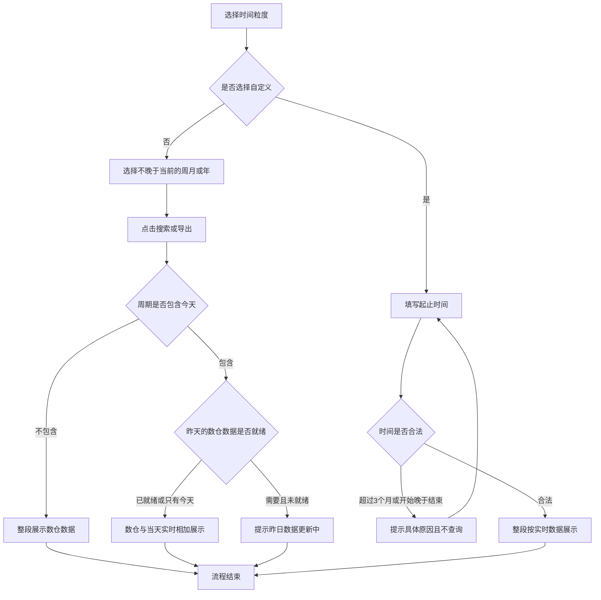

# PRD-绩效时间粒度筛选

## 一、修订记录

| 版本号 | 修改日期 | 修改原因 | 修订人 |
|--------|----------|----------|--------|
| v1.0 | 2026-10-21 | 初稿 | AI PRD Writer |
| v1.1 | 2026-10-30 | 切到自定义后不带出默认时间，由用户手动填写 | AI PRD Writer |

## 二、需求概述

- **背景/现状**：绩效页只能按起止时间实时查询，不能按周、月、年查看，也不能用数仓截至昨日的数据。
- **需求目标**：选择周、月、年或自定义后，按对应周期筛选，并用约定的数据来源展示。
- **核心逻辑简述**：周、月、年展示数仓截至昨日的数据与当天实时数据之和；自定义沿用起止时间实时查询，跨度不超过3个月。

## 三、术语表

| 术语 | 定义 |
|------|------|
| 时间粒度 | 周、月、年、自定义四种筛选方式 |
| 自然周 | 周一 0 点至周日 23 点 59 分 59 秒 |
| 自然月 | 当月 1 日 0 点至当月最后一天 23 点 59 分 59 秒 |
| 自然年 | 当年 1 月 1 日 0 点至 12 月 31 日 23 点 59 分 59 秒 |
| 数仓昨日数据 | 数仓已经算完的、截止到昨天 23 点 59 分 59 秒的绩效数据 |
| 当天实时数据 | 今天 0 点至当前时刻已经产生的绩效数据 |

## 四、调整范围

- 绩效页线索维度、家庭维度的时间条件左侧新增时间粒度，选项为周、月、年、自定义。
- 周、月、年改为选择一个自然周期；自定义沿用现在的开始时间至结束时间。
- 自定义的时间跨度不能超过 3 个月，查询和导出仍走实时数据。
- 周、月、年的查询和导出改为数仓昨日数据与当天实时数据相加后展示。
- 其他筛选项、列表字段、导出入口位置沿用现有配置。

## 五、业务流程图

**按时间粒度查询**

## 六、可交互原型

在线预览：[点击查看可交互原型](https://pages.yc345.tv/yping-c78bba/performance-time-grain/)

> 原型为带变更批注的可交互页面。打开即可看到本次变更编号；收起右侧批注栏后连线隐藏，点击编号会重新打开批注。

## 七、功能需求详细描述

#### 7.1 【新增】时间粒度

| 功能名称 | 功能类型 | 是否必填 | 交互说明 | 备注 |
|----------|----------|----------|----------|------|
| 时间粒度 | 选择器 | 是 | 时间条件左侧增加周、月、年、自定义，打开页面默认选中月 | 线索维度和家庭维度都展示 |

| 标题 | 改前 | 改后 |
|------|------|------|
| 新增时间粒度 | 无此选项 | 可选周、月、年、自定义，默认月。线索维度和家庭维度都展示。 |

下拉展开后依次为周、月、年、自定义。当前项为蓝色选中态。再次点击或点击空白处收起。两个页签各自记住自己的粒度，互不影响。

#### 7.2 【修改】时间选择

| 功能/字段名称 | 修改项 | 改前 | 改后 | 备注 |
|---------------|--------|------|------|------|
| 时间条件 | 选择方式 | 只有开始时间和结束时间，默认本月1日0点至今天23点59分 | 周选自然周，月选自然月，年选自然年，都不能晚于当前周期。自定义仍是开始时间至结束时间。切到周、月、年时立即带出当前周期；切到自定义后开始时间和结束时间为空，由用户手动填写。点击搜索才刷新列表。 | 周期名称展示完整自然周期，取数截止到今天 |
| 自定义时间 | 跨度与查询 | 起止时间没有三个月上限，查询为实时数据 | 仍用起止时间实时查询。结束时间不能晚于开始日期加3个自然月当天的23点59分59秒。超出时提示「时间范围不能超过3个月」，不查询、不导出。开始时间晚于结束时间时提示「开始时间不能晚于结束时间」。未选择时间时提示「请选择时间范围」。从首页带入当天时间时，粒度定为自定义。 | 搜索、导出都做这三项校验 |

切换粒度时带出的时间：

| 切换结果 | 带出的时间 |
|----------|------------|
| 周 | 包含今天的自然周 |
| 月 | 当前月 |
| 年 | 当前年 |
| 自定义 | 不带出时间。开始时间和结束时间都为空，需手动填写 |

时间是否合法：

| 条件 | 系统行为 |
|------|----------|
| 自定义未选开始或结束时间 | 提示「请选择时间范围」，不查询、不导出 |
| 开始时间晚于结束时间 | 提示「开始时间不能晚于结束时间」，不查询、不导出，列表保持上次结果 |
| 结束时间晚于「开始日期加 3 个自然月」当天 23 点 59 分 59 秒 | 提示「时间范围不能超过3个月」，不查询、不导出，列表保持上次结果 |
| 开始日在目标月不存在 | 加月时取该月最后一天。1 月 31 日加 3 个月，最晚到 4 月 30 日 23 点 59 分 59 秒 |
| 正好等于 3 个月 | 允许。7 月 21 日 0 点起，最晚可到 10 月 21 日 23 点 59 分 59 秒 |
| 周、月、年晚于当前周期 | 不可选。已开始但尚未结束的当前周、当前月、当前年可选 |

打开页面时按当前月直接查询，沿用现有进入即查询。从首页今日数据进入时，粒度定为自定义，起止时间带入当天 0 点至 23 点 59 分 59 秒，并按实时数据查询。

#### 7.3 【修改】数据口径

| 功能/字段名称 | 修改项 | 改前 | 改后 | 备注 |
|---------------|--------|------|------|------|
| 列表和导出 | 数据来源 | 不论所选时间，列表和导出都按实时数据查询 | 周、月、年的列表和导出，用数仓截至昨日的数据加上当天实时数据，同一指标只展示一行。不含今天的已结束周期只使用数仓数据。自定义整段实时查询和导出。次数、时长、人数、金额先相加，比率和客单价按相加后的总量重算。 | 筛选区下方展示当前口径说明 |

口径判定：

| 条件 | 展示 |
|------|------|
| 周、月或年，周期包含今天，且昨天及以前的数仓已就绪 | 昨天及以前取数仓，当天取实时，相加后展示。说明示例：「10月1日至10月20日为数仓数据，10月21日为实时数据，相加后展示」 |
| 周、月或年，周期包含今天，但没有昨天及以前 | 只展示当天实时数据。说明为「该周期只有今天，展示当天实时数据」 |
| 周、月或年，周期不包含今天 | 整段只展示数仓数据。说明为「该周期不含今天，整段为数仓数据」 |
| 自定义，且时间合法 | 整段实时查询。说明为「按所选时间实时查询」 |

同一指标只展示合并后的一行，不把数仓和当天拆成两行。拨打次数、通话时长、人数、金额直接相加。接通率、转化率、客单价按相加后的总量重算，算法沿用现有配置，不把两段比率直接相加。今天的实时部分取今天 0 点至当前时刻，与昨天的数仓数据不重复计算。当前周、月、年里今天之后的日期不取数。

导出使用当前已选的粒度和时间，校验规则与搜索相同，数据来源与同一次搜索相同。

#### 7.4 状态与异常变更

| 涉及位置 | 变更动作 | 触发条件 | 系统行为 / 文案 |
|----------|----------|----------|------------------|
| 重置 | 修改 | 点击重置 | 粒度回到月，时间为当前月，按数仓昨日数据加当天实时数据重新查询。改前为重置到本月1日0点至今天23点59分并按实时数据查询 |
| 搜索 | 新增 | 自定义时间不合法 | 按钮保持可点。提示对应原因，不刷新列表 |
| 导出 | 新增 | 自定义时间不合法 | 按钮保持可点。提示对应原因，不下载文件 |
| 列表 | 新增 | 周、月、年需要昨天及以前的数仓数据，但数仓尚未就绪 | 提示「昨日数据更新中，请稍后重试」，不展示残缺数字 |
| 导出 | 新增 | 同上 | 提示「昨日数据更新中，请稍后重试」，不下载文件 |
| 列表 | 沿用 | 实时查询失败 | 沿用现有失败表现，列表清空 |
| 查询结果 | 新增 | 周、月、年查询成功且结果为空 | 沿用现有空列表表现 |

搜索、重置、导出在上述场景中均保持可点击。校验不通过或数仓未就绪时，停在当前页，不跳转。

## 八、埋点与数据需求

本次无新增埋点需求。

## 九、权限说明

本次不新增权限。线索维度、家庭维度沿用现有可见范围，能看到对应页签就能使用时间粒度。导出沿用现有导出权限。
