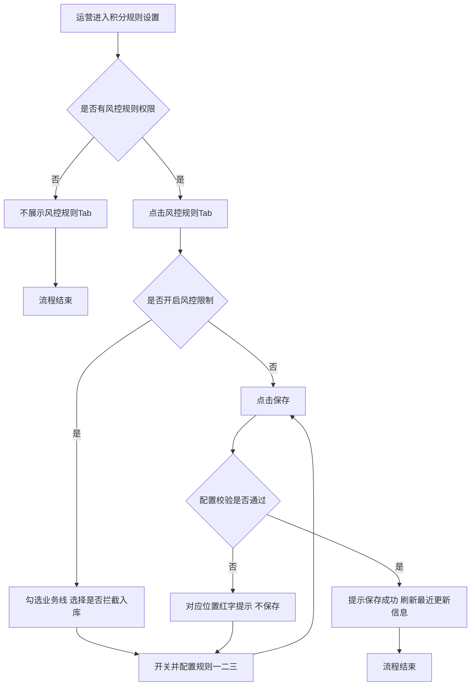
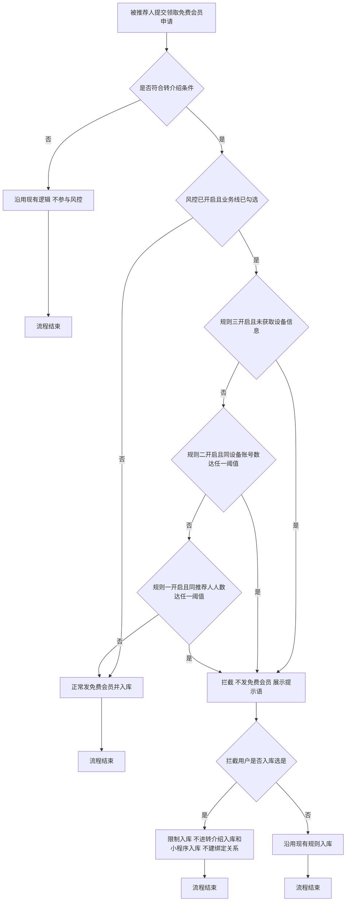

# PRD-积分规则设置新增风控规则

## 一、修订记录

| 版本号 | 修改日期 | 修改原因 | 修订人 |
|--------|----------|----------|--------|
| v1.0 | 2026-11-13 | 初稿 | AI PRD Writer |
| v1.1 | 2026-11-17 | 补充不能领取权益提示语、有效申请定义、拦截入库口径与限制展示；规则二支持新增；明确仅拦截符合转介绍条件的新用户 | AI PRD Writer |
| v1.2 | 2026-11-17 | 不能领取权益提示语改为前端固定文案，取消配置项；补充重试后可能通过活跃入库的边界说明 | AI PRD Writer |

## 二、需求概述

- **背景/现状**：符合转介绍条件的新用户领取免费会员时，系统未做频次与设备校验，存在批量刷号套取免费会员的风险。
- **需求目标**：当运营开启风控限制时，系统应按配置规则拦截异常领取，不发免费会员，并可同时拦截入库。
- **核心逻辑简述**：当符合转介绍条件的新用户在已勾选业务线提交领取申请时，系统依次校验设备信息缺失、同设备多账号、同推荐人频次三条规则；命中任一已开启规则即拦截，前端展示固定提示语，并按配置决定是否限制入库。

## 三、术语表

| 术语 | 定义 |
|------|------|
| 推荐人 | 分享海报或链接、发起转介绍的老用户 |
| 被推荐人 | 通过推荐人的海报或链接进入小程序的新用户 |
| 符合转介绍条件的新用户 | 同时满足：通过老用户分享的海报或链接进入小程序且推荐人不是本人；推荐人积分未被禁用；满足转介绍新用户条件（沿用现有判定） |
| 有效申请 | 符合转介绍条件的新用户提交的领取免费会员申请。同一用户多次提交只计 1 人 / 1 个账号；被拦截的申请也计入统计 |
| 时间窗口 | 以本次申请时间为终点向前回溯的时长，如 60 秒、10 分钟、24 小时 |
| 拦截 | 有效申请命中风控规则，本次不发免费会员，并在前端展示不能领取权益提示语 |
| 限制入库 | 被拦截用户不进行转介绍入库和转介绍小程序入库，也不建立转介绍绑定关系 |

## 四、调整范围

1. 积分商城 → 积分规则设置：新增「风控规则」Tab。
2. 风控规则 Tab 新增配置项：是否开启风控限制、风控业务线（多选）、拦截用户是否入库。
3. 风控规则 Tab 新增有效申请说明，以及三条可单独开关、单独配置的规则：同一推荐人频次限制（支持新增）、同一设备多账号限制（支持新增）、设备信息缺失限制。
4. 规则表「限制」列按「拦截用户是否入库」展示「限制入库&不发免费会员」或「不发免费会员」。
5. 风控规则配置的保存、重置与校验，以及最近更新时间与操作人展示。
6. 符合转介绍条件的新用户领取免费会员时，按已保存的风控配置校验与拦截；拦截入库时同步拦截转介绍入库、转介绍小程序入库及转介绍绑定关系。
7. 用户端：被拦截时前端展示固定的不能领取权益提示语。
8. 新增风控规则 Tab 的查看与编辑权限。

## 五、业务流程图

**风控规则配置流程**

**新用户领取免费会员风控校验流程**

## 六、可交互原型

在线预览：[点击查看可交互原型](https://pages.yc345.tv/yping-c78bba/point-rule-risk-control/)

> 原型为带变更批注的可交互 HTML 页面。打开即可看到本次变更编号；收起右侧批注栏后连线隐藏，点击编号会重新打开批注。

## 七、功能需求详细描述

### 7.1 【新增】功能

#### 7.1.1 【新增】风控规则Tab

| 功能名称 | 功能类型 | 是否必填 | 交互说明 | 备注 |
|----------|----------|----------|----------|------|
| 风控规则 Tab | Tab | 不适用 | 在「电销」「体验营」之后新增「风控规则」Tab，用于统一配置被推荐人领取免费会员时的风控拦截规则。 | 有风控规则配置权限的账号可见；无权限不展示 |

#### 7.1.2 【新增】风控规则配置项

| 功能名称 | 功能类型 | 是否必填 | 交互说明 | 备注 |
|----------|----------|----------|----------|------|
| 是否开启风控限制 | 单选：是 / 否 | 是 | 选「否」：仅展示本字段，不做风控校验；选「是」：展示其余配置，并对符合转介绍条件的新用户按配置校验。 | 默认「否」 |
| 风控业务线 | 多选：电销 / 体验营 | 是 | 可同时勾选电销与体验营；风控规则只对已勾选业务线的领取申请生效。 | 至少勾选一个；仅开启风控限制时展示 |
| 拦截用户是否入库 | 单选：是 / 否 | 是 | 选「是」：被拦截用户不发免费会员，且限制入库，即不进行转介绍入库、转介绍小程序入库，也不建立转介绍绑定关系；规则表「限制」列展示「限制入库&不发免费会员」。选「否」：被拦截用户仅不发免费会员，入库与绑定关系沿用现有规则；「限制」列展示「不发免费会员」。 | 默认「否」；切换后「限制」列实时更新；仅开启风控限制时展示 |

#### 7.1.3 【新增】风控规则

**有效申请说明（展示在规则列表上方）：**

- 风控只对**符合转介绍条件的新用户**校验与拦截，需同时满足：
  1. 通过老用户分享的海报或链接进入小程序，且推荐人不是本人；
  2. 推荐人积分未被禁用；
  3. 满足转介绍新用户条件（沿用现有判定）。
- 这类用户提交的领取免费会员申请即为「有效申请」，是三条规则的统计口径。
- 同一用户多次提交只计 1 人 / 1 个账号；被拦截的申请也计入统计。
- 不符合转介绍条件的用户不参与风控校验，也不计入统计，沿用现有逻辑。被拦截入库的用户重试后，如已不符合转介绍条件，可能通过现有活跃入库进入线索库；活跃入库不在本次拦截范围内。

**规则配置：** 三条规则各自独立开关，关闭时收起该规则的配置区，且不参与校验。「限制」列按「拦截用户是否入库」展示。

| 规则 | 校验对象 | 可配置项 | 默认值 | 触发点 |
|------|----------|----------|--------|--------|
| 规则一：同一推荐人频次限制 | 同一推荐人在时间窗口内，提交有效申请的不同被推荐人数（含本次） | 开关；每条子规则的时间、单位（秒 / 分钟 / 小时）、人数；可新增、删除子规则 | 开启；60秒≥5人、10分钟≥15人、24小时≥30人 | 第 N 个不同用户提交有效申请时，从第 N 个起拦截 |
| 规则二：同一设备多账号限制 | 同一设备在时间窗口内，提交有效申请的不同账号数（含本次） | 开关；每条子规则的时间、单位、账号数；可新增、删除子规则 | 开启；24小时≥3个 | 第 N 个不同账号提交有效申请时，从第 N 个起拦截 |
| 规则三：设备信息缺失限制 | 有效申请提交时是否获取到设备信息 | 仅开关 | 开启 | 未获取到设备信息即拦截 |

**规则一、规则二子规则操作（两条规则交互一致）：**

- 「新增」按钮：子规则少于 5 条时可点；已有 5 条时置灰。新增行时间、数量为空，单位默认「分钟」。
- 「删除」按钮：子规则多于 1 条时可点；仅剩 1 条时置灰。
- 「触发点」列根据数量自动展示：规则一为「第N个不同用户提交有效申请」，规则二为「第N个不同账号提交有效申请」。
- 同一规则内多条子规则同时生效，命中任一条即拦截。

**计算逻辑举例（规则一，60秒≥5人）：** 推荐人 A 的被推荐人提交有效申请时，系统统计此前 60 秒内（含本次）A 名下提交有效申请的不同用户数。达到 5 人时，第 5 个及之后的申请都被拦截，前 4 个正常发放。

**校验顺序：** 规则三 → 规则二 → 规则一，命中任一条即拦截，不再继续校验。

**拦截结果：**

| 拦截用户是否入库 | 免费会员 | 转介绍入库 / 转介绍小程序入库 | 转介绍绑定关系 | 用户端 |
|------------------|----------|-------------------------------|----------------|--------|
| 是 | 不发放 | 不入库 | 不建立 | 展示不能领取权益提示语 |
| 否 | 不发放 | 沿用现有规则 | 沿用现有规则 | 展示不能领取权益提示语 |

**不能领取权益提示语（前端固定文案，不做配置）：**

| 触发条件 | 展示位置 | 提示语 |
|----------|----------|--------|
| 命中规则一、规则二或规则三任一条 | 用户点击领取免费会员时，以轻提示展示 | 很抱歉，您暂不符合领取条件，无法领取免费会员 |

- 三条规则统一使用同一条提示语，不透出具体风控原因，避免被识别后绕过。
- 提示语展示后停留在当前页面，领取按钮保持可点；再次点击仍按风控规则重新校验。

### 7.4 状态与异常变更

点击「保存」时校验配置。校验不通过时，在对应位置展示红字提示且不保存；校验通过时提示「保存成功」，并刷新最近更新时间和操作人。保存后对新提交的领取申请生效。

| 涉及位置 | 变更动作 | 触发条件 | 系统行为 / 文案 |
|----------|----------|----------|------------------|
| 保存按钮 | 新增 | 开启风控限制，且风控业务线一个都未勾选 | 提示「请至少选择一个风控业务线」，不保存 |
| 保存按钮 | 新增 | 开启风控限制，但三条规则都已关闭 | 提示「开启风控限制后，至少开启一条规则」，不保存 |
| 规则一 / 规则二 | 新增 | 时间为空或小于 1 | 提示「第N行：时间窗口需为正整数」，不保存 |
| 规则一 / 规则二 | 新增 | 时间折算后超过 24 小时 | 提示「第N行：时间窗口最长不超过24小时」，不保存 |
| 规则一 / 规则二 | 新增 | 人数或账号数为空或小于 2 | 提示「第N行：阈值需为不小于2的整数」，不保存 |
| 规则一 / 规则二 | 新增 | 同一规则内两行时间窗口折算后相同 | 提示「第N行：时间窗口与第M行重复」，不保存 |
| 输入框 | 新增 | 数量或时间输入非数字 | 自动过滤，仅保留整数 |
| 重置按钮 | 新增 | 点击重置 | 恢复为上次保存的配置，清除红字提示 |
| 是否开启风控限制 | 新增 | 选「否」并保存 | 保留其余配置但不生效；下次选「是」时回显上次配置 |

## 八、埋点与数据需求

## 九、权限说明

| 权限 | 说明 |
|------|------|
| 风控规则 Tab 权限 | 新增独立权限，与「电销」「体验营」Tab 权限分开配置；有权限的账号可见并编辑风控规则 Tab，无权限不展示 |
