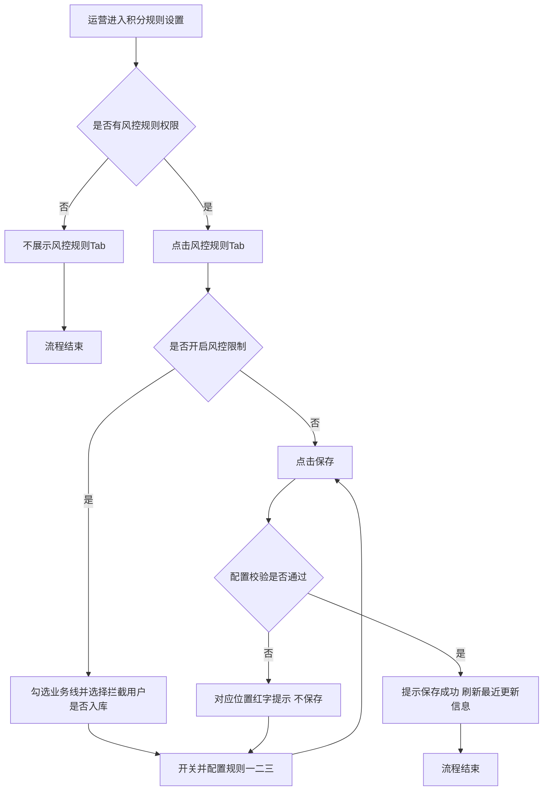
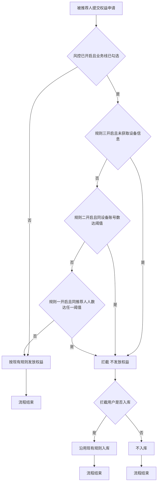

# PRD-积分规则设置新增风控规则

## 一、修订记录

| 版本号 | 修改日期 | 修改原因 | 修订人 |
|--------|----------|----------|--------|
| v1.0 | 2026-11-13 | 初稿 | AI PRD Writer |

## 二、需求概述

- **背景/现状**：被推荐人申请发放转介绍权益时，系统未做频次与设备校验，存在批量刷号套取权益的风险。
- **需求目标**：当运营开启风控限制时，系统应按配置规则拦截异常申请，不发放权益。
- **核心逻辑简述**：当被推荐人在已勾选的业务线提交权益申请时，系统依次校验设备信息缺失、同设备多账号、同推荐人频次三条规则，命中任一已开启规则则不发放权益，并按配置决定该用户是否入库。

## 三、术语表

| 术语 | 定义 |
|------|------|
| 推荐人 | 分享邀请、发起转介绍的老用户 |
| 被推荐人 | 通过推荐人邀请进入并申请发放权益的新用户 |
| 有效申请 | 被推荐人提交的、符合现有权益领取条件的权益发放申请 |
| 时间窗口 | 以本次申请时间为终点向前回溯的时长，如 60 秒、10 分钟、24 小时 |
| 拦截 | 申请命中风控规则，本次不发放权益 |

## 四、调整范围

1. 积分商城 → 积分规则设置：新增「风控规则」Tab。
2. 风控规则 Tab 新增配置项：是否开启风控限制、风控业务线（多选）、拦截用户是否入库。
3. 风控规则 Tab 新增三条可单独开关、单独配置的规则：同一推荐人频次限制、同一设备多账号限制、设备信息缺失限制。
4. 风控规则配置的保存、重置与校验，以及最近更新时间与操作人展示。
5. 被推荐人申请发放权益时，按已保存的风控配置进行校验与拦截。
6. 新增风控规则 Tab 的查看与编辑权限。

## 五、业务流程图

**风控规则配置流程**

**被推荐人申请权益风控校验流程**

## 六、可交互原型

在线预览：[点击查看可交互原型](https://pages.yc345.tv/yping-c78bba/point-rule-risk-control/)

> 原型为带变更批注的可交互 HTML 页面。打开即可看到本次变更编号；收起右侧批注栏后连线隐藏，点击编号会重新打开批注。

## 七、功能需求详细描述

### 7.1 【新增】功能

#### 7.1.1 【新增】风控规则Tab

| 功能名称 | 功能类型 | 是否必填 | 交互说明 | 备注 |
|----------|----------|----------|----------|------|
| 风控规则 Tab | Tab | 不适用 | 在「电销」「体验营」之后新增「风控规则」Tab，用于统一配置被推荐人申请发放权益时的风控拦截规则。 | 有风控规则配置权限的账号可见；无权限不展示 |

#### 7.1.2 【新增】风控规则配置项

| 功能名称 | 功能类型 | 是否必填 | 交互说明 | 备注 |
|----------|----------|----------|----------|------|
| 是否开启风控限制 | 单选：是 / 否 | 是 | 选「否」：仅展示本字段，不做风控校验；选「是」：展示风控业务线、拦截用户是否入库和三条风控规则，并按配置校验。 | 默认「否」 |
| 风控业务线 | 多选：电销 / 体验营 | 是 | 可同时勾选电销与体验营；风控规则只对已勾选业务线的权益申请生效。 | 至少勾选一个；仅「是否开启风控限制」为「是」时展示 |
| 拦截用户是否入库 | 单选：是 / 否 | 是 | 选「是」：被拦截用户不发权益，但沿用现有规则入库；选「否」：被拦截用户不发权益，也不入库。 | 默认「否」；仅「是否开启风控限制」为「是」时展示 |

#### 7.1.3 【新增】风控规则

三条规则各自独立开关，关闭时收起该规则的配置区，且不参与校验。所有规则的限制结果均为「不发放权益」。

| 规则 | 校验对象 | 可配置项 | 默认值 | 触发点 |
|------|----------|----------|--------|--------|
| 规则一：同一推荐人频次限制 | 同一推荐人在时间窗口内，提交有效申请的不同被推荐人数（含本次） | 开关；每条子规则的时间、单位（秒 / 分钟 / 小时）、人数；可新增、删除子规则 | 开启；60秒≥5人、10分钟≥15人、24小时≥30人 | 第 N 个不同用户提交有效申请时，从第 N 个起不发放权益 |
| 规则二：同一设备多账号限制 | 同一设备在时间窗口内，提交有效申请的不同账号数（含本次） | 开关；时间、单位、账号数 | 开启；24小时≥3个 | 第 N 个不同账号提交有效申请时，从第 N 个起不发放权益 |
| 规则三：设备信息缺失限制 | 被推荐人提交申请时是否获取到设备信息 | 仅开关 | 开启 | 未获取到设备信息即不发放权益 |

**规则一子规则操作：**

- 「新增」按钮：子规则少于 5 条时可点；已有 5 条时置灰。新增行时间、人数为空，单位默认「分钟」。
- 「删除」按钮：子规则多于 1 条时可点；仅剩 1 条时置灰。
- 「触发点」列根据人数自动展示「第N个不同用户提交有效申请」。规则二同理，展示「第N个不同账号提交有效申请」。

**计算逻辑举例（规则一，60秒≥5人）：** 推荐人 A 的被推荐人提交申请时，系统统计此前 60 秒内（含本次）A 名下提交有效申请的不同用户数。达到 5 人时，第 5 个及之后的申请都不发放权益，前 4 个正常发放。多条子规则同时生效，命中任一条即拦截。

**校验顺序：** 规则三 → 规则二 → 规则一，命中任一条即拦截，不再继续校验。

### 7.4 状态与异常变更

点击「保存」时校验配置。校验不通过时，在对应位置展示红字提示且不保存；校验通过时提示「保存成功」，并刷新最近更新时间和操作人。保存后对新提交的权益申请生效。

| 涉及位置 | 变更动作 | 触发条件 | 系统行为 / 文案 |
|----------|----------|----------|------------------|
| 保存按钮 | 新增 | 开启风控限制，且风控业务线一个都未勾选 | 提示「请至少选择一个风控业务线」，不保存 |
| 保存按钮 | 新增 | 开启风控限制，但三条规则都已关闭 | 提示「开启风控限制后，至少开启一条规则」，不保存 |
| 规则一 / 规则二 | 新增 | 时间为空或小于 1 | 提示「第N行：时间窗口需为正整数」（规则二不带行号），不保存 |
| 规则一 / 规则二 | 新增 | 时间折算后超过 24 小时 | 提示「时间窗口最长不超过24小时」，不保存 |
| 规则一 / 规则二 | 新增 | 人数或账号数为空或小于 2 | 提示「阈值需为不小于2的整数」，不保存 |
| 规则一 | 新增 | 两行时间窗口折算后相同 | 提示「第N行：时间窗口与第M行重复」，不保存 |
| 输入框 | 新增 | 输入非数字 | 自动过滤，仅保留整数 |
| 重置按钮 | 新增 | 点击重置 | 恢复为上次保存的配置，清除红字提示 |
| 是否开启风控限制 | 新增 | 选「否」并保存 | 保留其余配置但不生效；下次选「是」时回显上次配置 |

## 八、埋点与数据需求

## 九、权限说明

| 权限 | 说明 |
|------|------|
| 风控规则 Tab 权限 | 新增独立权限，与「电销」「体验营」Tab 权限分开配置；有权限的账号可见并编辑风控规则 Tab，无权限不展示 |
