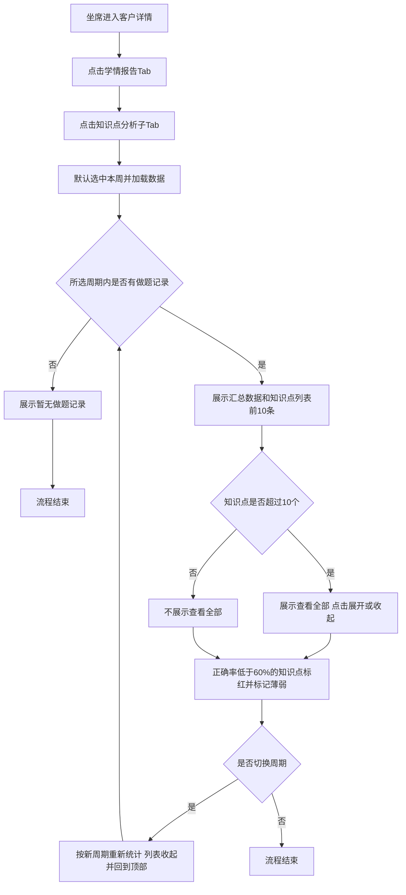

# PRD-学情报告-知识点分析

## 一、修订记录

| 版本号 | 修改日期 | 修改原因 | 修订人 |
|--------|----------|----------|--------|
| v1.0 | 2026-11-13 | 初稿 | AI PRD Writer |

## 二、需求概述

- **背景/现状**：当坐席查看客户学情时，系统只提供学情报告、学情分析、学科分析，无法看到学生具体在哪些知识点上做题、错得多。
- **需求目标**：系统应在学情报告下提供知识点维度的做题分布，让坐席快速定位学生的薄弱知识点。
- **核心逻辑简述**：当坐席打开「知识点分析」子Tab 时，系统按所选自然周汇总学生做题记录，按知识点列出做题数与正确率，并标记正确率低于 60% 的薄弱知识点。

## 三、术语表

| 术语 | 定义 |
|------|------|
| 薄弱知识点 | 统计周期内，该知识点做题正确率低于 60% 的知识点 |
| 正确率 | 该知识点答对题数 ÷ 该知识点做题数，四舍五入取整数百分比 |

## 四、调整范围

- 客户详情 → 学情报告 Tab：新增「知识点分析」子Tab
- 知识点分析：新增本周 / 上周统计周期切换
- 知识点分析：新增「习题内容分布」模块，含汇总数据、知识点做题列表、薄弱知识点标记、展开收起、空状态
- 数据侧：按学生、自然周、知识点汇总做题数、答对数和做题时长，口径与学情报告现有做题数据保持一致

## 五、业务流程图

**查看知识点分析**

## 六、可交互原型

在线预览：[点击查看可交互原型](https://pages.yc345.tv/yping-c78bba/study-report-knowledge-analysis/)

> 原型为带变更批注的可交互 HTML 页面。打开即可看到本次变更编号；收起右侧批注栏后连线隐藏，点击编号会重新打开批注。

## 七、功能需求详细描述

### 7.1 【新增】功能

#### 7.1.1 【新增】知识点分析子Tab

| 功能名称 | 功能类型 | 是否必填 | 交互说明 | 备注 |
|----------|----------|----------|----------|------|
| 知识点分析 | 子Tab | 不适用 | 位于「学情报告」Tab 下、「学科分析」之后；点击后才加载数据 | 改前：子Tab 只有学情报告、学情分析、学科分析；改后：依次为学情报告、学情分析、学科分析、知识点分析。未获取到用户编号时，沿用现有「未获取到用户id」提示 |

#### 7.1.2 【新增】统计周期

| 功能名称 | 功能类型 | 是否必填 | 交互说明 | 备注 |
|----------|----------|----------|----------|------|
| 本周 / 上周 | 切换按钮 | 不适用 | 默认选中「本周」；切换后按新周期重新统计，列表收起为前 10 条并回到顶部 | 本周：本周一 0 点至当前时间；上周：上周一 0 点至上周日 24 点 |

#### 7.1.3 【新增】习题内容分布

**汇总与列表**

| 字段名称 | 字段说明 | 字段来源 | 备注 |
|----------|----------|----------|------|
| 汇总数据 | 文案「做题N个，涉及知识点N个，总时长X小时Y分钟」 | 统计周期内该学生的做题记录 | 做题数=做题总题数；涉及知识点=去重知识点个数；总时长不足 1 小时只显示分钟 |
| 学科 | 知识点所属学科 | 知识点所属学科 | — |
| 知识点 | 知识点名称 | 题目关联的知识点 | 名称过长时换行展示 |
| 做题数 | 该知识点下做题总数 | 做题记录 | — |
| 正确率 | 答对题数 ÷ 做题数 | 做题记录 | 四舍五入取整数百分比 |

**排序与展示规则**

| 规则 | 说明 |
|------|------|
| 排序 | 按做题数从高到低；做题数相同时，正确率低的排前面 |
| 默认条数 | 默认展示前 10 条 |
| 查看全部 | 知识点超过 10 个时，底部展示「查看全部N个」，点击展开全部，文案变为「收起」；不超过 10 个时不展示 |

**薄弱知识点标记**

| 条件 | 展示 |
|------|------|
| 正确率 < 60% | 整行浅红底，正确率红字，知识点名称后加「薄弱」标签 |
| 正确率 ≥ 60% | 正常展示 |

列表下方固定展示说明文案「注：正确率低于 60% 标记为薄弱知识点」。

### 7.4 状态与异常变更

| 涉及位置 | 变更动作 | 触发条件 | 系统行为 / 文案 |
|----------|----------|----------|------------------|
| 习题内容分布 | 新增 | 所选周期内没有做题记录 | 不展示汇总和列表，展示「本周暂无做题记录」或「上周暂无做题记录」 |
| 习题内容分布 | 新增 | 数据加载失败 | 沿用学情报告现有加载失败提示 |

## 八、埋点与数据需求

## 九、权限说明

沿用客户详情「学情报告」Tab 现有查看权限，不新增权限。

## 待确认事项

| 事项 | 当前方案 |
|------|----------|
| 薄弱知识点阈值 | 暂定正确率低于 60% |
| 数据口径 | 暂定与学情报告现有做题数据一致，需研发确认数据来源 |
