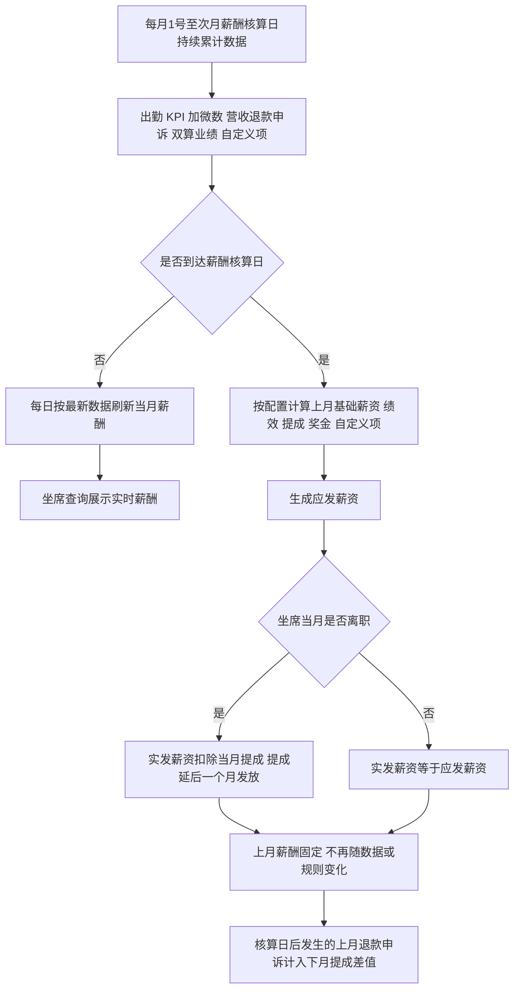
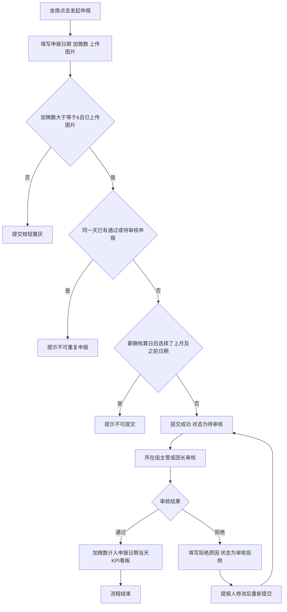
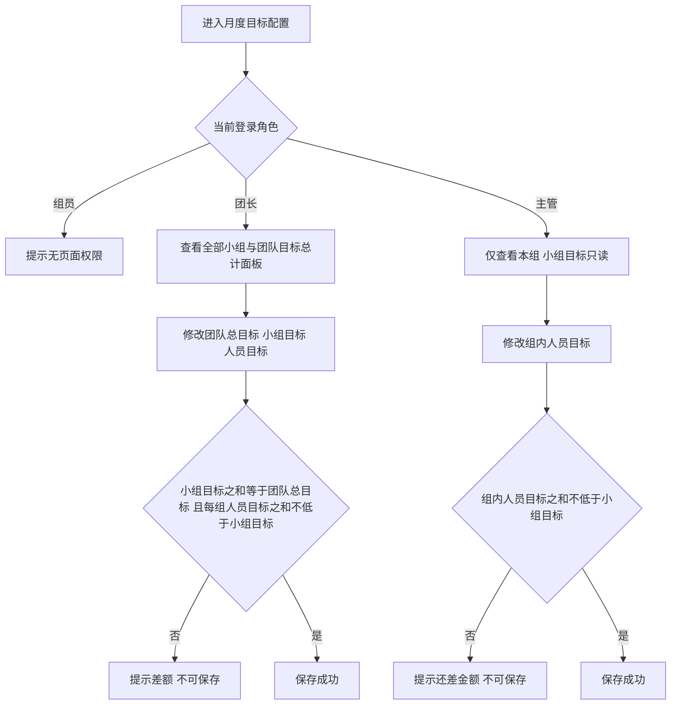

# PRD-体验营薪酬体系线上化

## 一、修订记录

| 版本号 | 修改日期 | 修改原因 | 修订人 |
|-|-|-|-|
| v1.0 | 2026-11-25 | 初稿 | AI PRD Writer |

## 二、需求概述

- **背景/现状**：体验营一线销售薪酬目前由人工汇总飞书排班、CRM营收、质检与KPI表格后线下核算。
- **需求目标**：当每月薪酬核算日到达时，系统应按配置规则自动生成体验营一线销售上月薪酬，并支持查询、核对与导出。
- **核心逻辑简述**：月薪 = 基础薪资 + 绩效 + 提成 + 奖金 + 自定义项；计算所需的出勤、KPI、加微数、目标、营收数据均在系统内产生或配置。

## 三、术语表

| 术语 | 定义 |
|-|-|
| 当月GMV | 净GMV + 双算业绩，用于提成、GMV排名、新人王、完成率计算 |
| 净GMV | 当月营收 − 当月退款；订单实付金额超过 49 元才计入营收 |
| 双算业绩 | 经质检审核需额外计入坐席的业绩，在「坐席查询 → 双算业绩」录入 |
| 当月目标 | 「月度目标配置」中该坐席当月的人员目标 |
| 目标完成率 | 当月GMV ÷ 当月目标 × 100% |
| 业绩达标 | 目标完成率 ≥ 100% |
| 完整月 | 飞书入职时间的次月为第一个完整月 |
| 新人保护期 | 入职当月 + 2 个完整月 |
| 老员工 | 入职第 3 个完整月起（即入职第 4 个月起）在职的员工 |
| 薪酬核算日 | 每月生成上月薪酬的日期，默认每月 5 号；生成后上月薪酬固定不变 |
| 有效通话 | 系统电话或企微通话中单通时长 ≥ 10 秒的通话，不含私人电话 |
| 期次当期转化率 | 结营组合品净付费人数 ÷ 所选等级线索数 × 100% |
| 排名分位 | 当月GMV排名 ÷ 参与排名人数 × 100% |

## 四、调整范围

1. **菜单**：体验营CRM新增一级菜单「薪酬体系」及六个二级菜单；「配置」菜单移除「月度目标配置」。
2. **薪酬自动核算**：按月计算一线销售的基础薪资、绩效、提成、奖金、自定义项，生成应发与实发薪资。
3. **页面**：

   - 坐席查询（薪酬、双算业绩）
   - 实际出勤
   - 坐席薪酬配置（底薪、提成、奖金、自定义项、基础配置）
   - KPI看板
   - 加微数申报
   - 月度目标配置（由「配置」迁入并调整权限与校验）
   - 线索投放计划（「配置」菜单下，期数配置新增「当期转化考核等级」）
   - 架构管理（「坐席管理」菜单下，新增岗位、离职时间字段及批量导入离职时间）
4. **数据对接**：

   - 通话数据取「数据统计 → 外呼数据统计」
   - 营收、退款、申诉取CRM订单数据
   - 排班、请假、入离职时间取飞书（入离职时间支持人工导入修正）
   - 「架构管理」新增「学段」「身份（组员 / 主管 / 团长）」字段
5. **不在本期范围**：主管、团长薪酬核算。

## 五、业务流程图

**月度薪酬生成流程**

**加微数申报与审核流程**

**月度目标配置流程**

## 六、可交互原型

在线预览：[点击查看可交互原型](https://pages.yc345.tv/yping-c78bba/tiyanying-salary-system/)

> 原型为带变更批注的可交互 HTML 页面。打开即可看到本次变更编号；收起右侧批注栏后连线隐藏，点击编号会重新打开批注。页面顶部紫色条为原型演示用的角色切换，线上按登录账号角色自动判断。

## 七、功能需求详细描述

> 本需求为体验营CRM首次上线薪酬体系，除「月度目标配置」为既有页面调整外，其余均为新增。本章先写薪资构成与各模块计算规则（7.1），再按页面写数据与功能（7.2）。

### 7.1 薪资构成与计算规则

#### 7.1.1 薪资构成总览

**月薪 = 基础薪资 + 绩效 + 提成 + 奖金 + 自定义项（其他类别）**

| 模块 | 计算方式（概要） | 主要数据来源 |
|-|-|-|
| 基础薪资 | 基数按出勤折算 + 法定节假日上班薪资 + GMV排名薪资 | 实际出勤、当月GMV排名、底薪配置 |
| 绩效 | 绩效基数按出勤折算 − KPI未达标扣款 − 自定义绩效扣款 | 实际出勤、KPI看板每日达标结果、基础配置、自定义项 |
| 提成 | 当月GMV × 对应档位提点 + 上月提成差值 | CRM营收与退款、双算业绩、月度目标、提成配置 |
| 奖金 | 新人王奖励 + 当期转化率奖金 + 自定义奖金项 | 当月GMV、期次转化数据、奖金配置、自定义项 |
| 自定义项 | 归属「其他」的奖励 / 惩罚金额合计 | 自定义项 |

- **适用对象**：「架构管理」中岗位为「销售」的人员，不含主管、团长及其他岗位。
- **应发薪资**：以上五项之和。
- **实发薪资**：坐席当月离职时 = 应发薪资 − 当月提成（提成延后一个月发放，奖金正常发放）；其余情况 = 应发薪资。
- **生成时间**：每月薪酬核算日（默认 5 号）生成上月薪酬；生成前每日按最新数据刷新；生成后上月薪酬固定，后续数据或规则变更不影响已生成薪酬。

#### 7.1.2 通用统计口径

**业绩口径**

| 项目 | 规则 |
|-|-|
| 当月GMV | 净GMV（当月营收 − 当月退款）+ 双算业绩 |
| 计入营收的订单 | 订单实付金额超过 49 元；订单归属在坐席名下即计入 |
| 统计时间范围 | 支付时间在当月的订单 |
| 退款 | 与电销一致：只扣减退款金额；核算日之前发生的退款扣减当月业绩；核算日之后发生的上月订单退款计入「上月订单本月退款」 |
| 申诉 | 与电销一致：核算日之前申诉通过的当月订单计入当月业绩；核算日之后申诉通过的上月订单计入「上月订单本月申诉」 |
| 当月目标 | 取「月度目标配置」中该坐席的人员目标；未填写视为无目标 |
| 目标完成率 / 业绩达标 | 当月GMV ÷ 当月目标 × 100%；≥ 100% 为业绩达标 |

**员工阶段**（入职时间取飞书入职时间，次月为第一个完整月）

| 阶段 | 判定 | 示例（4/1 或 4/13 入职） |
|-|-|-|
| 入职当月 | 入职所在月份 | 4 月 |
| 新人保护期 | 入职当月 + 2 个完整月（可配置） | 4、5、6 月 |
| 老员工 | 新人保护期后的下一个完整月起（= 新人保护期完整月数 + 1，自动计算） | 7 月起 |

#### 7.1.3 基础薪资

**基础薪资 = 基本薪资 + 法定节假日上班薪资 + GMV排名薪资**

1. **基本薪资** = 基本薪资基数 ÷ 应出勤天数 × 实际出勤天数

   - 基数根据配置展示
   - 应出勤天数取【实际出勤-应出勤天数】
   - 实际出勤天数=**班+半+法+薪+0.5法**
2. **法定节假日上班薪资** = 基本薪资基数 ÷ 21.75 × 3 × 法定节假日上班天数

   - 同电销，只按基数计算，不含排名薪资。
3. **GMV排名薪资**：按排名分位匹配档位，不按出勤折算。

| 月度GMV排名分位 | 排名薪资 |
|-|-|
| 前 0% \~ 10%（不含 10%） | 2500 元 |
| 前 10% \~ 20%（不含 20%） | 2000 元 |
| 前 20% \~ 30%（不含 30%） | 1500 元 |
| 前 30% \~ 40%（不含 40%） | 1000 元 |
| 前 40% \~ 50%（不含 50%） | 500 元 |
| 前 50% \~ 100%（含 100%） | 0 元 |

- **参与排名**：当月填写了目标的坐席，新老员工统一排名，不区分学段。
- **未填写目标**：不参与排名，排名薪资为 0。
- **排名分位** = 当月GMV排名 ÷ 参与排名人数 × 100%；GMV 相同名次并列。
- **示例**：应出勤 21 天、实际出勤 20 天、GMV 排名第 2 / 共 22 人（前 9.09%）→ 基本薪资 4000 ÷ 21 × 20 = 3809.52 元，排名薪资 2500 元，基础薪资 6309.52 元。

#### 7.1.4 提成

**提成 = 当月GMV × 对应档位提点 + 上月提成差值**

**提成档位**（按当月GMV所在区间匹配，可配置）

| 当月GMV | 业绩达标 | 业绩不达标 |
|-|-|-|
| 2万以下 | 0% | 0% |
| 2万（含）\~ 4万 | 5% | 4% |
| 4万（含）\~ 6万 | 7% | 6% |
| 6万（含）\~ 8万 | 8% | 7% |
| 8万（含）\~ 11万 | 9% | 8% |
| 11万（含）\~ 14万 | 11% | 10% |
| 14万（含）\~ 17万 | 12% | 11% |
| 17万（含）\~ 20万 | 13% | 12% |
| 20万及以上 | 15% | 14% |

**提点判定**（按顺序判断，命中即止）

| 条件 | 提点 |
|-|-|
| 入职当月，且当月GMV超过 2 万元（不含） | 对应档位「业绩达标」提点 |
| 老员工，且当月GMV低于 4 万元（不含），且目标完成率未高于 50% | 0（无提成） |
| 其他情况，业绩达标 | 对应档位「业绩达标」提点 |
| 其他情况，业绩不达标 | 对应档位「业绩不达标」提点 |

- **老员工规则**：只对老员工生效，新人保护期内按档位表正常提成。
- **上月提成差值**：与电销一致，=（上月业绩 + 上月订单本月申诉 − 上月订单本月退款）× 新提点 − 上月业绩 × 原提点。
- **离职**：当月离职的坐席，提成延后一个月发放。
- **示例**：入职当月坐席，当月GMV 100799 元、未填写目标 → 命中「入职当月超过 2 万」，按 8万\~11万档的达标提点 9% 计算。

#### 7.1.5 绩效

**绩效 = 绩效基数 × 出勤率 − KPI未达标扣款 − 自定义绩效扣款**（结果小于 0 按 0）

1. **绩效基数**：默认 1000 元。
2. **出勤率** = 实际出勤天数 ÷ 应出勤天数。
3. **当日KPI达标**（固定标准，不做配置）：

   - 有效通话时长 ≥ 50 分钟为必备条件；
   - 同时满足以下任一项：有效通话人数 ≥ 15、加微数 ≥ 6、当日营收 > 2000 元。

| 指标 | 口径 |
|-|-|
| 有效通话时长 | 取「外呼数据统计」的合计有效通话时长：系统电话和企微通话中单通 ≥ 10 秒的通话时长之和，不含私人电话 |
| 有效通话人数 | 同一数据源中有效通话的客户数（按客户手机号去重） |
| 加微数 | 当天审核通过的「加微数申报」数量 |
| 当日营收 | 当日成交订单金额累计，含申诉通过订单 |

1. **考核日**：

   - 实际出勤中状态为班、半、法、0.5法的日期均需考核；
   - 半天出勤（半、0.5法）当天以上四项标准减半，如通话时长  ≥ 25 分钟且【有效通话人数 ≥ 8、加微数 ≥ 3、当日营收 > 1000 元】任一满足
2. **KPI未达标扣款**：按当月累计未达标次数匹配档位，不叠加（可配置）。

| 当月累计未达标次数 | 扣款 |
|-|-|
| 1 次 | 0 元（警告） |
| 2 次 | 100 元 |
| 3 次 | 200 元 |
| 4 次 | 300 元 |
| 5 次及以上 | 500 元 |

1. **免扣与特殊情况**：

| 条件 | 处理 |
|-|-|
| 入职当月 | KPI未达标不扣款 |
| 当月业绩达标（完成率 ≥ 100%） | 不考核过程指标，KPI未达标不扣款 |
| 当月入职且当月离职 | 绩效不发放（为 0） |
| 质检扣款 | 在「自定义项」中以归属类别「绩效」的惩罚项录入，计入自定义绩效扣款 |

- **示例**：应出勤 21 天、实际出勤 20 天、当月累计未达标 3 次且业绩未达标 → 1000 × 20 ÷ 21 − 200 = 752.38 元。

#### 7.1.6 奖金

**奖金 = 新人王奖励 + 当期转化率奖金 + 自定义奖金项**；核算后发生的退费不追扣奖金；离职坐席奖金正常发放。

**新人王奖励**

| 项目 | 规则 |
|-|-|
| 参与范围 | 入职当月及第一个完整月的坐席 |
| 发放条件 | 范围内当月GMV（净GMV + 双算业绩）排名第一，且当月GMV ≥ 门槛 |
| 默认配置 | 门槛与奖金留空，由业务自主配置（制度参考值：门槛 10000 元、奖金 600 元）；两项都填写后才生效 |
| 并列 | 给优先达到指定门槛的人员 |
| 次数 | 每人仅可获得一次，获得后下个月不再参与排名 |

**当期转化率奖金**

| 项目 | 规则 |
|-|-|
| 参与期次 | 结营时间落在薪酬月份内的期次，每个期次单独排名，同月多个期次奖金累加 |
| 参与条件 | 当月已填写目标（已下组且正常接标），且期次当期转化率 ≥ 8%、转化订单数 ≥ 2 单（可配置） |
| 转化率口径 | 当期结营组合品净付费人数 ÷ 当期所选等级线索数 × 100%；   所选等级按期次读取「配置 → 线索投放计划」中该期次的「当期转化考核等级」（默认 S、A、B、C、E、I） |
| 排名 | 初中、小学分开排名，学段以期次结营最后一天坐席所在学段为准；转化率相同按当期线索转化订单金额排序；其他学段不参与 |

| 学段 | 名次 | 奖金（默认，可配置） |
|-|-|-|
| 初中 | 第 1 名 | 800 元 |
| 初中 | 第 2 名 | 500 元 |
| 初中 | 第 3 名 | 300 元 |
| 小学 | 第 1 名 | 800 元 |
| 小学 | 第 2 名 | 500 元 |

- **示例**：小学坐席当月有 4 个期次结营：

  - 2610-1期：转化率 26.32%（5单），第 1 名，800 元
  - 2610-2期：转化率 16.67%（5单），第 4 名，0 元
  - 2610-3期：转化率 5.56%，未达门槛，0 元
  - 当月转化率奖金合计 800 元

#### 7.1.7 自定义项

- 按小组和月份配置奖励或惩罚项，金额按类型自动正负（奖励为正，惩罚为负）。
- 归属类别决定计入模块：

  - 「绩效」计入绩效扣款或奖励；
  - 「奖金」计入奖金；
  - 「其他」计入其他类别。
- 活动营销现金激励等随薪资发放的奖金，通过自定义项录入。

### 7.2 页面功能说明

#### 7.2.1 菜单入口

| 变更 | 说明 |
|-|-|
| 【新增】新增一级菜单「薪酬体系」 | 位于「坐席管理」之后；二级菜单依次为：坐席查询、实际出勤、坐席薪酬配置、KPI看板、加微数申报、月度目标配置 |
| 【删除】「配置」菜单移除月度目标配置 | 改前：配置 → 月度目标配置；改后：薪酬体系 → 月度目标配置 |

#### 7.2.2 坐席查询

页面包含「薪酬」「双算业绩」两个 Tab。

**【新增】新增坐席薪酬列表（薪酬 Tab）**

| 区域 | 说明 |
|-|-|
| 筛选 | 小组、坐席、月份（默认当月，不可选未来月份）；「搜索」「导出」按钮 |
| 汇总栏 | 当前筛选结果的提成、绩效、基础薪资、奖金合计，保留两位小数 |
| 数据截止时间 | 当月展示最近一次刷新时间；历史月份展示该月薪酬生成时间 |
| 列表字段 | 提成/元、绩效/元、基础薪资/元、奖金/元、其他类别/元、应发薪资/元、实发薪资/元（均可排序）、坐席名称、飞书工号、所属小组、操作 |
| 操作 | 查看明细 |
| 导出 | 导出当前筛选结果，字段与列表一致 |

**【新增】新增薪酬明细弹窗**：点击「查看明细」，按底薪、绩效、提成、奖金、其他五个部分展示，样式与电销薪酬明细一致，只展示参与计算的字段；各字段取值逻辑如下。

| 模块 | 字段 | 取值逻辑 |
|-|-|-|
| 底薪 | 基础薪资 | 底薪 ÷ 应出勤天数 × 实际出勤天数 + 底薪 ÷ 21.75 × 3 × 法定假日上班天数 + 档位薪资 |
| 底薪 | 排名分布 | 坐席当月GMV排名分位（当月GMV排名 ÷ 参与排名人数）命中的「坐席薪酬配置 → 底薪 → GMV排名薪资」区间；当月未填写目标、不参与排名时不展示该字段 |
| 底薪 | 底薪 | 「坐席薪酬配置 → 底薪」中配置的基本薪资基数 |
| 底薪 | 档位薪资 | 排名分布对应的排名薪资，不按出勤折算；不参与排名时为 0 元 |
| 底薪 | 应出勤天数 | 「实际出勤」中该坐席当月的应出勤天数 |
| 底薪 | 实际出勤天数 | 「实际出勤」中该坐席当月状态为班、半、法、薪、0.5法的天数 |
| 底薪 | 法定假日上班天数 | 「实际出勤」中该坐席当月状态为法、0.5法的天数（法计 1 天，0.5法计 0.5 天） |
| 绩效 | 绩效结果 | 绩效基数 × 实际出勤天数 ÷ 应出勤天数 − KPI未达标扣款 − 自定义绩效扣款，小于 0 按 0；   KPI未达标扣款按当月累计未达标次数匹配「基础配置」扣款档位，入职当月或个人目标达标时不扣；   当月入职当月离职为 0 |
| 绩效 | 绩效基数 | 「坐席薪酬配置 → 基础配置」中的绩效基数 |
| 绩效 | 个人目标是否达标 | 当月总业绩 ÷ 当月目标 ≥ 100% 为「是」，否则为「否」；未填写目标为「否」 |
| 绩效 | KPI未达标次数 | 当月考核日中 KPI看板判定未达标的天数，括号内列出对应日期；当月数据截至今天 |
| 绩效 | 自定义绩效项（有则展示） | 「自定义项」中归属类别为「绩效」、适用于该坐席所在小组和当月的项目，逐条展示「名称：金额（说明）」 |
| 提成 | 提成 | 总业绩 × 提成系数 + 上月提成差值；当月离职的坐席提成延后一个月发放 |
| 提成 | 总业绩 | 营收 − 退款 + 双算业绩（即当月GMV） |
| 提成 | 提成系数 | 按总业绩所在「提成档位」取提点：个人目标达标取「业绩达标」比例，否则取「业绩不达标」比例；   入职当月总业绩超过特殊规则阈值时取「业绩达标」比例；   老员工总业绩低于阈值且完成率未高于阈值时为 0 |
| 提成 | 营收 | 支付时间在当月、实付金额超过 49 元、归属该坐席的订单实付金额合计，含薪酬核算日前申诉通过的当月订单 |
| 提成 | 退款 | 当月订单在薪酬核算日前发生的退款金额合计（只扣退款部分）；点击「查看明细」展示订单列表 |
| 提成 | 双算业绩 | 「坐席查询 → 双算业绩」中薪资归属月份为当月的订单金额合计 |
| 提成 | 上月订单本月退款 | 上月订单在上月薪酬核算日之后发生的退款金额合计；点击「查看明细」展示订单列表 |
| 提成 | 上月订单本月申诉 | 上月订单在上月薪酬核算日之后申诉通过的金额合计；点击「查看明细」展示订单列表 |
| 提成 | 上月提成差值 | （上月业绩 + 上月订单本月申诉 − 上月订单本月退款）× 新提点 − 上月业绩 × 原提点，与电销一致 |
| 奖金 | 新人王奖励 | 满足新人王奖励条件（见 7.1.6）时取「坐席薪酬配置 → 奖金」中配置的奖金，否则为 0 元 |
| 奖金 | 当期转化率奖金 | 结营在当月的各期次中，该坐席按学段排名获得的奖金累加（见 7.1.6）；未参与或未获奖为 0 元 |
| 奖金 | 自定义奖金项（有则展示） | 「自定义项」中归属类别为「奖金」的项目，逐条展示「名称：金额（说明）」 |
| 其他 | 自定义其他项 | 「自定义项」中归属类别为「其他」的项目，逐条展示「名称：金额（说明）」；没有时展示「无」 |

- 退款、上月订单本月退款、上月订单本月申诉旁有「查看明细」，弹出订单列表：手机号、洋葱ID、订单号、支付时间、订单实付金额 / 申诉金额、退款金额、退款时间 / 申诉成功时间。按照订单支付时间倒序展示

**【新增】新增双算业绩录入（双算业绩 Tab）**

| 区域 | 说明 |
|-|-|
| 筛选 | 手机号、订单编号、支付月份、薪资归属月份、坐席；字段说明见下方「筛选字段说明」 |
| 按钮 | 批量删除、批量上传（下载模板 → 上传 Excel）、新增 |
| 列表字段 | 序号、用户手机号（可复制）、订单编号、支付月份、薪资归属月份、订单金额、归属坐席、所属小组、更新人、更新时间、操作（编辑 / 删除） |
| 新增 / 编辑 | 用户手机号、订单编号、支付月份、薪资归属月份、订单金额、归属坐席，均必填；字段说明与限制见下方「新增 / 编辑字段说明」 |
| 计算 | 按薪资归属月份计入坐席当月GMV |

**筛选字段说明**

| 筛选项 | 控件 | 说明 |
|-|-|-|
| 手机号 | 输入框 | 按用户手机号精准匹配，可清空，输入后按回车或点击「搜索」生效 |
| 订单编号 | 输入框 | 按订单编号精准匹配，可清空，输入后按回车或点击「搜索」生效 |
| 支付月份 | 月份选择 | 按订单支付月份精确匹配，可清空 |
| 薪资归属月份 | 月份选择 | 按薪资归属月份精确匹配，可清空 |
| 坐席 | 下拉选择（可搜索） | 按归属坐席筛选，可清空 |
| 默认 | - | 筛选项默认为空，展示全部记录；列表按更新时间倒序，每页 10 条 |

**新增 / 编辑字段说明**

| 字段 | 控件 | 必填 | 说明与限制 |
|-|-|-|-|
| 用户手机号 | 输入框 | 是 | 下单用户的手机号；需为以 1 开头的 11 位数字，否则提示「请输入正确的手机号」 |
| 订单编号 | 输入框 | 否 | 双算订单的订单编号；同一订单编号不可重复录入，否则提示「该订单编号已录入，不可重复添加」 |
| 支付月份 | 月份选择 | 是 | 订单实际支付的月份；不可选择当前月份之后的月份 |
| 薪资归属月份 | 月份选择 | 是 | 该笔业绩计入哪个月的薪酬；不可选择当前月份之后的月份，不可选择已生成薪酬的月份（提示「该薪资归属月份薪酬已生成，不可新增/编辑」） |
| 订单金额 | 数字输入框 | 是 | 单位元，需大于 0，最多两位小数，否则提示「订单金额需大于 0，最多两位小数」；按此金额计入坐席当月GMV |
| 归属坐席 | 下拉选择（可搜索） | 是 | 该笔业绩归属的坐席；列表中的所属小组按坐席当前所在小组带出 |
| 通用 | - | - | 任一必填项为空时提示「请完善必填项」；编辑时带出原值；保存后自动记录更新人与更新时间；已生成薪酬月份的数据不可编辑、删除 |

- 已生成薪酬的月份：编辑、删除置灰；批量删除包含此类数据时，提示「存在已生成薪酬的月份数据，不可删除」。
- 导出字段<cite doc-id="FwIJwqEzBimOfTkR38lcYxtEnUe" file-type="wiki" title="坐席薪酬导出模版" type="doc"></cite>

#### 7.2.3 实际出勤

**【新增】新增实际出勤列表**

- **筛选**：月份（默认上月）、小组、坐席、应出勤天数区间（最小值不可大于最大值）。
- **列表字段**：序号、坐席、应出勤、所属小组、入职时间、离职时间、当月每日出勤状态。
- **出勤状态**：休、班、半、法、薪、0.5法，规则与电销一致。

  1. 出勤状态说明：
  
     1. 班：当天排班状态为【班】
     2. 半：当天排班为【班】但请假半天
     3. 休：当天排班状态为【休】或者当天请假
     4. 薪：法定节假日排班为【休】
     5. 法：法定节假日排班为【班】
     6. 0.5法：法定节假日排班为【班】但请了半天假
  2. 出勤同步说明：每月 **1 日、15 日、30 日** 自动同步飞书排班
  3. 请假同步说明：每月 **1 日 0 点**，或 **薪酬核算日 0 点同步飞书请假数据**
  4. 法定节假日状态同步：每月**月底最后一天**、**薪酬核算日当天更新状态**
- **数据来源**：排班与请假自动同步飞书结果

**【新增】新增出勤编辑、批量编辑与特殊设置**

| 功能 | 说明 |
|-|-|
| 导出 | 导出当前筛选月份出勤数据 |
| 特殊设置 | 设置法定节假日日期；若当天状态为「班」则自动更新为「法」 |
| 说明 | 展示出勤状态与同步规则说明 |
| 编辑 | 修改单个坐席应出勤天数及每日状态：单击日期切换状态，右键或双击可批量设置某日之前 / 之后 / 全部 |
| 批量编辑天数 | 勾选坐席后可用，未勾选时置灰；修改应出勤天数（0\~31，步长 0.5），展示变更预览 |

- 已生成薪酬的月份隐藏「编辑」列、勾选框与「批量编辑天数」。
- 导出字段：列表展示字段+邮箱

#### 7.2.4 坐席薪酬配置

页面包含底薪、提成、奖金、自定义项、基础配置五个 Tab；配置类 Tab 底部均有「重置」（恢复为上次保存结果，需二次确认）和「保存」。

**底薪 Tab**

- **【新增】新增基本薪资基数配置**：基本薪资基数输入框（默认 4000 元），说明基本薪资按出勤折算、法定节假日上班薪资算法。
- **【新增】新增GMV排名薪资配置**：

  - 列表字段：月度GMV排名分布、排名薪资、操作（编辑 / 删除）；
  - 「新增」弹窗：区间下限（运算符 + 百分比）、区间上限（运算符 + 百分比）、排名薪资；
  
    - 区间下限、上限至少填写一项，运算符与数值需同时填写；
    - 区间数值只能输入 0\~100 的数（百分比，最多两位小数），
    - 同时填写上下限时上限需大于下限，否则提示「区间上限需大于区间下限」；
    - 排名薪资只能输入大于等于 0 的整数（元）；
  - 页面注明参与排名口径。

**提成 Tab**

- **【新增】新增提成档位配置**：

  - 顶部说明当月GMV、订单门槛、业绩达标、退款申诉与上月提成差值口径；
  - 列表字段：业绩达成区间、业绩达标、业绩不达标、操作；
  - 「新增」弹窗：区间下限、区间上限、业绩达标比例、业绩不达标比例；
  
    - 区间金额只能输入大于等于 0 的整数（元）
    - 同时填写上下限时上限需大于下限，否则提示「区间上限需大于区间下限」；
    - 业绩达标、不达标比例只能输入 0\~100 的数，最多两位小数。
- **【新增】新增提成特殊规则**：

  - 「新人入职当月，业绩超过（不含）[20000] 元时，按对应档位的「业绩达标」比例计算提成；除当月外的新人保护期，按照上述档位核算提成」；
  - 「老员工业绩低于（不含）[40000] 时，若业绩完成率高于（不含）[50]% 则正常按区间档位提成，否则无提成」；
  - 输入限制：业绩金额只能输入正整数（元）；业绩完成率只能输入 0\~100 的数，最多两位小数；「新人入职当月」金额可为空，为空时不启用该规则。
  - 说明该规则不对新人保护期生效，以及离职与退费规则。

**奖金 Tab**

- **【新增】新增新人王奖励配置**：

  - 「入职当月及第一个完整月，GMV排名第一，且当月GMV ≥ [ ] 元，奖金 [ ] 元」，两项默认留空；
  - 只填一项时保存提示补全，都不填写时不发放；GMV门槛、奖金只能输入正数，最多两位小数。
- **【新增】新增当期转化率奖金配置**：

  - 参与门槛：转化率 ≥ [8]%、转化订单数 ≥ [2] 单；转化率只能输入 0\~100 的数（最多两位小数），转化订单数只能输入正整数；
  - 统计线索等级改为在「配置 → 线索投放计划」按期次配置，此处不再配置；
  - 学段名次奖金列表：学段、名次、奖金、操作；
  - 「新增」弹窗：学段（初中 / 小学）、名次（第 1\~10 名可多选，多个名次共用同一奖金；同学段已配置的名次置灰）、奖金（只能输入正数，最多两位小数）。

**自定义项 Tab**

- **【新增】新增自定义项**：

| 区域 | 说明 |
|-|-|
| 筛选 | 团队、坐席、月份 |
| 按钮 | 批量删除、批量上传（说明见下方「批量上传说明」）、新增 |
| 列表字段 | 名称、类型（奖励 / 惩罚）、金额（奖励为 +、惩罚为 −）、归属类别（绩效 / 奖金 / 其他）、说明、适用对象（小组）、适用时间、更新人、更新时间、操作（编辑 / 删除） |
| 新增 / 编辑 | 名称、类型、金额、归属类别、适用对象、适用时间必填，说明选填；字段说明与限制见下方「新增 / 编辑字段说明」 |

**新增 / 编辑字段说明**

| 字段 | 控件 | 必填 | 说明与限制 |
|-|-|-|-|
| 名称 | 输入框 | 是 | 自定义项名称，最多 20 个字，在薪酬明细中作为项目名称展示 |
| 类型 | 下拉选择 | 是 | 奖励 / 惩罚；奖励按正数计入，惩罚按负数计入 |
| 金额 | 数字输入框 | 是 | 单位元，只能输入大于 0 的数，最多两位小数，否则提示「金额只能输入大于 0 的数，最多两位小数」；正负由类型决定，无需输入负号 |
| 归属类别 | 下拉选择 | 是 | 绩效 / 奖金 / 其他，决定计入绩效、奖金或其他类别 |
| 说明 | 多行文本 | 否 | 最多 200 字，在薪酬明细中展示在金额后的括号内 |
| 适用对象 | 小组多选 | 是 | 至少选择一个小组，对所选小组内岗位为销售的人员生效 |
| 适用时间 | 月份选择 | 是 | 计入哪个月的薪酬；不可选择已生成薪酬的月份，否则提示「该月份薪酬已生成，不可新增/编辑」 |
| 通用 | - | - | 必填项为空时提示「请完善必填项」；编辑时带出原值；保存后自动记录更新人与更新时间 |

**批量上传说明**

| 区域 | 说明 |
|-|-|
| 入口 | 点击「批量上传」弹出「导入自定义配置」弹窗，可下载模版并上传 Excel（限 1 个文件） |
| 模版字段 | 名称、类型（奖励 / 惩罚）、金额、归属类别（绩效 / 奖金 / 其他）、说明、适用对象（小组名称，多个用顿号分隔）、适用时间（年-月） |
| 校验规则 | 逐行按新增规则校验：必填项为空、类型或归属类别不在可选值内、金额不是大于 0 且最多两位小数的数、名称超过 20 字或说明超过 200 字、小组名称不存在、适用时间已生成薪酬的行导入失败 |
| 导入结果 | 提示「N条导入成功，M条导入失败」；有失败时可下载导入失败信息（含失败原因） |

- 已生成薪酬的月份不可新增、编辑、删除。

**基础配置 Tab**

- **【新增】新增员工定义与薪酬生成时间**：

  - 新人保护期「入职当月 + [2] 个完整月」（只能输入正整数）；老员工起始完整月 = 新人保护期 + 1，根据新人保护期自动带出、不可单独输入（如保护期为 2，则自入职时间起第 3 个完整月在职的员工为老员工）；
  - 说明入职时间取飞书入职时间、次月为第一个完整月；
  - 保存时校验新人保护期需为正整数；
  - 薪酬生成时间「每月 [5] 号」（1\~28）。
- **【新增】新增当日KPI达标标准**：

  - 固定展示「有效通话时长 ≥ 50 分钟（必备），且有效通话人数 ≥ 15 个 / 加微数 ≥ 6 个 / 当日营收 > 2000 元，任一满足」，不做成配置项；
  - 说明指标口径与半天出勤标准减半。
- **【新增】新增绩效基数与未达标扣款档位**：

  - 绩效基数（默认 1000 元）；
  - 未达标扣款档位「当月累计第 [N] 次未达标，扣除绩效 [X] 元」，最后一档自动显示「及以上」，可新增、删除档位；
  - 保存时校验次数为正整数且从小到大递增、不重复；
  - 说明免扣情形。

#### 7.2.5 KPI看板

**【新增】新增KPI看板列表**

| 字段 | 说明 |
|-|-|
| 有效通话时长 | 外呼数据统计「合计有效通话时长」，展示为「x天x小时x分x秒」，省略前面为 0 的单位 |
| 有效通话次数 | 外呼数据统计「合计有效通话次数」 |
| 有效通话人数 | 通话时长≧10s的客户数（去重） |
| 订单金额 | 当日成交订单金额累计（元，两位小数），申诉通过的订单也需要计算 |
| 加微数 | 审核通过的加微数申报合计 |
| 达标情况（达标/考核） | 「达标天数/绩效考核天数」，如 11/15；只要当天上班就需要考核绩效 |
| 坐席 / 所在小组 | 坐席姓名与所在小组 |

- 默认按订单金额倒序，前五项表头可点击切换排序。
- 列表最后一行固定展示「总计/均值」，仅前五项展示总计与均值（均值 = 总计 ÷ 列表坐席数），其余列留空。
- 页面注明指标口径。

**【新增】新增KPI看板筛选、导出与数据权限**

<table><colgroup><col/><col/></colgroup><thead><tr><th vertical-align="top">功能</th><th vertical-align="top">说明</th></tr></thead><tbody><tr><td vertical-align="top">筛选</td><td vertical-align="top">坐席、小组、时间范围（默认当天，不可选未来日期）</td></tr><tr><td vertical-align="top">时间校验</td><td vertical-align="top">开始日期晚于结束日期时提示；不支持跨月查询，最多查询一个自然月</td></tr><tr><td vertical-align="top">导出</td><td vertical-align="top">字段与列表一致（含序号），末尾附总计、均值两行，按当前排序与筛选导出<ul><li>导出数据：列表字段+邮箱</li></ul></td></tr></tbody></table>

**数据权限**：

| 角色 | 可见数据 | 筛选项 |
|-|-|-|
| 组员 | 仅本人 | 坐席、小组置灰并固定为本人 |
| 主管 | 本组 | 小组固定为本组，坐席仅可选本组成员 |
| 团长 | 全部 | 均可选 |

#### 7.2.6 加微数申报

**【新增】新增加微数申报列表**

| 区域 | 说明 |
|-|-|
| 筛选 | 提报人（组员固定为本人）、提报时间区间、审核状态（待审核 / 审核通过 / 审核拒绝） |
| 按钮 | 发起申报 |
| 列表字段 | 申报日期、加微数、图片（缩略图，最多显示 3 张，超出显示 +N，点击可放大翻页）、提报人、提报时间、审核状态、审核人、审核时间、操作 |
| 排序 | 按提报时间倒序 |
| 数据权限 | 按提报人控制：组员看自己，主管看本组，团长看全部 |

**操作与状态对应**：

| 审核状态 | 操作 |
|-|-|
| 待审核 | 查看详情、审核 |
| 审核拒绝 | 查看详情、重新提交（仅提报人本人可见） |
| 审核通过 | 查看详情 |

- 「审核」按钮单独受审核权限控制；主管只能审核本组、团长可审核全部。
- 查看详情展示：申报信息、图片、拒绝原因（如有）。

**【新增】新增发起申报弹窗**

| 字段 | 规则 |
|-|-|
| 申报日期 | 日期选择（年月日），默认当天，可选过去，不可选未来；薪酬核算日后不可选上月及之前日期 |
| 加微数 | 仅可输入 ≥ 3的正整数，输入不合法时实时提示「仅可输入大于等于3的正整数」 |
| 上传图片 | 最多 5 张，仅支持图片格式，可预览、删除 |

- **提交按钮**：加微数合法且至少上传 1 张图片时可点击，否则置灰。

**提交校验**：

| 条件 | 提示 |
|-|-|
| 同一提报人同一申报日期已有审核通过的申报 | 该日期已有审核通过的加微数申报，不可重复申报 |
| 同一提报人同一申报日期已有待审核的申报 | 该日期已有待审核的申报，请勿重复提交 |
| 薪酬核算日后选择上月及之前日期 | 薪酬核算日后不可提交上月及之前日期的加微数 |

- **提交成功**：状态为待审核，提示等待所在组主管或团长审核。
- **重新提交**：带出上次内容并在顶部展示拒绝原因，提交后状态恢复为待审核。

**【新增】新增申报审核**

- 审核弹窗展示申报信息与图片，审核结果「通过 / 拒绝」必选，选择拒绝时拒绝原因必填（200 字以内）。
- 审核通过时，若该提报人同一天已有审核通过的申报，提示不可重复通过。
- 审核通过后，加微数计入提报人申报日期当天的 KPI看板加微数，并参与当日 KPI 达标判定。

#### 7.2.7 月度目标配置

**【修改】团长可设置团队总目标与小组目标**

| 修改项 | 改前 | 改后 |
|-|-|-|
| 菜单位置 | 配置 → 月度目标配置 | 薪酬体系 → 月度目标配置 |
| 团队目标总计 | 由各成员目标自动加总 | 团长单独设置，统计面板中可直接输入 |
| 小组目标 | 由组内成员目标自动加总 | 团长单独设置，行内可直接输入 |
| 统计面板 | 团队目标总计、小组数量、在职人数 | 新增「小组目标合计」，并提示是否与团队总目标一致及差额 |
| 列表列 | 小组 / 成员、在职人数、目标 | 新增「组内人员目标合计（元）」，低于小组目标时标红并显示差额 |
| 保存校验 | 无 | 小组目标之和需等于团队总目标；每组人员目标之和需 ≥ 小组目标；不满足时提示具体差额并阻止保存 |

**【修改】主管仅可修改本组人员目标**

| 修改项 | 改前 | 改后 |
|-|-|-|
| 可见范围 | 全部小组 | 仅本组，默认展开 |
| 统计面板 | 展示 | 不展示，改为一行提示：小组目标（由团长设定）、组内人员目标合计及是否满足 |
| 小组目标 | 自动加总 | 只读，标注「不可修改」 |
| 人员目标 | 可修改 | 仅可修改本组人员目标 |
| 保存校验 | 无 | 组内人员目标之和需 ≥ 小组目标，不满足时提示还差金额 |

- 组员无该页面权限；历史月份仅可查看、保存置灰（沿用现有逻辑）。

#### 7.2.8 线索投放计划

**【新增】期数配置新增「当期转化考核等级」**

| 位置 | 说明 |
|-|-|
| 期数配置弹窗 | 新增必填多选字段「当期转化考核等级」，选项为系统线索等级（S级、A级 … M级）；新增期次默认勾选 S、A、B、C、E、I，复制期次时带出原期次的等级；未选择时提示「请至少选择一个当期转化考核等级」 |
| 列表 | 新增「当期转化考核等级」列，展示该期次所选等级 |
| 薪酬计算 | 统计当期转化率排名时按期次读取该字段：当期转化率 = 当期结营组合品净付费人数 ÷ 该期次所选等级线索数 × 100% |
| 坐席薪酬配置 → 奖金 | 不再配置统计线索等级 |

#### 7.2.9 架构管理

**【新增】列表新增「岗位」「离职时间」**

| 字段 | 说明 |
|-|-|
| 岗位 | 位于「职级」之后，枚举值：销售、主管、团长、其他；销售薪酬核算只统计岗位为「销售」的人员（含坐席查询薪酬列表、GMV排名、新人王、当期转化率排名） |
| 离职时间 | 位于「入职时间」之后，格式为年-月-日；默认取飞书离职时间，可通过编辑或批量导入修改；薪酬核算以该字段为准 |

**【新增】新增/编辑坐席增加岗位与离职时间**

| 字段 | 规则 |
|-|-|
| 岗位 | 新增坐席时必选（销售 / 主管 / 团长 / 其他），未选择时提示「请选择岗位」；编辑坐席时可修改 |
| 离职时间 | 仅编辑坐席时展示，日期选择，默认带出当前离职时间，可清空；不能早于入职时间，否则提示「离职时间不能早于入职时间」 |

**【新增】新增批量导入离职时间**

| 区域 | 说明 |
|-|-|
| 入口 | 页面右上角新增「批量导入离职时间」按钮，点击弹出「批量导入离职时间」弹窗 |
| 上传 | 「上传导入文件」（Excel，限 1 个文件）与「下载导入模版」；未上传文件点击提交时提示「请上传文件」 |
| 模版 | 两列：邮箱、离职时间（示例：xiaozhen_it@guanghe.tv，2025-12-12），弹窗内展示模版示例 |
| 导入规则 | 按邮箱匹配架构中的坐席并更新其离职时间；邮箱不在组织架构中、离职时间为空或格式不是「年-月-日」、离职时间早于入职时间的行导入失败 |
| 导入结果 | 弹窗提示「N条导入成功，M条导入失败」；有失败时可「下载导入失败信息」（含失败原因），无失败时点击「我知道了」关闭 |

### 7.3 状态与异常

| 涉及位置 | 触发条件 | 系统行为 / 文案 |
|-|-|-|
| 坐席查询 → 双算业绩、坐席薪酬配置 → 自定义项 | 数据所属月份已生成薪酬 | 编辑、删除置灰；新增或编辑到该月份时提示「该月份薪酬已生成，不可新增/编辑」 |
| 实际出勤 | 所选月份已生成薪酬 | 隐藏编辑列、勾选框与「批量编辑天数」 |
| 实际出勤 → 批量编辑天数 | 未勾选坐席 | 按钮置灰；勾选后按钮变为可点击并显示「已选 N 人」 |
| 底薪 / 提成档位弹窗 | 区间上下限都未填写，或运算符与数值未同时填写 | 提示「请至少填写一个完整的区间条件」/「区间运算符与数值需同时填写」 |
| 奖金 → 新人王奖励 | GMV门槛与奖金只填写一项 | 提示补全另一项，不可保存 |
| 配置 → 线索投放计划 | 期数配置中当期转化考核等级未选择 | 提示「请至少选择一个当期转化考核等级」 |
| 基础配置 | 新人保护期为空或不是正整数 | 提示「新人保护期需为正整数」 |
| 基础配置 → 未达标扣款 | 次数非正整数或未递增 | 提示「未达标次数需为正整数」/「需从小到大递增且不重复」 |
| KPI看板 | 开始日期晚于结束日期 / 跨月 | 提示「开始日期不能晚于结束日期」/「不支持跨月查询，最多查询一个自然月」 |
| KPI看板 → 导出 | 无数据 | 提示「暂无可导出的数据」 |
| 月度目标配置 | 角色为组员 | 页面提示无权限 |

## 八、埋点与数据需求

无。

## 九、权限说明

| 权限项 | 说明 |
|-|-|
| 页面权限 | 坐席查询、实际出勤、坐席薪酬配置、KPI看板、加微数申报、月度目标配置分别配置页面访问权限 |
| 数据权限（KPI看板、加微数申报） | 按「架构管理」身份字段判断：组员看自己，主管看本组，团长看全部 |
| 加微数申报 → 审核按钮 | 单独配置审核权限；拥有权限的主管可审核本组、团长可审核全部，均不能审核本人申报 |
| 月度目标配置 | 团长看全部、可改团队总目标 / 小组目标 / 人员目标；主管只看本组、只改人员目标；组员无权限 |

## 附：待确认事项

1. 坐席学段（含历史学段）、身份、承接期次关系的取数方式：计划由「架构管理」新增字段维护，承接期次关系来源待定。
2. 飞书入职时间存在审批延迟时的人工修正方式（离职时间已支持在「架构管理」编辑和批量导入，见 7.2.9）。
3. KPI看板：主管带多个小组时，是否可查看全部所带小组。
4. 加微数申报：

   - 主管 / 团长本人是否也需要申报；
   - 薪酬核算日之后，上月待审核的申报是否还能审核通过；
   - 图片格式与大小限制。
5. 月度目标配置：

   - 团长调高小组目标后组内人员目标不足时，是否允许团长先保存（当前为不允许）；
   - 原页面中组员可修改本人目标的逻辑是否取消。