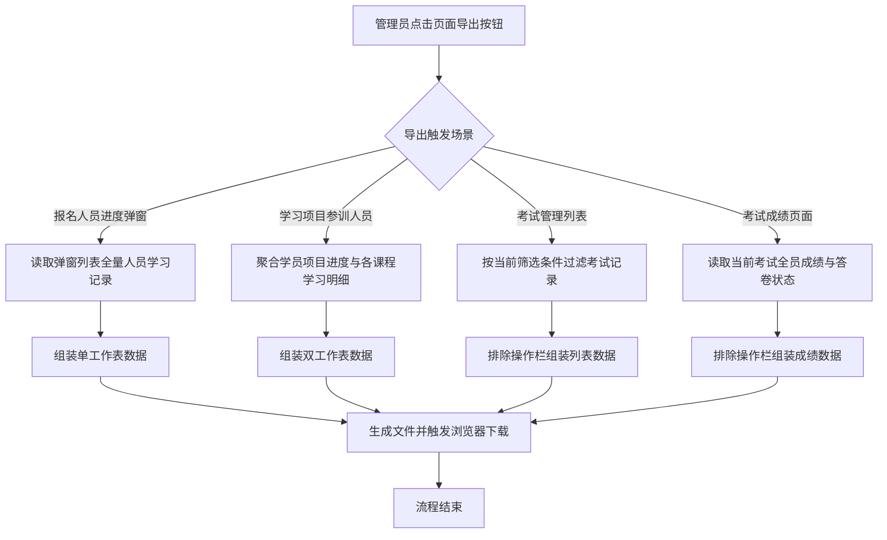
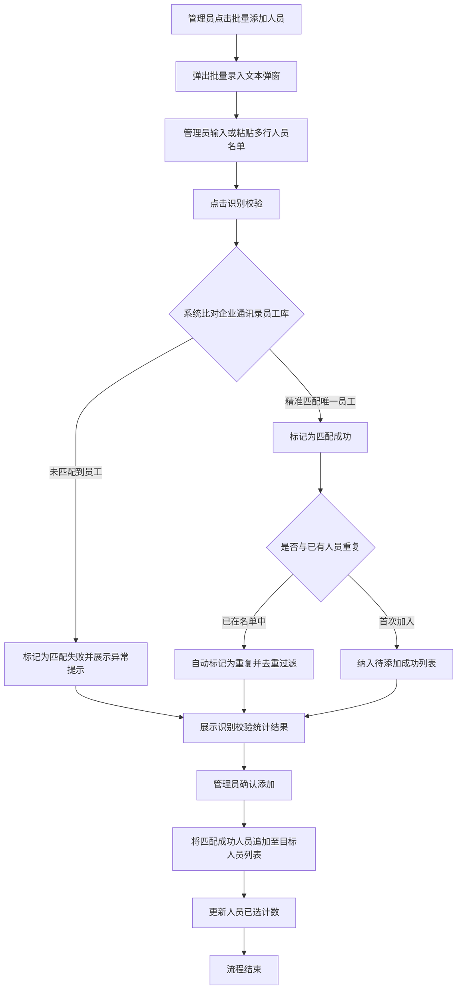

# PRD-AI质培中台数据导出与人员批量添加

## 一、修订记录

| 版本号 | 修改日期 | 修改原因 | 修订人 |
|--------|----------|----------|--------|
| v1.0   | 2026-10-15 | 初稿，支持课程/项目/考试数据导出与人员批量添加 | AI PRD Writer |

## 二、需求概述

- **背景/现状**：当培训管理员在 AI 质培中台跟进培训进度时，系统缺乏数据导出能力且仅能单选人员，导致培训复盘耗时且大批人员配置繁琐。
- **需求目标**：在课程管理、学习项目及考试管理中补充数据导出功能，并在项目与考试创建编辑时支持批量录入人员，实现培训数据高效分析与人员快速分发。
- **核心逻辑简述**：当管理员触发导出时系统按既定字段生成报表文件；当管理员粘贴人员名单时系统自动识别匹配企业组织架构并批量去重录入。

## 三、术语表

| 术语 | 定义 |
|------|------|
| 整体完成情况 | 学员在指定学习项目维度上的综合项目进度与项目学习状态汇总 |
| 课程学习明细 | 学员在指定学习项目所包含的每一门具体课程上的学习进度、状态与完成时间明细 |

## 四、调整范围

| 序号 | 功能模块 | 调整类型 | 功能说明 |
|------|----------|----------|----------|
| 1 | 课程管理-报名人员进度弹窗 | 新增 | 增加「导出」按钮，支持导出当前课程所有人员的学习进度数据 |
| 2 | 学习项目-项目详情抽屉 | 新增 | 在参训人员区域增加「导出」按钮，导出包含整体完成情况与课程学习明细的双工作表报表 |
| 3 | 学习项目-新建/编辑抽屉 | 新增 | 在参训人员选择模块增加「批量添加人员」，支持文本粘贴识别与批量导入 |
| 4 | 考试管理-列表页面 | 新增 | 列表操作区增加「导出列表」按钮，根据当前页面筛选条件导出考试数据 |
| 5 | 考试管理-成绩详情页面 | 新增 | 成绩列表操作区增加「导出成绩」按钮，支持导出当前考试全员成绩明细 |
| 6 | 考试管理-新建/编辑抽屉 | 新增 | 在参考人员选择模块增加「批量添加人员」，支持文本粘贴识别与批量导入 |

## 五、业务流程图

**培训与考试数据导出业务流程**

**人员批量添加与匹配校验流程**

## 六、可交互原型

在线预览：[点击查看可交互原型](https://pages.yc345.tv/yping-c78bba/train-data-export-and-batch-users/)

> 原型为单文件可交互 HTML 页面，还原了课程管理报名人员进度导出、学习项目参训人员双工作表导出、考试管理列表及成绩导出，以及项目与考试的批量添加人员完整交互链路。

## 七、功能需求详细描述

### 7.1 【新增】功能

#### 7.1.1 导出功能与按钮定义

| 功能名称 | 页面所在位置 | 功能类型 | 交互说明 | 备注 |
|----------|--------------|----------|----------|------|
| 导出报名人员进度 | 课程管理 - 报名人员进度弹窗顶部工具栏（重置按钮右侧） | 操作按钮 | 点击后直接导出当前课程全部已报名人员的学习进度数据，无需二次确认，触发下载时弹出成功提示 | 导出当前课程全部学员数据 |
| 导出参训人员数据 | 学习项目 - 项目详情抽屉参训人员区域标题右侧 | 操作按钮 | 点击后导出包含两个工作表的表格文件，触发下载时弹出成功提示 | 生成双工作表表格文件 |
| 导出考试列表 | 在线考试 - 考试管理列表顶部筛选操作区（新建考试按钮左侧） | 操作按钮 | 点击后结合当前筛选栏条件（考试名称、状态、时间范围）导出符合条件的考试列表数据，触发下载时弹出成功提示 | 仅导出筛选后的数据集 |
| 导出考试成绩 | 在线考试 - 考试成绩独立页面列表操作区（重置按钮右侧） | 操作按钮 | 点击后导出当前考试对应的全部学员成绩明细数据，包含已考与未考人员，触发下载时弹出成功提示 | 排除操作栏列 |
| 批量添加人员入口（学习项目） | 学习项目 - 新建/编辑抽屉参训人员管理区域 | 操作按钮 | 点击后弹出批量添加人员弹窗，支持多行文本录入人员信息 | 位于「从组织架构选择」按钮旁 |
| 批量添加人员入口（在线考试） | 考试管理 - 新建/编辑抽屉参考人员设置区域 | 操作按钮 | 点击后弹出批量添加人员弹窗，支持多行文本录入人员信息 | 位于「从组织架构选择」按钮旁 |
| 批量添加人员弹窗 | 学习项目及考试管理人员配置公共组件 | 模态弹窗 | 提供多行文本输入框、识别校验按钮、匹配结果汇总区及确认添加按钮 | 支持按行、逗号或分号分隔 |

#### 7.1.2 导出数据字段与报表规范

**1. 课程管理 - 报名人员进度导出规范**

- 文件命名规则：`报名人员进度_{课程名称}_{导出日期YYYYMMDD}.xlsx`
- 工作表名称：`报名人员进度`
- 导出字段及数据格式要求：

| 导出列名称 | 取值说明 | 格式/展示要求 |
|------------|----------|---------------|
| 姓名 | 学员中文真实姓名 | 纯文本 |
| 部门 | 学员所属完整部门组织架构路径 | 纯文本，各层级以斜杠分隔 |
| 学习进度 | 当前学员在课程中的完成百分比 | 如 `70%`，保留整数百分比 |
| 状态 | 学员在该课程的当前学习状态 | 枚举值：未开始、学习中、已完成 |
| 报名时间 | 学员报名或被分配至该课程的日期时间 | 格式：`YYYY-MM-DD`，未报名填 `-` |
| 完成时间 | 学员学完所有课件的达标完成日期时间 | 格式：`YYYY-MM-DD`，未完成填 `-` |

**2. 学习项目 - 参训人员导出规范（双工作表）**

- 文件命名规则：`学习项目_{项目名称}_参训人员学习数据_{导出日期YYYYMMDD}.xlsx`
- 包含 2 个工作表（Sheet）：
  - **Sheet 1：人员整体完成情况**
    - 工作表名称：`人员整体完成情况`
    - 导出字段：【姓名、部门、项目进度、状态】
    - 取值说明：
      - 姓名：学员中文真实姓名
      - 部门：学员所属完整部门路径
      - 项目进度：格式如 `0/1`、`3/5`（已完成课程数/总课程数）
      - 状态：枚举值：未开始、学习中、已完成
  - **Sheet 2：人员明细情况**
    - 工作表名称：`人员明细情况`
    - 导出字段：【姓名、课程名称、学习进度、状态、完成时间】
    - 取值说明：
      - 姓名：学员中文真实姓名
      - 课程名称：项目内包含的具体单门课程全称
      - 学习进度：学员在对应单门课程中的学习百分比（如 `0%`、`100%`）
      - 状态：枚举值：未开始、学习中、已完成
      - 完成时间：该单门课程学完时间，格式：`YYYY-MM-DD`，未完成填 `-`

**3. 考试管理 - 列表数据导出规范**

- 文件命名规则：`考试管理_列表数据_{导出日期YYYYMMDD}.xlsx`
- 工作表名称：`考试列表`
- 数据范围：严格遵循当前页面筛选条件进行过滤导出（除操作栏外所有列）
- 导出字段列表：【考试名称、关联试卷、考试时间、答题时长、总分、合格分、应考人数、已考人数、参考率、状态】
- 取值说明：
  - 考试时间：起止区间文本（格式：`YYYY-MM-DD ~ YYYY-MM-DD`）
  - 答题时长：带单位文本（如 `45分钟`，不限时展示 `不限时`）
  - 参考率：百分比展示（如 `93.3%`）
  - 状态：枚举值：草稿、未开始、进行中、已结束

**4. 考试管理 - 成绩页面导出规范**

- 文件命名规则：`考试成绩_{考试名称}_{导出日期YYYYMMDD}.xlsx`
- 工作表名称：`成绩明细`
- 数据范围：导出当前考试关联的全体应考学员数据（除操作栏外所有列）
- 导出字段列表：【姓名、部门、考试状态、得分、是否合格、提交时间】
- 取值说明：
  - 考试状态：枚举值：已考、未考
  - 得分：考试最终得分数字，未考人员填 `-`
  - 是否合格：枚举值：合格、不合格，未考人员填 `-`
  - 提交时间：答卷交卷时间，格式：`YYYY-MM-DD HH:mm:ss`，未考人员填 `-`

#### 7.1.3 批量添加人员交互与业务规则

**1. 录入与分隔规则**
- 在弹窗文本框中支持直接输入或由外部表格批量复制粘贴人员名单。
- 分隔符兼容支持：换行符（回车）、半角逗号、全角逗号、半角分号、全角分号、空格，支持混合分隔。
- 单次批量输入上限支持 1000 人。

**2. 识别匹配逻辑**
- 系统优先按员工工号进行唯一匹配；未命中工号时按员工企业微信真实姓名及手机号进行精确匹配。
- 匹配结果分为三类展示：
  - 匹配成功：精准识别到组织架构在职员工，展示姓名与部门信息。
  - 重复人员：已被添加在当前参训/参考人员名单中，系统自动标明并去重，不重复添加。
  - 匹配失败：在企业组织架构中未找到对应员工、员工已离职或输入格式错误，高亮红色标注未匹配原词，不影响其余成功人员录入。

**3. 确认入库逻辑**
- 点击「确认添加」后，仅将校验通过且去重后的员工追加并入当前项目或考试的人员名单集合中。
- 弹窗关闭并即时刷新主界面的已选人员总数与标签列表。

### 7.2 【修改】功能

| 功能/字段名称 | 修改项 | 改前 | 改后 | 备注 |
|---------------|--------|------|------|------|
| 学习项目参训人员选择 | 人员录入方式 | 仅支持从树形组织架构逐级展开并勾选 | 支持从组织架构勾选与批量文本粘贴识别两种方式并行使用 | 沿用现有人员标签删除与保存交互 |
| 考试管理参考人员选择 | 人员录入方式 | 仅支持从树形组织架构逐级展开并勾选 | 支持从组织架构勾选与批量文本粘贴识别两种方式并行使用 | 沿用现有多次添加去重累加规则 |

### 7.3 状态与异常变更

| 涉及位置 | 变更动作 | 触发条件 | 系统行为 / 文案 |
|----------|----------|----------|------------------|
| 全部导出按钮 | 新增 | 点击导出按钮 | 按钮展示轻量加载状态，文件生成后弹出提示：「正在导出数据并下载，请稍候」 |
| 全部导出按钮 | 新增 | 列表数据为空时点击导出 | 拦截导出并弹出轻量提示：「当前无符合条件的数据可导出」 |
| 批量添加人员弹窗 | 新增 | 输入框内容为空点击识别校验 | 拦截并提示：「请输入需要添加的人员姓名或工号」 |
| 批量添加人员弹窗 | 新增 | 输入内容全部未匹配成功 | 提示：「未识别到有效员工信息，请检查输入内容后重试」，确认添加按钮置灰不可点击 |
| 批量添加人员弹窗 | 新增 | 输入内容全部为已存在重复人员 | 提示：「所录入人员均已存在于当前名单中，无需重复添加」，确认添加按钮置灰不可点击 |

## 八、埋点与数据需求

（本期无埋点需求）

## 九、权限说明

### 9.1 课程管理页导出权限
- 导出报名人员学习数据权限跟随现有的课程管理页面访问权限；具备课程管理只读及以上权限的管理员均可导出报名人员进度。

### 9.2 学习项目管理页权限
- 导出参训人员数据权限跟随学习项目管理页面访问权限；具备项目详情查看权限的角色均可使用导出功能。
- 批量添加参训人员操作受「新建项目权限」与「编辑项目权限」控制，仅在创建或编辑项目状态下允许操作。

### 9.3 在线考试管理页权限
- 导出考试列表及导出考试成绩权限跟随考试管理页面访问权限，未授权人员不可访问与导出。
- 批量添加参考人员操作受「新建考试权限」与「编辑考试权限」控制。
