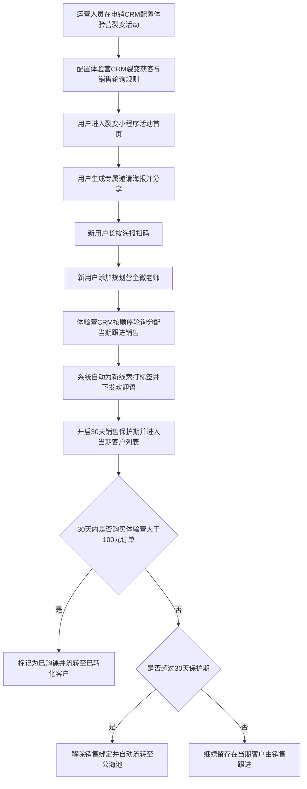
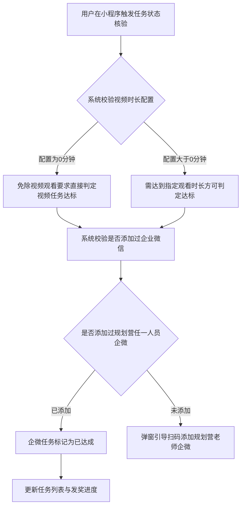

# PRD-体验营裂变活动

## 一、修订记录

| 版本号 | 修改日期 | 修改原因 | 修订人 |
|--------|----------|----------|--------|
| v1.0   | 2026-10-16 | 初稿 | AI PRD Writer |

## 二、需求概述

- **背景/现状**：体验营当前裂变机制较为基础，亟需复用电销成熟的裂变活动能力扩大高质量线索增长。
- **需求目标**：当体验营开展裂变活动时，系统应支持在现有体系内完成活动配置、线索承接与效果统计。
- **核心逻辑简述**：电销CRM裂变模块新增业务线分类与权限隔离；体验营CRM新增裂变获客配置并规范30天跟进流转期；小程序端精简入口并对齐体验营规则。

## 三、术语表

| 术语 | 定义 |
|------|------|
| 体验营 | 面向新用户的短期低价体验课程服务体系 |
| 体验营CRM | 体验营销售人员跟进线索、配置获客通道的业务后台系统 |
| 电销CRM | 电销业务活动管理、线索流转与销售运营的中后台系统 |
| 裂变活动 | 用户通过邀请好友完成指定任务（如添加企微、购课）获取奖励的营销活动 |
| 规划营企微 | 洋葱学园规划营企微服务号与辅导老师个人企业微信统称 |

## 四、调整范围

本次需求主要实现体验营接入裂变活动业务，涉及以下模块：

1. **电销CRM - 裂变活动配置**：新增业务线分类标签页（电销/体验营）与权限控制；新建活动时视频时长支持配置为0；体验营模式剔除缩略图配置。
2. **电销CRM - 用户参与明细**：新增业务线分类标签页（电销/体验营）与权限控制；体验营列表剔除历史付费总金额列；体验营是否购课判定口径调整为购买体验营大于100元订单。
3. **电销CRM - 活动中奖明细**：新增业务线分类标签页（电销/体验营）与权限控制，历史数据归入电销。
4. **体验营CRM - 渠道获客链接/二维码**：新增裂变活动获客配置标签页，支持销售人员顺序轮询分配、自动打标签、自动备注与分时段欢迎语。
5. **体验营CRM - 客户管理**：裂变进线线索渠道标识为裂变活动，执行30天销售绑定保护期（超期未转化自动入公海）；高级筛选渠道项补充裂变活动。
6. **裂变小程序**：去除首页选择活动页面，直达裂变首页；海报保存页删除赠送全科VIP文案及对应发券逻辑；企微添加校验调整为校验是否添加过规划营成员企微。

## 五、业务流程图

### 业务流程一：体验营裂变活动全链路流转

### 业务流程二：小程序企微核身与任务判定

## 六、可交互原型

在线预览：[点击查看可交互原型](https://pages.yc345.tv/yping-c78bba/training-camp-fission-activity/)

> 原型为可交互 HTML 页面，点击链接即可在浏览器中体验完整交互流程。

## 七、功能需求详细描述

### 7.1 【新增】功能

**功能 / 按钮 / 弹窗类**

| 功能名称 | 功能类型 | 是否必填 | 交互说明 | 备注 |
|----------|----------|----------|----------|------|
| 裂变活动配置业务线标签页 | 页面标签栏 | 是 | 点击在【电销】与【体验营】活动列表间切换，受对应权限控制 | 默认选中电销，历史数据归入电销 |
| 用户参与明细业务线标签页 | 页面标签栏 | 是 | 点击在【电销】与【体验营】参与明细间切换，受对应权限控制 | 默认选中电销，历史数据归入电销 |
| 活动中奖明细业务线标签页 | 页面标签栏 | 是 | 点击在【电销】与【体验营】中奖明细间切换，受对应权限控制 | 默认选中电销，历史数据归入电销 |
| 裂变活动获客配置标签页 | 配置页面标签 | 是 | 体验营CRM渠道配置中新增此标签，点击进入裂变获客规则表单 | 与现有研学渠道获客配置能力保持一致 |
| 裂变活动销售轮询分配 | 人员选择器 | 是 | 支持多选销售人员，新进线索按配置的人员顺序循环分配 | 至少选择一名有效销售 |
| 裂变活动自动打标签 | 标签选择器 | 否 | 支持为进线客户配置初始业务标签，支持多选 | 进线时自动写入线索属性 |
| 裂变活动自动备注 | 开关与输入框 | 否 | 开启后支持输入固定文本，新进线索自动追加该备注 | 文本长度限制200字符以内 |
| 裂变活动欢迎语与分时段欢迎语 | 开关与文本域 | 否 | 支持配置通用微信欢迎语及夜间/特定时段自动下发文案 | 沿用现有获客欢迎语下发规则 |

**列表字段类**

| 字段名称 | 字段说明 | 字段来源 | 备注 |
|----------|----------|----------|------|
| 渠道来源筛选项（裂变活动） | 高级筛选渠道下拉选项 | 客户管理系统筛选器 | 选项文案展示为“裂变活动” |

### 7.2 【修改】功能

| 功能/字段名称 | 修改项 | 改前 | 改后 | 备注 |
|---------------|--------|------|------|------|
| 裂变活动视频时长配置 | 校验规则 | 仅允许输入大于0的正整数分钟 | 允许输入大于等于0的整数（支持输入0） | 输入0表示添加企微后无需观看视频即算达标 |
| 用户参与明细【是否购课】判定 | 判定逻辑 | 判断是否购买电销正价课 | 判断添加企微后是否在体验营购买大于100元的订单 | 仅作用于【体验营】明细标签页 |
| 裂变活动线索跟进保护期 | 保护周期与流转 | 沿用各渠道默认时效 | 裂变活动线索与销售绑定30天，30天内未转化留存当期，30天内已转化进已转化，满30天未转化自动流转进公海池 | 仅作用于裂变活动渠道进线客户 |
| 小程序端活动入口 | 进入链路 | 进入小程序后先展示“活动选择页”，用户手动选择活动后进入活动首页 | 去除选择活动页，用户访问小程序直接进入体验营裂变活动首页 | 缩短用户转化链路 |
| 小程序企微添加核身 | 校验范围 | 仅判断是否添加活动指定人员企微 | 判断是否添加过【洋葱学园规划营】任何一个企业微信成员 | 只要添加过规划营任意一人即判定达标 |
| 小程序活动数据源 | 数据来源 | 读取电销业务裂变配置 | 读取【体验营-裂变活动配置】内容 | 裂变线索归属进入体验营服务期 |

### 7.3 【删除】功能

| 功能/字段名称 | 删除范围 | 影响说明 |
|---------------|----------|----------|
| 体验营裂变活动缩略图配置 | 新建/编辑活动弹窗中的图片配置项 | 仅体验营业务线新建/编辑时隐藏缩略图项，点击活动直接进入活动首页 |
| 体验营用户参与明细【历史付费总金额】 | 列表表头、单元格展示及明细导出文件 | 体验营标签页下不再展示该列，电销标签页继续保留 |
| 小程序海报页全科VIP权益文案与逻辑 | 海报保存页界面文案及底层发券接口 | 删除“立即送好友一天全科VIP”提示，同时停止发放一天全科VIP权益 |

### 7.4 状态与异常变更

| 涉及位置 | 变更动作 | 触发条件 | 系统行为 / 文案 |
|----------|----------|----------|------------------|
| 视频时长输入框 | 修改校验提示 | 用户输入数值为0时 | 提示：“已设置门槛为0分钟，用户添加企微后无需观看视频即达成任务” |
| 体验营客户列表 | 新增流转提示 | 线索绑定销售满30天仍未产生大于100元订单 | 系统触发定时任务自动解绑销售并移入公海池，状态变更为“超期未转化入公海” |

## 八、埋点与数据需求

默认为空。

## 九、权限说明

本次需求涉及电销CRM活动管理模块新增标签页的权限管控，对应权限点与业务角色如下：

| 页面模块 | 权限中文名称 | 权限控制说明 |
|----------|--------------|--------------|
| 裂变活动配置 - 电销标签页 | 电销裂变活动配置权限 | 控制【电销】活动配置标签页的可见与操作权限，无权限时隐藏该标签 |
| 裂变活动配置 - 体验营标签页 | 体验营裂变活动配置权限 | 控制【体验营】活动配置标签页的可见与操作权限，无权限时隐藏该标签 |
| 用户参与明细 - 电销标签页 | 电销用户参与明细权限 | 控制【电销】参与明细标签页的可见与导出权限，无权限时隐藏该标签 |
| 用户参与明细 - 体验营标签页 | 体验营用户参与明细权限 | 控制【体验营】参与明细标签页的可见与导出权限，无权限时隐藏该标签 |
| 活动中奖明细 - 电销标签页 | 电销活动中奖明细权限 | 控制【电销】中奖明细标签页的可见与导出权限，无权限时隐藏该标签 |
| 活动中奖明细 - 体验营标签页 | 体验营活动中奖明细权限 | 控制【体验营】中奖明细标签页的可见与导出权限，无权限时隐藏该标签 |
