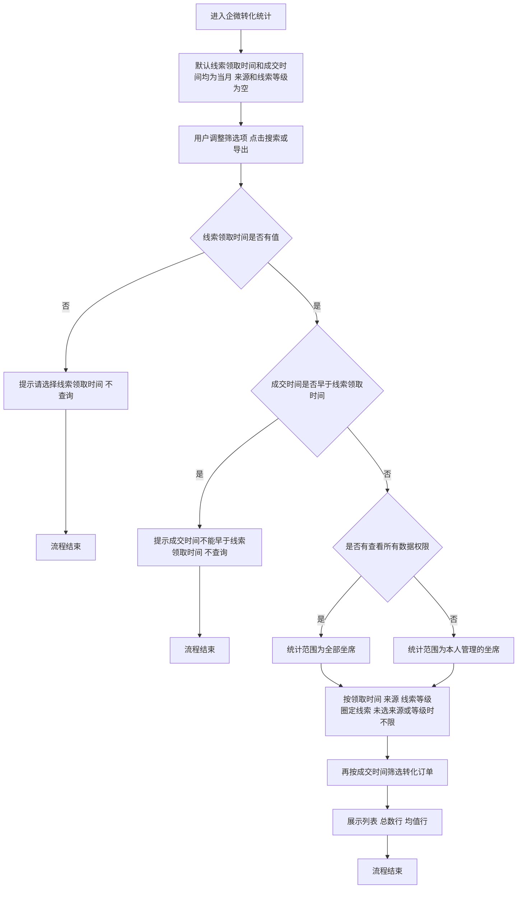
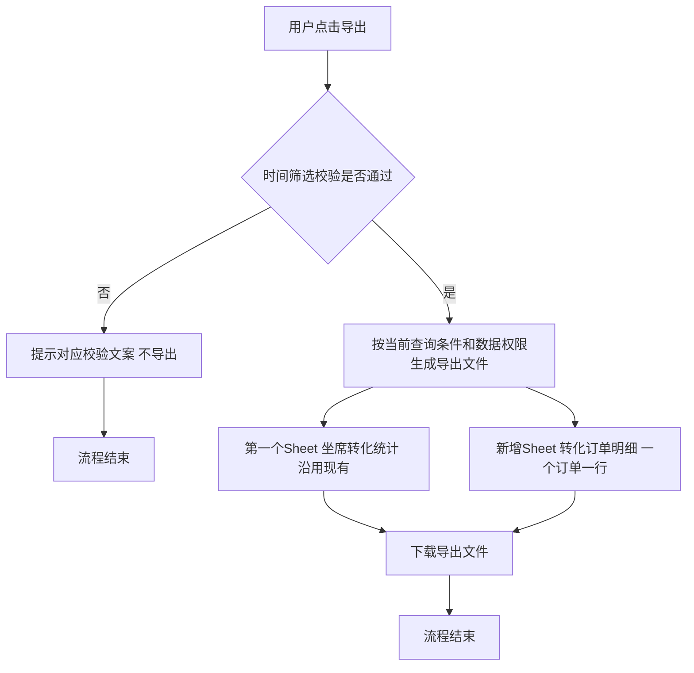

# PRD-企微转化统计来源筛选与导出优化

## 一、修订记录

| 版本号 | 修改日期 | 修改原因 | 修订人 |
|--------|----------|----------|--------|
| v1.0 | 2026-11-18 | 初稿 | AI PRD Writer |
| v1.1 | 2026-11-23 | 新增来源筛选；线索等级新增「无等级」选项 | AI PRD Writer |

## 二、需求概述

- **背景/现状**：企微转化统计只有一个时间筛选，转化按支付时间统计，无法区分线索领取月份和来源，也无法单独查看无等级线索；页面只能看本人管理范围的数据，导出没有订单明细。
- **需求目标**：当用户查询时，系统应按领取时间、成交时间、来源、线索等级联动统计转化，支持授权查看全部数据，并导出转化订单明细。
- **核心逻辑简述**：当用户选择各筛选项时，系统只统计符合条件的已领取线索在成交时间内的转化；成交时间、来源、线索等级为空时均不限制。

## 三、术语表

| 术语 | 定义 |
|------|------|
| 线索领取时间 | 企微线索分配给坐席的时间，用于圈定本次统计的线索范围 |
| 成交时间 | 转化订单的支付时间，用于限定统计哪个时间段内产生的转化 |
| 来源 | 企微线索的进线来源，分为 AI机器人、企业微信 两类 |
| 无等级 | 线索领取时没有线索等级 |
| 转化订单 | 同时满足现有转化定义的订单：线索来源为企微、支付成功、成交时间晚于入库时间、成交时线索在库、订单金额大于 298 元 |
| 转化线索 | 符合筛选条件的已领取线索中，在所选成交时间内至少有一笔转化订单的线索，同一线索只计一次 |

## 四、调整范围

1. 数据统计 → 企微数据 → 企微转化统计：原时间筛选改为「线索领取时间」，必填，默认当月。
2. 新增「成交时间」筛选，默认当月，可清空。
3. 转化线索量、转化金额、转化率、客单价、ARPU 改为按「线索领取时间 + 成交时间」联动统计；领取线索量只受线索领取时间影响。
4. 新增搜索、导出前的时间筛选校验。
5. 新增「查看所有数据」权限，有权限的账号可查看、导出全部坐席数据。
6. 导出文件新增「转化订单明细」Sheet。
7. 新增「来源」筛选，枚举为 AI机器人、企业微信，可多选；不选时查询全部来源。
8. 「线索等级」筛选新增「无等级」选项。

## 五、业务流程图

**查询与统计流程**

**导出流程**

## 六、可交互原型

在线预览：[点击查看可交互原型](https://pages.yc345.tv/yping-c78bba/wecom-conversion-source-filter/)

> 原型为带变更批注的可交互 HTML 页面。打开即可看到本次变更编号；收起右侧批注栏后连线隐藏，点击编号会重新打开批注。

## 七、功能需求详细描述

### 7.1 【新增】功能

#### 7.1.1 【新增】成交时间筛选

| 功能名称 | 功能类型 | 是否必填 | 交互说明 | 备注 |
|----------|----------|----------|----------|------|
| 成交时间 | 时间类型选择 + 时间选择器 | 否 | 位于「线索领取时间」之后；时间类型支持月份 / 周 / 自定义，选择方式沿用现有时间筛选；用于限定转化订单的支付时间；成交时间所选时间不可早于线索领取时间 | 默认当月；提供清空按钮，清空后不限成交时间；自定义最长 3 个月、不早于 2021-01-01、不晚于今天，沿用现有限制 |

**两个时间筛选的组合场景：**

| 线索领取时间 | 成交时间 | 统计结果 |
|--------------|----------|----------|
| 2026-11（默认） | 2026-11（默认） | 11 月领取的线索在 11 月的成交情况 |
| 2026-10 | 2026-11 | 10 月领取的线索在 11 月的成交情况 |
| 2026-10 | 空 | 10 月领取的线索截至当前的全部成交情况 |
| 2026-10 | 2026-10 | 10 月领取的线索在 10 月的成交情况 |

#### 7.1.2 【新增】查看所有数据权限

| 功能名称 | 功能类型 | 是否必填 | 交互说明 | 备注 |
|----------|----------|----------|----------|------|
| 查看所有数据 | 页面数据权限 | 不适用 | 有权限：不受本人组织架构层级限制，小组、坐席筛选项展示全部小组和坐席，列表、总数行、均值行、导出均按全部坐席统计。无权限：沿用现有逻辑，仅统计本人管理范围内的坐席 | 权限配置见第九章；页面无新增按钮或入口 |

#### 7.1.3 【新增】导出转化订单明细

导出文件在现有 Sheet（坐席转化统计，内容不变）之后新增一个 Sheet，名称为「转化订单明细」。

**导出范围：**

- 只导出当前查询条件下发生转化的线索所对应的转化订单，查询条件包括：小组、坐席、线索领取时间、成交时间、线索等级、来源，以及当前账号的数据权限范围。
- 一个订单一行；同一线索有多笔转化订单时，导出多行。
- 只导出满足转化定义的订单；不满足的订单（如金额不大于 298 元、成交时线索不在库）不导出。
- 本 Sheet 的支付金额合计与列表「转化金额」总数一致，订单所属线索去重后的数量与列表「转化线索量」总数一致。
- 按支付时间倒序排列。查询条件下没有转化订单时，本 Sheet 只保留表头。

**列表字段（按顺序）：**

| 字段名称 | 字段说明 | 字段来源 | 备注 |
|----------|----------|----------|------|
| 坐席名称 | 领取该线索的坐席 | 坐席信息 | 与第一个 Sheet 口径一致 |
| 所属学段 | 坐席所属学段 | 组织架构 | — |
| 所属团队 | 坐席所属团队 | 组织架构 | — |
| 所属组 | 坐席所属组 | 组织架构 | — |
| 所属小组 | 坐席所属小组 | 组织架构 | — |
| 洋葱ID | 线索对应用户的洋葱ID | 线索信息 | — |
| 线索领取时间 | 该线索分配给坐席的时间 | 线索分配记录 | 格式：年-月-日 时:分:秒 |
| 线索等级 | 该线索领取时的线索等级 | 线索分配记录 | 没有等级时显示「无等级」 |
| 订单号 | 转化订单的订单号 | 订单信息 | — |
| 支付时间 | 转化订单的支付时间 | 订单信息 | 格式：年-月-日 时:分:秒 |
| 支付金额 | 转化订单的金额 | 订单信息 | 保留两位小数；与列表「转化金额」口径一致 |

#### 7.1.4 【新增】来源筛选

| 功能名称 | 功能类型 | 是否必填 | 交互说明 | 备注 |
|----------|----------|----------|----------|------|
| 来源 | 下拉多选 | 否 | 位于「线索等级」之后，占位文案「选择来源」；枚举值：AI机器人、企业微信。选择后，领取线索量及转化线索量、转化金额、转化率、客单价、ARPU 只统计所选来源的线索；总数行、均值行、导出两个 Sheet 同步按所选来源统计 | 默认为空；不选时查询全部来源；两项都选与不选结果一致；与其他筛选项同时生效 |

**来源与线索等级的组合场景：**

| 来源 | 线索等级 | 统计结果 |
|------|----------|----------|
| 空（默认） | 空（默认） | 全部来源、全部等级（含无等级）的线索 |
| AI机器人 | 空 | AI机器人来源的全部线索 |
| 企业微信 | A级 | 企业微信来源的 A 级线索 |
| AI机器人、企业微信 | 无等级 | 全部来源中领取时没有等级的线索 |

### 7.2 【修改】功能

#### 7.2.1 【修改】时间筛选改为线索领取时间

| 功能/字段名称 | 修改项 | 改前 | 改后 | 备注 |
|---------------|--------|------|------|------|
| 时间筛选 | 名称 | 无名称，仅时间类型 + 时间选择器 | 「线索领取时间」，名称前加必填标识 | 时间类型（月份 / 周 / 自定义）及选择范围限制沿用现有配置 |
| 时间筛选 | 作用范围 | 同时作用于领取线索量（按分配时间）和转化数据（按支付时间），两者互不关联 | 只作用于线索范围：领取线索量及其后续转化，都以该时间内领取的线索为准 | — |
| 时间筛选 | 必填与清空 | 不涉及 | 必填，不提供清空按钮；切换为「自定义」后需重新选择日期 | 默认当月 |

#### 7.2.2 【修改】转化指标统计口径

| 功能/字段名称 | 修改项 | 改前 | 改后 | 备注 |
|---------------|--------|------|------|------|
| 领取线索量 | 统计口径 | 所选时间内分配的企微线索量 | 不变，取「线索领取时间」内分配的企微线索量 | 不受成交时间影响 |
| 转化线索量 | 统计口径 | 所选时间内支付的企微转化订单对应线索数，不限线索何时领取 | 「线索领取时间」内领取的线索中，在「成交时间」内至少有一笔转化订单的线索数，去重 | 成交时间为空时不限成交时间 |
| 转化金额 | 统计口径 | 所选时间内支付的企微转化订单金额之和 | 上述转化线索在「成交时间」内的转化订单金额之和 | 同一线索多笔订单金额累加 |
| 转化率、客单价、ARPU | 统计口径 | 按原领取线索量、转化线索量、转化金额计算 | 计算公式不变，随新的转化线索量、转化金额联动 | — |
| 线索等级筛选 | 作用对象 | 分别作用于领取线索和转化订单 | 作用于领取线索，转化数据只统计符合等级的已领取线索 | 选项见 7.2.3 |

**计算举例：** 坐席 10 月领取 80 条企微线索，其中 3 条在 10 月转化、2 条在 11 月转化。

| 线索领取时间 | 成交时间 | 领取线索量 | 转化线索量 | 转化率 |
|--------------|----------|------------|------------|--------|
| 2026-10 | 2026-10 | 80 | 3 | 3.75% |
| 2026-10 | 2026-11 | 80 | 2 | 2.50% |
| 2026-10 | 空 | 80 | 5 | 6.25% |

**线索与订单归属：** 同一用户被多次领取时，订单只归属于成交时该用户所在的那条领取记录，与现有「成交时线索在库」口径一致；不会因为同一用户有多条领取记录而重复计入。

#### 7.2.3 【修改】线索等级新增无等级

| 功能/字段名称 | 修改项 | 改前 | 改后 | 备注 |
|---------------|--------|------|------|------|
| 线索等级筛选 | 枚举值 | 只有现有线索等级选项，无法单独筛选没有等级的线索 | 在现有等级选项最后新增「无等级」，可与其他等级同时勾选 | 其他等级选项沿用现有配置 |
| 线索等级筛选 | 统计口径 | 不涉及 | 勾选「无等级」时，统计领取时没有线索等级的线索；不选线索等级时仍统计全部线索（含无等级） | 领取线索量与转化类指标、导出同步生效 |
| 导出「转化订单明细」线索等级列 | 展示内容 | 不涉及 | 线索领取时没有等级时显示「无等级」 | — |

### 7.4 状态与异常变更

点击「搜索」或「导出」时校验时间筛选，校验不通过时在对应筛选项下方展示红字并弹出提示，不查询、不导出。来源、线索等级为非必填，不参与校验。

| 涉及位置 | 变更动作 | 触发条件 | 系统行为 / 文案 |
|----------|----------|----------|------------------|
| 线索领取时间 | 新增 | 无值（如切换为自定义后未选日期） | 提示「请选择线索领取时间」 |
| 成交时间 | 新增 | 成交时间的结束时间早于或等于线索领取时间的开始时间 | 提示「成交时间不能早于线索领取时间」 |
| 成交时间 | 新增 | 自定义只选了开始或结束日期 | 提示「请选择完整的成交时间」 |
| 线索领取时间 / 成交时间 | 沿用 | 自定义范围超过 3 个月 | 沿用现有提示「时间范围不能超过3个月」 |
| 成交时间清空按钮 | 新增 | 成交时间有值时展示；点击后 | 清空成交时间，下次查询不限成交时间 |
| 列表 | 新增 | 校验不通过 | 保留上一次查询结果，不刷新 |
| 列表 | 新增 | 所选来源、线索等级下没有数据 | 沿用现有空态「暂无数据」 |
| 筛选项 | 新增 | 修改任一时间筛选 | 清除对应红字提示 |

## 八、埋点与数据需求

## 九、权限说明

| 权限 | 说明 |
|------|------|
| 查看所有数据 | 新增企微转化统计页面的数据权限，在权限配置中可分配给任意角色或账号。有权限：可查看、导出全部坐席数据，不受本人组织架构层级限制。无权限：沿用现有逻辑，只能查看、导出本人管理范围内的坐席数据 |
