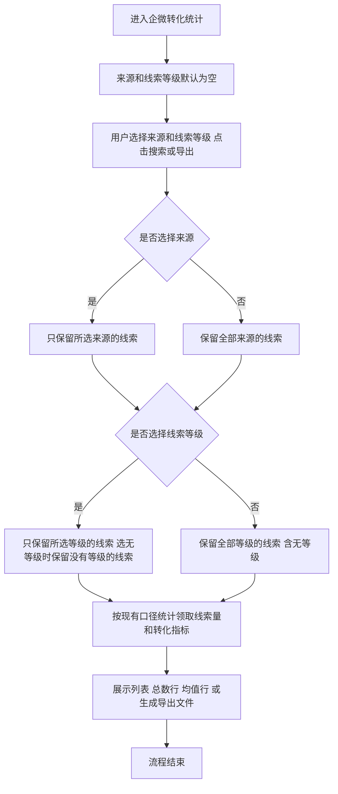

# PRD-企微转化统计来源筛选与无等级

## 一、修订记录

| 版本号 | 修改日期 | 修改原因 | 修订人 |
|--------|----------|----------|--------|
| v1.0 | 2026-11-23 | 初稿 | AI PRD Writer |

## 二、需求概述

- **背景/现状**：企微转化统计无法按线索来源区分数据，线索等级筛选也无法单独查看没有等级的线索。
- **需求目标**：当用户查询时，系统应支持按来源筛选，并支持筛选无等级线索。
- **核心逻辑简述**：当用户选择来源或线索等级时，系统只统计符合条件的已领取线索及其转化；未选择时不限制。

## 三、术语表

| 术语 | 定义 |
|------|------|
| 来源 | 企微线索的进线来源，分为 AI机器人、企业微信 两类 |
| 无等级 | 线索领取时没有线索等级 |

## 四、调整范围

1. 数据统计 → 企微数据 → 企微转化统计：新增「来源」筛选，枚举为 AI机器人、企业微信，单选；不选时查询全部来源。
2. 「线索等级」筛选新增「无等级」选项。

## 五、业务流程图

**来源与线索等级筛选流程**

## 六、可交互原型

在线预览：[点击查看可交互原型](https://pages.yc345.tv/yping-c78bba/wecom-conversion-source-filter/)

> 原型为带变更批注的可交互 HTML 页面。打开即可看到本次变更编号；收起右侧批注栏后连线隐藏，点击编号会重新打开批注。

## 七、功能需求详细描述

### 7.1 【新增】功能

#### 7.1.1 【新增】来源筛选

| 功能名称 | 功能类型 | 是否必填 | 交互说明 | 备注 |
|----------|----------|----------|----------|------|
| 来源 | 下拉单选 | 否 | 位于「线索等级」之后，占位文案「选择来源」；枚举值：AI机器人、企业微信，一次只能选一个，选中后收起下拉。选择后，领取线索量及转化线索量、转化金额、转化率、客单价、ARPU 只统计所选来源的线索；总数行、均值行、导出文件同步按所选来源统计 | 默认为空；不选时查询全部来源；有值时提供清空按钮，清空后恢复查询全部来源；与其他筛选项同时生效 |

**来源与线索等级的组合场景：**

| 来源 | 线索等级 | 统计结果 |
|------|----------|----------|
| 空（默认） | 空（默认） | 全部来源、全部等级（含无等级）的线索 |
| AI机器人 | 空 | AI机器人来源的全部线索 |
| 企业微信 | A级 | 企业微信来源的 A 级线索 |
| 空 | 无等级 | 全部来源中领取时没有等级的线索 |

### 7.2 【修改】功能

#### 7.2.1 【修改】线索等级新增无等级

| 功能/字段名称 | 修改项 | 改前 | 改后 | 备注 |
|---------------|--------|------|------|------|
| 线索等级筛选 | 枚举值 | 只有现有线索等级选项，无法单独筛选没有等级的线索 | 在现有等级选项最后新增「无等级」，可与其他等级同时勾选 | 其他等级选项沿用现有配置 |
| 线索等级筛选 | 统计口径 | 不涉及 | 勾选「无等级」时，统计领取时没有线索等级的线索；不选线索等级时仍统计全部线索（含无等级） | 领取线索量、转化类指标、导出同步生效 |
| 导出「转化订单明细」线索等级列 | 展示内容 | 不涉及 | 线索领取时没有等级时显示「无等级」 | — |

## 八、埋点与数据需求

## 九、权限说明
